# 04 · Arquitectura

Los diagramas renderizan solos en GitHub. Este documento es **vivo**: la sección
de evolución se actualiza conforme cerramos etapas.

## 1. Reglas de oro

| Regla | Qué significa |
|---|---|
| **La ingesta no pasa por la API** | El generador escribe directo en MongoDB. La detección reacciona a la base de datos, no a nuestro endpoint |
| **El motor no sabe que existe una pantalla** | Se construye headless. Si el portal desaparece, el motor sigue creando alertas correctas |
| **Las reglas viven en datos, no en código** | Cambiar un umbral no requiere desplegar |
| **La lógica de lectura recurrente vive en el servidor** | Vistas y pipelines materializados; la API los consume, no los reimplementa |
| **Nada se recalcula dentro de una petición HTTP** | Los indicadores se materializan aparte; el tablero solo lee |
| **La alerta guarda por qué se creó** | Puntaje, reglas disparadas y versión de cada regla quedan dentro del documento |

## 2. Contexto

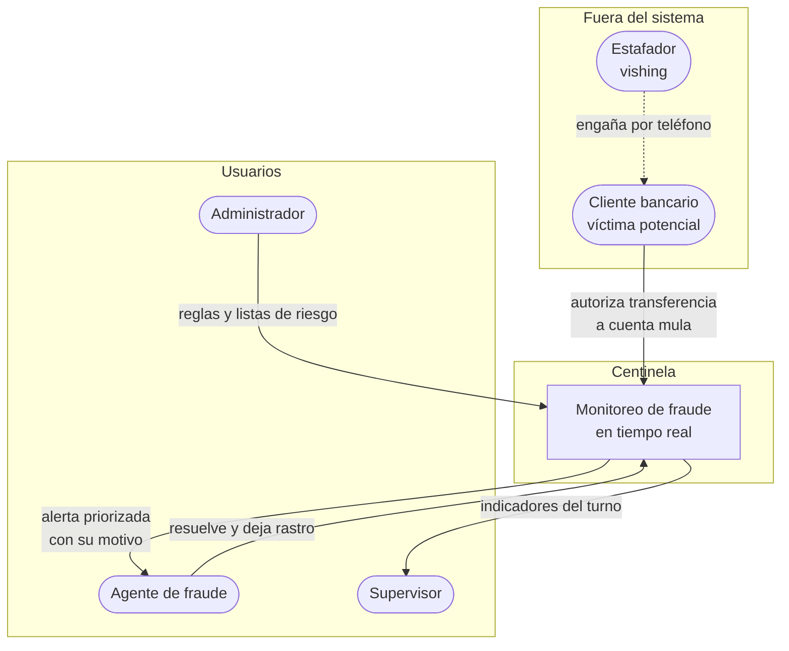

## 3. Contenedores

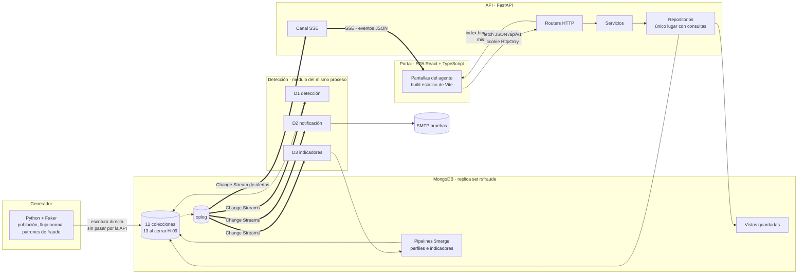

El portal es una SPA React + TypeScript construida con Vite y servida por el **mismo**
FastAPI: `uvicorn app.main:app` sigue siendo el único proceso y el único comando. No hay
servidor Node en producción (Node solo construye), ni Next.js, ni WebSocket, ni bus en
memoria. Detalle en la sección 6b.

## 4. El flujo que define el producto

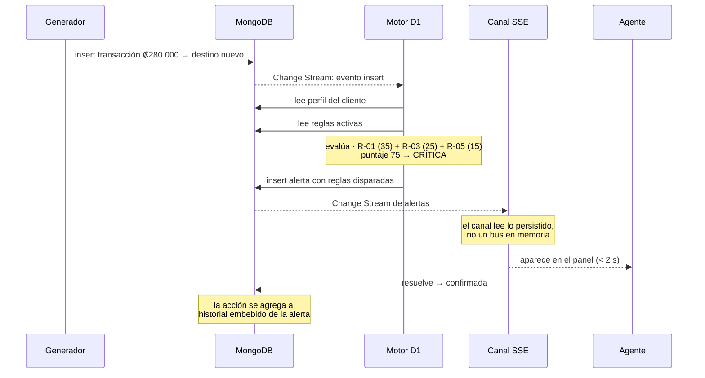

## 5. Decisiones de modelado

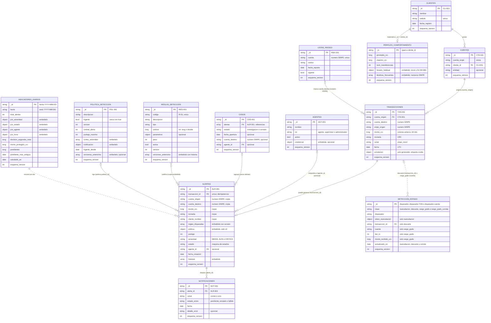

`deteccion_estado` no es una coleccion de dominio: guarda cuatro clases de documento,
distinguidas por `clase`. `reanudacion` tiene `_id` = nombre del disparador
(`d1_deteccion`) y guarda el token del change stream. `descarte` tiene `_id` =
`disparador:TXN-NNN` y es un evento que agoto los reintentos. `rasgo_grafo` tiene
`_id` = `d3_rasgos_grafo:<cuenta SINPE>` y guarda los rasgos de grafo de una cuenta
destino. `rasgo_grafo_corrida` tiene `_id` = `d3_rasgos_grafo` y dice de que rango son
esos rasgos.

| Decisión | Elección | Por qué |
|---|---|---|
| Historial de acciones de una alerta | **Embebido** | Se lee siempre con la alerta, nunca solo. Crece acotado |
| Alerta → agente | **Referencia** | Cambia de dueño con frecuencia; duplicar el agente sería incoherente |
| Reglas disparadas dentro de la alerta | **Copia embebida con versión** | La alerta debe poder explicarse dentro de un año, aunque la regla haya cambiado |
| Perfil de comportamiento | **Colección materializada** | Se calcula caro y se lee en cada transacción |
| Indicadores | **Colección materializada** | El tablero abre al instante; nada se agrega dentro de la petición |

### Las 13 colecciones

Once de dominio (Práctica 1) y dos de operación. Índices tomados de
`scripts/semilla/02-indices.js`; `_id` es el índice por defecto cuando no hay otro.

| Colección | Para qué sirve | Embebe o referencia | Índice principal |
|---|---|---|---|
| `clientes` | Titulares de cuentas; búsqueda por cédula en atención al cliente | Referenciada por `cuentas.cliente_id` | `idx_clientes_cedula` (único) |
| `cuentas` | Cuentas SINPE Móvil de cada cliente | Referencia a `clientes`; `cuenta_sinpe` es el número SINPE | `idx_cuentas_sinpe` (único); también `idx_cuentas_cliente` |
| `perfiles_comportamiento` | Hábitos de cada cliente, leídos en cada transacción | Embebe `horario_habitual` y `destinos_frecuentes`; `_id` = `cliente_id` | `_id` (sin índice adicional) |
| `reglas_deteccion` | Catálogo de reglas R-xx con umbral, peso y versión | Embebe `versiones_anteriores` (historia de la regla) | `idx_reglas_codigo` (único) |
| `listas_riesgo` | Cuentas marcadas como mula (regla R-07) | Referencia por número SINPE a `transacciones.cuenta_destino` | `idx_listas_riesgo_cuenta` (único) |
| `transacciones` | Transferencias SINPE Móvil: el hecho original | Referencia a `cuentas` (`cuenta_origen`); embebe `simulacion` (solo generador) | `idx_transacciones_cuenta_origen_fecha` |
| `agentes` | Quién atiende las alertas y con qué rol | Embebe `credencial` (hash y sal) | `idx_agentes_rol` |
| `alertas` | Una alerta por transacción: puntaje, severidad, estado e historial | Embebe `historial`, `reglas_disparadas` (copia con versión) y `politica`; referencia `transaccion_id` y `agente_id` | `idx_alertas_estado_severidad_fecha` (panel); `idx_alertas_transaccion_id` (único, idempotencia) |
| `casos` | Agrupa alertas escaladas, por cuenta destino | Referencia alertas por `_id` (arreglo `alertas`) y al agente | `idx_casos_estado` |
| `notificaciones` | Correo o SMS enviado por una alerta | Referencia a `alertas` por `alerta_id` | `idx_notificaciones_alerta` |
| `indicadores_diarios` | Resumen del día para el tablero | Embebe los contadores (`por_severidad`, `por_estado`, `por_agente`, `por_hora`) | `_id` = fecha (sin índice adicional) |
| `politica_deteccion` (operación) | Cortes de severidad y umbral de alerta, con historia | Embebe `cortes_severidad`, `notificacion` y `versiones_anteriores` | `idx_politica_vigente` (único parcial sobre `vigente: true`) |
| `deteccion_estado` (operación) | Token de reanudación del motor, descartes y rasgos de grafo | Referencia `transaccion_id` (descarte) y cuenta SINPE (rasgo) | `_id` natural (sin índice adicional) |

## 6. Evolución: cómo llegamos ahí

Seis etapas. **Cada una deja algo que funciona**, no un pedazo inerte.

### E0 · Fundación — terminada

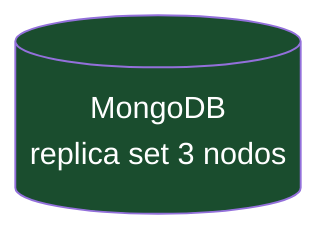

Replica set `rsfraude` corriendo con Change Streams, transacciones
multi-documento y `$graphLookup` verificados. Repo estructurado.
**Se puede demostrar:** `rs.status()` con un primario y dos secundarios.

---

### E1 · Los datos existen

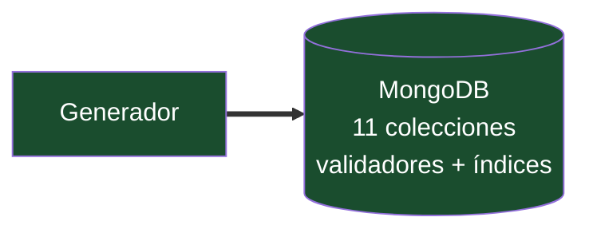

Historias **H-01 a H-06, H-12, H-26 (adelantada)**. Hay clientes con hábitos,
transacciones que respetan esos hábitos, fraude inyectado como minoría, consultas
que usan índice, y el documento ya lleva versión de esquema con su migración.
**Se puede demostrar:** 100.000 transacciones consultadas con `IXSCAN`.
**El recorte H-01+H-02 es la Práctica 1 (28 sep); H-26 es la Práctica 4 (19 oct).**

---

### E2 · El motor ve — *aquí el proyecto deja de ser un CRUD*

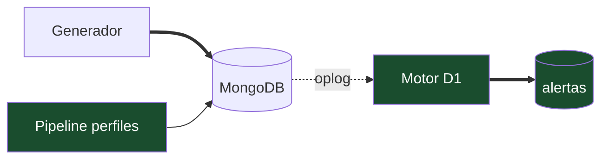

Historias **H-07 a H-10, H-21**. El Change Stream reacciona, evalúa contra reglas
configurables y crea alertas explicadas. Todavía **sin una sola pantalla**.
**Se puede demostrar:** correr el generador y ver alertas apareciendo en `mongosh`,
con el reporte de efectividad diciendo cuánto fraude se atrapó.

---

### E3 · El agente ve — meta del Avance 2 (16 nov)

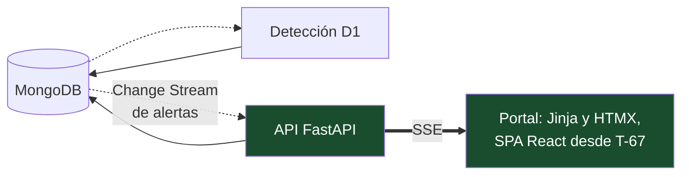

Historias **H-13 a H-15, H-17 a H-19**. Las alertas aparecen solas en el panel,
el agente las resuelve y queda rastro. **Es exactamente lo que pide el Avance 2:
pantallas ejecutando con toma de decisiones.**

---

### E4 · Inteligencia

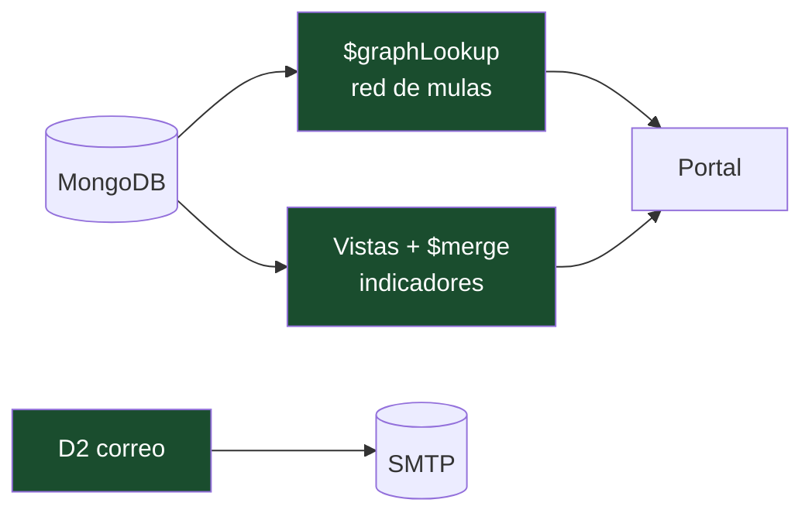

Historias **H-11, H-16, H-20, H-22 a H-24**. La cadena de mulas se recorre y se
dibuja, los indicadores se materializan, el correo sale.
**Es donde el sistema deja de reportar hechos sueltos y empieza a explicar un patrón.**

---

### E5 · Endurecimiento

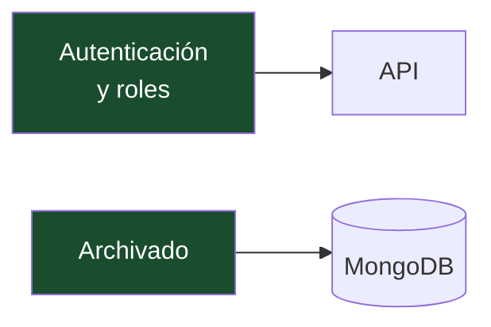

Historias **H-25, H-27** (H-26 ya se hizo en E1, ver arriba). Roles y permisos,
purga del histórico. Aquí el sistema se vuelve defendible, no solo demostrable.

---

## 6b. El portal: SPA React servida por el monolito (T-61)

Decisiones D-60 a D-63, D-69 y D-71. Las siete pantallas se migraron en las fases 1, 2A,
2B y 2C, y desde T-67 la SPA es **el portal por omisión** (`portal.interfaz: spa`), con
todos los recorridos de la defensa en e2e contra ella. Jinja + HTMX queda vivo como
**respaldo hasta el 2 de diciembre**: se vuelve a él en un paso, sin tocar archivos, con
`CENTINELA_PORTAL__INTERFAZ=htmx`. T-68 lo retira.

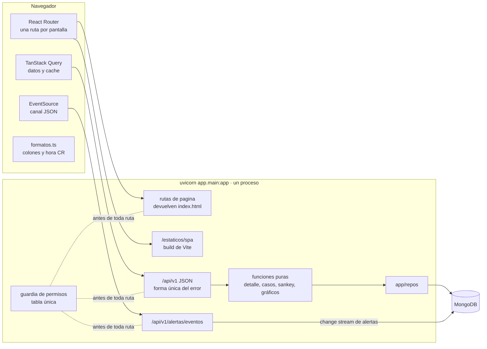

| Pieza | Decisión |
|---|---|
| Servir | Las rutas de página (`/`, `/panel`, `/detalle/...`, `/red-mulas/...`, `/busqueda`, `/tablero`, `/reglas`, `/login`) devuelven el `index.html` del build; JS y CSS salen del montaje `/estaticos` de siempre. `/api/v1`, `/estado` y `/salud` no cambian |
| Calcular | El servidor calcula todo lo que se dibuja: la explicación del puntaje, los casos por cuenta destino, la disposición del Sankey y del grafo (nodos, bandas con ancho entero, columnas). La SPA solo dibuja SVG; no hay librería de grafos en el navegador |
| Datos | TanStack Query sobre la API JSON. Cada lectura comparte su función pura con la página HTMX equivalente, así que las dos interfaces no divergen mientras conviven |
| Tiempo real | `EventSource` sobre `GET /api/v1/alertas/eventos`: el mismo canal que el de HTMX (mismo change stream, mismo `id`, misma reanudación, mismo `resincronizar`) con cuerpo JSON |
| Sesión | `POST /api/v1/sesion` deja la cookie HttpOnly y SameSite=Strict; la SPA nunca guarda el token. 401 y 403 en la forma única del error; sin sesión se vuelve al login con el destino, con la misma regla anti redirección abierta |
| Permisos | La tabla única de `app/seguridad/permisos.py`. La SPA recibe en `GET /api/v1/sesion` qué páginas puede abrir el rol y no copia la tabla |
| Convivencia | `portal.interfaz` elige qué interfaz sirven las rutas de página: `spa` por omisión, `htmx` como respaldo hasta T-68. Mientras viva el respaldo, los fragmentos HTMX siguen registrados con las dos |
| Imagen | `infra/Dockerfile` en dos etapas: Node 26.8.1 (la de `frontend/.nvmrc`) hace `npm ci` y el build; la imagen que corre solo copia `app/estaticos/spa/` y no lleva Node. Corre con un usuario sin privilegios y con `HEALTHCHECK` sobre `/salud` |

## 7. Calendario de etapas

Revisado el 2026-09-20 contra las fechas reales del curso (con la corrección de
Práctica 1 confirmada en clase). Dos ajustes respecto a la versión anterior:
**H-26 se adelantó** de E5 a E1 (la Práctica 4 del curso, "sellos de versiones",
vence el 19 de octubre, mucho antes de diciembre), y se agregó la sección de
**hitos del curso** superpuesta a las etapas propias, para ver de un vistazo
qué entrega académica cae dentro de qué etapa técnica.

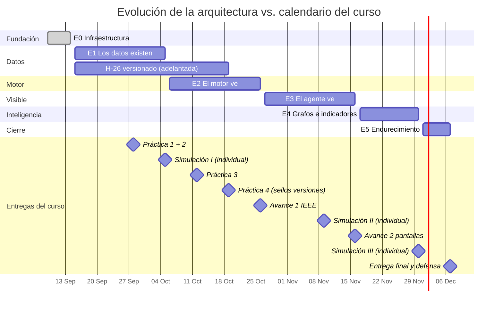

**Lectura de esta tabla, no del programa impreso — reparto detallado con
paquetes por semana en `sc609-reparto-semanal` del cerebro.**

## 8. Glosario

| Término | Qué es |
|---|---|
| **Change Stream** | Suscripción al flujo de cambios de MongoDB. Es cómo el motor se entera de una transacción nueva sin preguntar cada segundo |
| **oplog** | Bitácora de operaciones del replica set. Es lo que hace posibles los Change Streams |
| **SSE** | *Server-Sent Events.* Flujo HTTP de una sola dirección, del servidor al navegador. Es cómo la alerta nueva llega al panel. Se eligió sobre WebSocket porque el panel solo necesita recibir, y el navegador reconecta solo |
| **HTMX** | Biblioteca que deja al servidor devolver HTML e insertarlo en la página, en vez de devolver JSON y armar la pantalla en el navegador. Fue el portal hasta T-67; queda como respaldo (`CENTINELA_PORTAL__INTERFAZ=htmx`) hasta T-68 |
| **SPA** | *Single Page Application.* La página se carga una vez y React cambia de pantalla sin pedir HTML nuevo; los datos llegan como JSON. La de Centinela se construye con Vite y la sirve el mismo FastAPI |
| **Token de reanudación** | Marca de posición en un Change Stream. El canal SSE la manda como identificador del evento; el navegador la devuelve al reconectar y el servidor retoma desde ahí. Si el oplog ya rodó, el token deja de servir y el panel vuelve a pedir su cola completa |
| **Replica set** | Grupo de nodos con los mismos datos. Obligatorio para Change Streams y transacciones |
| **Pipeline de agregación** | Secuencia de etapas que transforma documentos. El equivalente de un `GROUP BY` con esteroides |
| **`$merge`** | Etapa final que escribe el resultado del pipeline en una colección. Así materializamos perfiles e indicadores |
| **Vista** | Pipeline guardado en el servidor que se consulta como si fuera una colección |
| **`$graphLookup`** | Etapa que recorre relaciones recursivamente. Con esto seguimos la cadena de cuentas mula |
| **Documento embebido** | Dato que vive dentro de otro. Se usa cuando siempre se leen juntos |
| **Referencia** | Puntero al id de otro documento. Se usa cuando la relación cambia o el dato se comparte |
| **Vishing** | Estafa telefónica donde el atacante suplanta al banco para que la víctima transfiera |
| **Cuenta mula** | Cuenta usada para recibir dinero robado y moverlo rápido |
| **Perfil de comportamiento** | Resumen estadístico de cómo opera normalmente un cliente |
| **Falso positivo** | Alerta que resultó ser una operación legítima |
