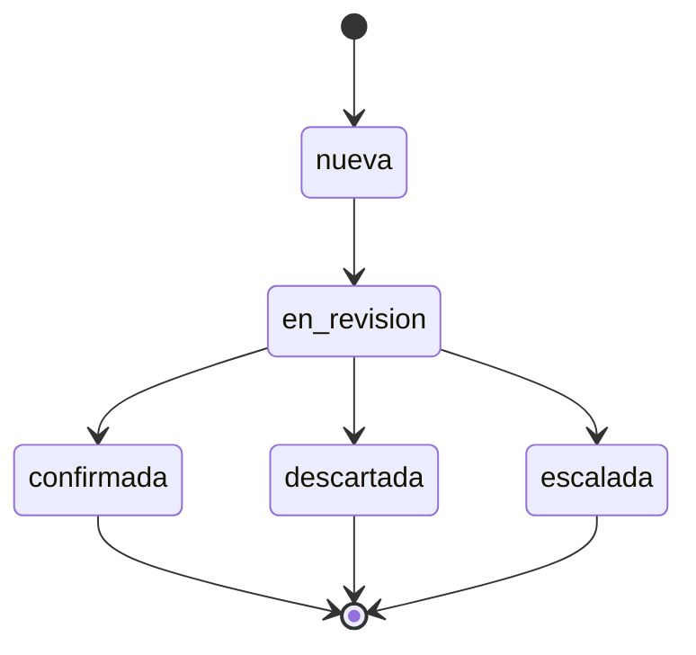

# 06 · Plataforma

Los contratos que las cuatro personas comparten, el árbol del repo, los comandos y las
modalidades de arranque.

> **Por qué este documento existe.** Los contratos de datos también están en
> `CLAUDE.md`, pero `CLAUDE.md` está en `.gitignore`: no viaja en el repo y nadie más
> lo recibe. **Este es el único lugar versionado donde el equipo puede leer los
> contratos.** Si algo de aquí cambia, cambia para los cuatro.

Cada contrato de este documento tiene una prueba que lo sostiene. La columna "prueba"
dice cuál. Un contrato sin prueba es una intención.

---

## 1. Contratos de datos

| Contrato | Decisión | Prueba |
|---|---|---|
| Dinero | `monto_crc`, entero de 64 bits, colones enteros. Nunca flotante. Campo `moneda: "CRC"` desde el día 1 | `prueba_modelos_dominio.py`, `prueba_validadores_mongo.py` |
| Fechas | Siempre ISODate en UTC. El portal formatea a hora de Costa Rica al presentar. Única excepción: `indicadores_diarios.fecha`, texto `YYYY-MM-DD` | `prueba_modelos_dominio.py` |
| Identificadores | Cadenas legibles del `scripts/practica1/CONTRATO-IDS.md` (`CLI-001`, `TXN-001`), nunca ObjectId | `prueba_modelos_dominio.py` |
| Versión de esquema | `esquema_version`, entero, en **todo** documento desde el primero | `prueba_modelos_dominio.py` |
| Nombres | snake_case en español, un solo estilo. Prohibidos `id`, `type` y `class` como nombre de campo | `prueba_modelos_dominio.py` |
| Estados de alerta | `nueva` → `en_revision` → `confirmada` / `descartada` / `escalada` | `prueba_maquina_estados.py` |
| Colecciones | 11 de dominio + 2 de operación = 13 | `prueba_modelos_dominio.py` |

Los 11 modelos Pydantic están en `app/modelos/`, agrupados igual que los scripts de la
Práctica 1 para que cada quien encuentre los suyos donde tiene su script:

| Archivo | Colecciones | Script hermano |
|---|---|---|
| `identidad.py` | `clientes`, `cuentas`, `perfiles_comportamiento` | `a-identidad.js` |
| `transaccional.py` | `transacciones`, `reglas_deteccion`, `listas_riesgo` | `b-transaccional.js` |
| `alertas.py` | `agentes`, `alertas`, `casos` | `c-alertas.js` |
| `cierre.py` | `notificaciones`, `indicadores_diarios` | `d-cierre.js` |

### 1.1 Dinero: "entero de 64 bits" no lo da el modelo

Esto es lo que más fácil se rompe, y romperlo no da error hasta mucho después.

El modelo Pydantic garantiza que `monto_crc` es un entero (`strict=True`, así que
`280000.0` es un error de validación y no una conversión silenciosa). **Lo que el
modelo no puede garantizar es el tipo BSON con el que se guarda:**

| Cómo se escribe | Qué queda en Mongo | Sirve |
|---|---|---|
| `280000` en mongosh | `double` | **No** |
| `280000` como `int` de Python | `int32` (cabe en 32 bits) | **No** |
| `NumberLong(280000)` en mongosh | `long` | Sí |
| `bson.Int64(280000)` en Python | `long` | Sí |

Los validadores declaran `bsonType: "long"`, así que un `int32` **se rechaza**. La
conversión la hace `app/repos/carga_demo.py` al escribir: todo campo que termine en
`_crc` se envuelve en `Int64`. La prueba
`prueba_el_dinero_como_entero_de_32_bits_se_rechaza` verifica las dos mitades: que el
entero pelado se rechaza y que envuelto pasa.

Campos de dinero actuales: `transacciones.monto_crc`, `alertas.monto_crc`,
`perfiles_comportamiento.promedio_crc` y `.maximo_crc`. Un promedio también es dinero:
va redondeado a colón entero, porque SINPE Móvil no opera céntimos.

### 1.2 Fechas

Una fecha sin zona es ambigua: 22:47 en San José y 22:47 en UTC son dos instantes
distintos con seis horas de diferencia, y la regla de horario habitual (R-05) depende
de la hora. Por eso el modelo **rechaza** un `datetime` sin `tzinfo` y normaliza
cualquier otro a UTC.

El cliente de Mongo se crea con `tz_aware=True`; sin eso, una fecha que se escribió en
UTC vuelve sin zona y queda lista para que alguien la interprete como hora local.

Dos excepciones, las dos declaradas:

- `indicadores_diarios.fecha`: texto `YYYY-MM-DD`. Un indicador es de un día
  calendario de Costa Rica, no de un instante.
- `perfiles_comportamiento.horario_habitual`: `{inicio: "07:00", fin: "19:00"}` en hora
  local. "Opera de 7 a 7" es una afirmación sobre el día del cliente.

### 1.3 Identificadores

| Prefijo | Colección | Ejemplo |
|---|---|---|
| `CLI` | `clientes` | `CLI-001` |
| `CTA` | `cuentas` | `CTA-001` |
| `TXN` | `transacciones` | `TXN-001` |
| `REG` | `reglas_deteccion` | `REG-001` |
| `RSK` | `listas_riesgo` | `RSK-001` |
| `AGT` | `agentes` | `AGT-001` |
| `ALR` | `alertas` | `ALR-001` |
| `CAS` | `casos` | `CAS-001` |
| `NOT` | `notificaciones` | `NOT-001` |

Los tipos del modelo llevan el patrón, así que un `CLI-001` donde va un `TXN-001` es un
error de validación y no una referencia rota que aparece tres semanas después.

**Dos colecciones no llevan prefijo, y es a propósito.** Son las materializadas, y usan
su clave natural para que el `$merge` que las produce sea idempotente sin trabajo extra:

- `perfiles_comportamiento._id` = el `cliente_id` (`CLI-001`). Un perfil por cliente.
- `indicadores_diarios._id` = la fecha (`2026-09-24`). Un documento por día. El
  documento lleva la fecha **dos veces**, como `_id` y como `fecha`: el `_id` para la
  idempotencia y el campo `fecha` porque es el que declara el validador.

Una cuenta mula **no** tiene documento en `cuentas`: viaja como número de cuenta dentro
de `transacciones.cuenta_destino` y, si se identifica, como entrada en `listas_riesgo`.

### 1.4 Máquina de estados de la alerta



| Desde | Puede ir a |
|---|---|
| `nueva` | `en_revision` |
| `en_revision` | `confirmada`, `descartada`, `escalada` |
| `confirmada`, `descartada`, `escalada` | nada: son terminales |

Está en `app/modelos/estados.py`, y **solo el arquitecto la cambia**: cambiarla es
cambiar `TRANSICIONES` y su prueba en el mismo commit. H-14 tiene que llamar
`exigir_transicion(origen, destino)` antes de escribir el estado nuevo.

Tres cosas que la tabla decide y conviene tener claras:

- **No existe `nueva → confirmada`.** El agente toma la alerta antes de resolverla, así
  el historial siempre registra quién la tomó. `prueba_todo_lo_demas_se_rechaza`
  recorre los 25 pares posibles y exige que los 21 que no están en la tabla fallen.
- **Los terminales no tienen salida.** Reabrir es crear un caso (colección `casos`), no
  retroceder la alerta, para que el historial no mienta.
- **No existe el estado `resuelta`** que menciona alguna versión vieja de
  `docs/01-vision-y-alcance.md`. Manda esta tabla.

### 1.5 Severidad, y dónde viven los números

`MEDIA`, `ALTA`, `CRITICA`, en mayúscula. **No hay `BAJA`**: si el puntaje no supera el
umbral no se crea alerta (UC-02), así que una alerta de severidad baja no puede existir.

**Los cortes de puntaje NO están en el código ni en el YAML.** Viven en
`politica_deteccion`, para que cambiar un umbral no requiera desplegar. Se lee con
`db.politica_deteccion.findOne({vigente: true})`, y **esta es la forma real del
documento**, no una parecida:

```js
{
  _id: "POL-001",
  descripcion: "Cortes de severidad y umbral de creacion de alerta",
  vigente: true,
  version: 1,                 // version de la politica, distinta de esquema_version
  umbral_alerta: 35,          // bajo esto no se crea alerta (40 antes de la calibracion, docs/08-calibracion.md)
  puntaje_maximo: 100,
  cortes_severidad: [         // ARREGLO de objetos, no un objeto
    { severidad: "MEDIA",   puntaje_minimo: 35, puntaje_maximo: 54 },
    { severidad: "ALTA",    puntaje_minimo: 55, puntaje_maximo: 69 },
    { severidad: "CRITICA", puntaje_minimo: 70, puntaje_maximo: 100 }
  ],
  notificacion: { severidad_minima: "CRITICA", ventana_agrupacion_minutos: 5 },
  esquema_version: 1,
  vigente_desde: ISODate("2026-09-01T00:00:00Z")
}
```

Los pesos de las 6 reglas suman más de 100, así que el puntaje se calcula como
`min(suma, puntaje_maximo)`. El modelo es `PoliticaDeteccion` (H-08, en
`app/deteccion/evaluador.py`) y **se lee en un solo lugar** (T-19):
`leer_politica_vigente` en `app/repos/reglas.py`, que usan la API de reglas y D1.
`pruebas/arquitectura/prueba_politica_unica.py` impide una segunda lectura.

### 1.6 La alerta lleva copia de los campos de despliegue

La fila del panel necesita cliente, cuentas y monto para que el agente decida sin abrir
el detalle. Esos campos van **copiados dentro de la alerta** al momento de crearse, no
resueltos con `$lookup` en cada página:

`cuenta_origen`, `cuenta_destino`, `monto_crc`, `moneda`, `cliente_nombre`.

Dos razones, y ninguna es nueva: "nada se recalcula dentro de una petición HTTP" es una
regla de oro de `docs/04-arquitectura.md`, y es el mismo principio por el que las reglas
disparadas van embebidas: la alerta debe poder explicarse dentro de un año, y para eso
el monto que se vio al crearla no puede depender de que la transacción siga igual. A D1
no le cuesta una consulta extra, porque cuando escribe la alerta ya tiene la transacción
en la mano.

> **Ojo con un mismo nombre que significa dos cosas.** En `transacciones`,
> `cuenta_origen` es el identificador `CTA-001`. En `alertas`, `cuenta_origen` es el
> **número SINPE** (`8712-4455`), porque es un campo para mostrar y el agente lee el
> número, no una llave interna. Está así en el validador y en el modelo.

### 1.7 `reglas_disparadas`: v1 referencias, v2 copia embebida (H-26)

`alertas` es la primera colección con dos versiones de esquema (decisiones D-01, D-12,
D-14). La versión es **por colección**: las demás siguen en `esquema_version: 1`.

| | `reglas_disparadas` | `politica` | Dónde queda la versión de cada regla |
|---|---|---|---|
| v1 | `["REG-001", "REG-002", "REG-003"]` | no existe | solo como texto en `historial[0].nota` |
| v2 | `[{regla_id, codigo, version, peso, explicacion}]` | `{politica_id, version}` | en el dato |

- **D1 escribe v2** con lo que ya produce el evaluador (`ReglaDisparada`): la alerta se
  explica sola dentro de un año aunque la regla cambie.
- **Lectura dual.** `Alerta` (en `app/modelos/alertas.py`) lee las dos; `esquema_version`
  decide qué forma es válida, y una mezcla se rechaza en el modelo y en el validador
  (`oneOf` del bloque de `alertas` en `01-colecciones.js`). `alerta.regla_ids` sirve
  igual en v1 y v2; `alerta.reglas_aplicadas` trae la copia embebida (vacía en v1).
- **Migración** `scripts/migraciones/001-alertas-v1-a-v2.js`, con `python tareas.py
  migrar`. Reejecutable e idempotente: imprime cuántas migró y cuántas ya estaban en v2.
  La versión sale de la nota de D1 y, si no la dice, de la que regía en
  `fecha_creacion` según `versiones_anteriores` de la regla (H-16). La explicación se
  reconstruye desde la regla **en esa versión**; si esa versión ya no existe queda
  `"no disponible: regla editada"` y se cuenta. La `ALR-001` sembrada queda en v1 a
  propósito: es lo que la migración demuestra.
- **D-15.** Re-sembrar (`python tareas.py datos-demo`) borra la historia de versiones
  de las reglas; el comando lo avisa.

### 1.8 El historial embebido empieza cuando nace la alerta

`alertas.historial` tiene **al menos una entrada siempre**: la primera es la creación, y
la escribe el motor con `agente_id: null`, porque no la hizo una persona. Los campos son
`accion`, `agente_id`, `fecha` y `nota` (no `agente` ni `ts`, como decía el andamio de la
Práctica 1). H-14 **agrega** a esta lista, nunca la sobrescribe.

### 1.9 Las 13 colecciones

11 de dominio (Práctica 1) más 2 de operación:

| Colección | Qué es |
|---|---|
| `politica_deteccion` | Cortes de severidad y umbral de creación. Por esto los umbrales no están en el YAML |
| `deteccion_estado` | Estado derivado del detector: token de reanudación del change stream (H-09), descartes y, desde T-63, los rasgos de grafo de R-11 |

Los nombres se toman de `app/modelos/__init__.py` (`COLECCIONES`, `COLECCION_ALERTAS`,
...) y no se escriben a mano: así un nombre mal escrito es un error de importación y no
una colección vacía que aparece de la nada.

---

## 2. Reglas de arquitectura

Todas verificadas por `pruebas/arquitectura/prueba_capas.py`, que recorre el árbol con
el módulo `ast`. No necesita Mongo ni levantar la aplicación.

| Regla | Por qué |
|---|---|
| `app/deteccion/` no importa `app/api/` | El motor es headless. Si importa la capa HTTP, deja de poder probarse sin levantar un servidor |
| Ninguna consulta a Mongo fuera de `app/repos/` | Para que "qué consultas hace este sistema" se pueda responder mirando una carpeta, y afinar un índice no sea una cacería |
| Un solo cliente de Mongo por proceso, creado en el lifespan | Uno por petición agota los sockets del servidor |
| La URI solo en `config/centinela.yml` | Una URI en el código es un ambiente hundido en el código |
| Solo `app/nucleo/config.py` lee entorno o YAML | Si cada módulo lee `os.environ`, la precedencia deja de ser un contrato |
| El driver es `pymongo.AsyncMongoClient` | Motor está deprecado, fin de vida mayo 2026. Por eso el paquete es `app/deteccion/` y no `app/motor/` |
| Sin emojis en ningún lado | Regla del repo, y la prueba la verifica por rango Unicode |

`app/deteccion/` todavía no existe: la prueba **pasa en vacío** a propósito, para que la
regla ya esté puesta cuando empiece H-09 en vez de llegar después a discutir un import
ya escrito. Hay una contraprueba que verifica que la regla no pasa por no mirar nada.

El ping de `/salud` vive en `app/repos/salud.py` y no en `app/nucleo/db.py`: un ping es
una consulta, y una regla que se incumple el primer día no es una regla.

### Árbol

```
app/
  main.py              FastAPI, lifespan que crea y cierra el cliente de Mongo
  nucleo/
    config.py          clase Ajustes; UNICO lugar que lee entorno o YAML
    db.py              AsyncMongoClient unico; UNICO lugar con la URI
  modelos/             los 11 de dominio, tipos base y maquina de estados
  repos/               UNICO lugar con consultas
  api/
    errores.py         forma estable del error
    esquemas.py        respuestas HTTP
    paginacion.py      acotado de limite
    dependencias.py    inyeccion de ajustes, base y repositorios
    rutas/             salud, alertas
frontend/              SPA React + TypeScript (Vite); su build va a app/estaticos/spa/ (T-61)
config/centinela.yml   tecnico, sin secretos, sin numeros de negocio
infra/                 docker-compose.yml y .env.ejemplo
pruebas/
  contrato/            configuracion, maquina de estados, modelos, error, OpenAPI, validadores
  unitarias/           paginacion, construccion del filtro
  arquitectura/        las reglas de capas
  dobles/              conjunto de demo y repositorios falsos
tareas.py              lanzador, solo biblioteca estandar
```

---

## 3. Configuración

Precedencia, de mayor a menor. **Verificada por `prueba_configuracion.py`, no a ojo:**

```
entorno  >  config/centinela.local.yml  >  config/centinela.yml
```

El archivo local no se versiona (está en `.gitignore`) y solo necesita las claves que
quiere cambiar: el merge es profundo, así que `app: {pagina_maxima: 25}` no borra el
resto del bloque `app`.

En entorno el prefijo es `CENTINELA_` y el separador de nivel es doble guion bajo:

```
CENTINELA_APP__PAGINA_MAXIMA=25
CENTINELA_MONGO__BASE=antifraude_pruebas
```

**Qué NO va en el YAML:**

- **Secretos.** Van por entorno; el molde está en `infra/.env.ejemplo`.
- **Números de negocio.** Ni umbrales, ni pesos de reglas, ni cortes de severidad: eso
  vive en `politica_deteccion` y en `reglas_deteccion`, en Mongo, para poder cambiarlo
  sin desplegar. Hay dos pruebas que lo vigilan: una recorre las claves del YAML
  buscando palabras de negocio, y la otra es que los bloques de configuración declaran
  `extra="forbid"`, así que **una clave no declarada impide arrancar**. Si alguien pone
  `app.umbral_alerta`, la aplicación no levanta.

`app.pagina_maxima` y `app.pagina_por_omision` sí van en el YAML: son guardas técnicas
de la capa HTTP, no reglas de negocio.

### La URI, una sola para las dos modalidades

```
mongodb://localhost:27018,localhost:27019,localhost:27020/?replicaSet=rsfraude
```

Funciona igual desde el host y desde un contenedor con
`network_mode: service:mongo1`, y no es casualidad: `scripts/init-replicaset.js` declara
los miembros como `localhost:27018/19/20`, y `mongo1` publica esos tres puertos. Desde
el host se alcanza por los puertos publicados; desde un contenedor que comparte el
espacio de red de `mongo1`, los tres nodos están en su propio `localhost`. Cambiarla por
nombres de servicio de Compose rompe la modalidad de host.

**Usar siempre la cadena completa, nunca un nodo suelto.** `mongo1` no siempre es el
primario: después de una elección puede ser `mongo2`, y entonces
`mongosh --port 27018` contesta `not primary`. Con la URI completa, el driver descubre
el primario solo.

---

## 4. Arranque

### El clúster es uno solo, y hay que saber quién manda

Un solo replica set compartido es lo correcto y es lo que el equipo quiere. Lo que no
puede quedar implícito es esto:

- **El proyecto de Compose tiene nombre explícito** (`name: centinela` en
  `infra/docker-compose.yml`). Sin esa clave, el proyecto depende de la ruta donde esté
  clonado el repo; con ella, dos personas con el repo en carpetas distintas obtienen el
  mismo proyecto.

  Lo que esa clave **no** hace es evitar que dos checkouts del repo se peleen los
  contenedores: comparten el archivo, así que antes derivaban todos el mismo nombre y
  ahora usan todos `centinela` — la misma colisión con otro nombre. Lo que la evita es
  la regla de abajo.

- **Los volúmenes son normales: Compose los crea y los administra.** No llevan
  `external: true` ni `name:`, y eso es una decisión con historia. Un volumen declarado
  `external` Compose **no lo crea**: asume que existe, y si no existe `up` falla con
  `external volume "..." not found` antes de arrancar un solo contenedor. En la máquina
  de quien clona el repo por primera vez, en un corredor de CI o en la del profesor el
  día de la defensa, eso es un arranque roto en el primer paso.

  Se habían fijado para conservar una siembra existente, y la cuenta no cerraba: **la
  base entera se regenera en segundos** (`01 → 02 → 03` más los documentos de dominio,
  todo idempotente). Perder un volumen viejo no cuesta nada; que un compañero no pueda
  arrancar cuesta el proyecto. `prueba_infraestructura.py` vigila que no vuelvan.

  Corolario práctico: **verificar el arranque en una máquina que ya tiene los volúmenes
  de corridas anteriores no prueba que funcione en una limpia.** Para probarlo de verdad
  hay que borrar los volúmenes (`python tareas.py abajo --borrar-datos`) o levantar una
  copia aislada del compose con otro nombre de proyecto.
- **Solo el checkout principal corre `docker compose`.** Esta es la regla operativa, y
  no es burocracia: mientras alguna rama todavía tenga el `docker-compose.yml` viejo sin
  la clave `name:`, desde ahí Compose usa el proyecto `infra` con los mismos nombres de
  contenedor, y los dos proyectos se pelean los mismos `fraude-mongo1/2/3`. El síntoma
  es que los contenedores se caen y vuelven a subir solos mientras alguien más verifica.

  Quien solo necesite **ejecutar** algo contra la base no necesita Compose para nada:

  ```
  mongosh "mongodb://localhost:27018,localhost:27019,localhost:27020/?replicaSet=rsfraude" --file /ruta/absoluta/script.js
  docker exec fraude-mongo1 mongosh --port 27018 --quiet --eval "..."
  ```

  **Nunca `docker compose up` desde un worktree.**
- **Los scripts se corren desde el host, con ruta absoluta del host y la URI completa**,
  no con `docker compose exec --file`. El montaje de `/scripts` apunta a la carpeta de
  quien recreó los contenedores de último; desde otro checkout, `--file /scripts/x.js`
  lee el archivo de otra persona o no lo encuentra. `tareas.py` ya lo hace así:

```
mongosh "mongodb://localhost:27018,localhost:27019,localhost:27020/?replicaSet=rsfraude" --file /ruta/absoluta/del/host/scripts/semilla/01-colecciones.js
```

La única excepción es `rs.initiate()`: antes de iniciar el conjunto no hay replica set
que descubrir, así que ese script se corre con conexión directa
(`mongodb://localhost:27018/?directConnection=true`). `tareas.py` también lo hace solo.

### Modalidad A: Mongo en Compose, Python en el host — **probada**

```
python tareas.py instalar     # uv sync: interprete 3.13 y versiones del lock
python tareas.py arriba       # levanta los 3 nodos, inicia el replica set y espera al primario
python tareas.py datos-demo   # siembra estructura, catalogos y el conjunto de demo
python tareas.py dev          # uvicorn con recarga
```

`arriba` espera a que la elección termine antes de reportar. La elección tarda entre 5 y
15 segundos, y sin la espera el comando terminaba mostrando tres `SECONDARY`, que parece
un error y no lo es.

### Modalidad B: todo en Compose — **probada**

```
python tareas.py arriba --con-app   # los 3 nodos mas la API, todo en Compose
python tareas.py datos-demo
```

Para la demo y la defensa. El navegador entra por el puerto publicado, igual que en la
modalidad A, y **la URI del YAML no cambia ni una letra** entre las dos.

Son **dos servidores** (D-73), cada uno en su contenedor, construidos del mismo
`infra/Dockerfile` con `target: web` y `target: api`:

| Servicio | Imagen | Qué hace | Puerto |
|---|---|---|---|
| `web` | `nginxinc/nginx-unprivileged:1.29.8-alpine` fijada por tag exacto **y digest** | Sirve la SPA construida y reenvía `/api`, `/estado`, `/salud` y `/openapi.json` a `api`. Sin Python, sin Node, sin driver de Mongo, sin variables de entorno | 8080 dentro; el host lo ve en `127.0.0.1:8000` |
| `api` | `python:3.13-slim` con uv | `uvicorn app.main:app`, un worker, usuario `centinela` (uid 10001). **Sin la SPA** y con `mongodump` y `mongorestore` | 8000 dentro; **no se publica** |

El Dockerfile tiene cuatro etapas: `spa` (`node:26.8.1-slim`, la versión de
`frontend/.nvmrc`; instala el lock con `npm ci` y corre `npm run build`), `herramientas`
(baja las MongoDB Database Tools con versión y sha256 fijos), `web` y `api`. La imagen que
corre no lleva Node ni usa la red. `.dockerignore` deja afuera `frontend/node_modules/` y
cualquier build del host.

**Por qué la API no lleva la SPA.** La SPA se sirve completa desde `web`; copiarla a la
API sumaría peso y una segunda copia que mantener. Lo que se pierde es que las rutas de
página ya no pasan por el guardia de la API: `/panel` devuelve el mismo `index.html` a
cualquiera, sin datos (igual que `/estaticos`, público por construcción). La sesión y los
permisos se siguen decidiendo en cada endpoint de la API, y la SPA pregunta
`GET /api/v1/sesion` para dibujar o negar una pantalla. Esto vale solo en Compose; en la
modalidad A (`uvicorn` en el host) FastAPI sigue sirviendo la SPA y el guardia de páginas
sigue igual.

**La red.** Los dos servicios entran al espacio de red de `mongo1` con
`network_mode: service:mongo1`, exactamente como ya hacen `mongo2` y `mongo3`. El motivo
es el de siempre: los miembros del replica set se anuncian como `localhost:27018-27020`
(`scripts/init-replicaset.js`) y el driver, al descubrir el conjunto, reconecta a esos
nombres; solo en el espacio de red de `mongo1` `localhost:27018` es el nodo. Cualquier
otra red obligaría a anunciar los miembros con otros nombres y rompería la modalidad A,
que usa los mismos nombres desde el host. A cambio, `web` alcanza a `api` en
`127.0.0.1:8000` sin que la API se publique, y **el puerto del portal se publica en la
lista `ports` de `mongo1`, no en la de `web`**: un servicio que toma prestada la pila de
red de otro no puede declarar puertos propios. `mongo1` publica `127.0.0.1:8000:8080`
(nginx), de modo que `http://localhost:8000` sigue siendo el portal en las dos
modalidades. La misma URI del YAML sirve en las dos.

"`web` no tiene acceso a Mongo" se cumple por contenido y no por aislamiento de red
(comparte el de `mongo1`): no recibe URI, claves ni volúmenes, no lleva driver, y su
configuración solo conoce a la API. Lo fija `pruebas/arquitectura/prueba_dos_servidores.py`.
La alternativa, reiniciar el replica set anunciando nombres de Docker, rompería el acceso
desde el host y obligaría a editar el archivo `hosts` en Windows.

**Lo que hace nginx** (`infra/nginx/`):

- **Mismo origen.** El navegador habla con un solo servidor: la cookie HttpOnly
  SameSite=Strict de la sesión y la tabla de permisos no cambian.
- **SSE.** `/api/v1/alertas/eventos` (y `/flujo`, el canal HTML de HTMX) salen con
  `proxy_buffering off`, `proxy_cache off`, `gzip off`, `X-Accel-Buffering: no` y
  `proxy_read_timeout 24h`. Sin eso nginx acumula la respuesta y el panel no ve nada.
- **SPA.** Toda ruta de página (`/`, `/login`, `/panel`, `/detalle/...`, `/busqueda`,
  `/red-mulas/...`, `/tablero`, `/reglas`, `/administracion/...` y las que vengan) recibe
  `index.html` sin caché. Un archivo con extensión que no existe es 404, no HTML.
- **Caché.** `/estaticos/spa/assets/` (con hash en el nombre) un año, `immutable`;
  `centinela.css` y el resto se revalidan.
- **Seguridad.** `X-Content-Type-Options`, `Referrer-Policy`, `X-Frame-Options`,
  `Permissions-Policy` y una CSP sin CDN: `default-src 'self'`, `script-src 'self'`,
  `style-src 'self' 'unsafe-inline'` (React escribe atributos `style`), `frame-ancestors
  'none'`. Verificado con Chromium contra el nginx real: sin violaciones de la CSP.
- **Respaldos.** `/api/v1/respaldos` tiene un `proxy_read_timeout` de 1900 s: crear y
  verificar corren `mongodump` y `mongorestore` dentro de la petición.

Cada servicio declara `HEALTHCHECK` (el de `web` es `/nginx-salud`, propio de nginx; el de
`api` es `/salud`), `restart: unless-stopped`, sistema de archivos de solo lectura (`/tmp`
en tmpfs), `cap_drop: ALL` y `no-new-privileges`. `docker compose up --wait` espera a que
los dos estén sanos.

`api` y `web` llevan `profiles: ["app"]`, así que un `docker compose up` sin argumentos
sigue levantando solo el replica set. Nadie se encuentra contenedores nuevos sin pedirlos.
`python tareas.py abajo` los baja también.

---

## 5. Comandos

| Comando | Qué hace |
|---|---|
| `python tareas.py instalar` | `uv sync` con las versiones exactas del lock |
| `python tareas.py arriba` | Levanta el replica set, lo inicializa y espera al primario. Con la SPA por omisión, si falta su build lo construye (T-67) |
| `python tareas.py arriba --con-app` | Lo mismo, más `api` y `web` (nginx con la SPA) dentro de Compose (modalidad B) |
| `python tareas.py abajo [--borrar-datos]` | Lo apaga. Con la bandera, borra también los volúmenes |
| `python tareas.py estado` | Estado de los tres nodos |
| `python tareas.py dev` | La API en el host, con recarga. Si falta el build de la SPA lo construye antes (`npm ci` + build); si es más viejo que `frontend/`, avisa (T-67) |
| `python tareas.py dev --front` | Lo mismo, más Vite en `http://127.0.0.1:8173` con recarga de la SPA y proxy a la API (T-61) |
| `python tareas.py front` | `npm ci` y `npm run build` de `frontend/`: deja la SPA en `app/estaticos/spa/` (T-61) |
| `python tareas.py datos-demo` | Siembra y carga el conjunto de demo |
| `python tareas.py demo-reiniciar --si` | Deja la base en el estado de la defensa, conservando las credenciales de login |
| `python tareas.py restaurar --archivo <x> --si [--base b]` | Restaura un respaldo sobre la base viva, con respaldo previo automático y conteos antes y después (D-74). Sin `--si` no hace nada |
| `python tareas.py pruebas [--tipo ...] [--sin-mongo]` | Las pruebas, por tipo |
| `python tareas.py verificar` | Instala y prueba: lo que se corre antes de pedir revisión |

`tareas.py` usa **solo biblioteca estándar** (`argparse` y `subprocess`), a propósito:
el equipo trabaja en macOS y en Windows, make no viene en Windows, y un `.sh` habría
excluido a media clase. Cualquier comando acepta `--dry-run`.

### Orden de la siembra: 01 → 02 → 03 → 05, y no otro

`datos-demo` corre, en este orden:

1. `scripts/semilla/01-colecciones.js` — colecciones con sus validadores
2. `scripts/semilla/02-indices.js` — índices con nombre
3. `scripts/semilla/03-catalogos.js` — catálogo de reglas y política de severidad
4. `scripts/semilla/05-vistas.js` — las vistas de consulta guardadas (H-24); el `04` es de `asegurar`
5. Los documentos de dominio del caso documentado

**El orden es obligatorio:** `01` hace drop de las colecciones para recrearlas con su
validador, así que corrido después del `03` se lleva el catálogo que el `03` acaba de
escribir. Ya pasó en vivo.

El catálogo de reglas **no** está en el cargador de Python: definirlo en dos lugares es
garantizar que se separen. Los pesos de las reglas son de quien las diseña (H-07).

### CI: una prueba de Mongo saltada no cuenta como verde

`.github/workflows/ci.yml` corre en cada PR hacia `dev` o `main` y en cada push a `dev`:
ruff, las compuertas del frontend (T-61: `npm ci`, lint, typecheck, Vitest,
`npm audit --audit-level=high` y el build, antes de las e2e), `pytest -m "not mongo"` y
`pytest -m mongo` contra un replica set de un nodo. Antes
del paso de Mongo siembra la base `antifraude` con `01 → 02 → 03 → 05`, en el mismo orden que
`datos-demo`, y corre ese paso con `CENTINELA_EXIGIR_MONGO=1`. Con esa variable, las dos
razones por las que una prueba de Mongo se saltaba (el replica set no responde, o la base
no tiene validadores) son **fallas**. La primera corrida del CI salió verde con 26 pruebas
saltadas; eso ya no puede pasar. En local, sin la variable, siguen siendo saltos, y quien
quiera la misma exigencia corre `CENTINELA_EXIGIR_MONGO=1 uv run pytest -m mongo -rs`.
`pruebas/unitarias/prueba_modo_estricto_mongo.py` verifica las dos mitades. El job tiene
permiso de solo lectura, cancela la corrida anterior de la misma rama y fija las acciones
por SHA. La auditoría de dependencias (`pip-audit`) no es compuerta todavía: hoy reporta
vulnerabilidades en `certifi`, `dnspython` y `pymongo`, que se cierran subiendo versiones
en el lock.

Ninguna prueba `mongo` lee ni escribe la base de trabajo `antifraude`: usan `antifraude_pruebas*`, y lo que necesitan de la semilla (validadores, catalogo, ALR-001 en v1) lo carga `conftest.py` en `antifraude_pruebas_semilla` desde `scripts/semilla/`. Resultado igual sobre una base recien sembrada, migrada o con datos del generador (T-34).

---

## 6. Contrato HTTP

Publicado como OpenAPI en `/openapi.json`, navegable en `/docs`.

### La forma del error es una sola

```json
{
  "error": {
    "codigo": "parametros_invalidos",
    "mensaje": "La peticion tiene parametros invalidos",
    "detalles": [{ "campo": "limite", "mensaje": "Input should be greater than or equal to 1" }]
  }
}
```

Un 404, un 422 de validación y un 500 inesperado tienen **la misma forma**. No se usa el
`{"detail": ...}` que trae FastAPI porque `detail` cambia de tipo según el caso (texto en
un `HTTPException`, lista de objetos en un error de validación), y entonces el portal
tiene que ramificar por tipo para mostrar un mensaje. Con esto, el portal lee
`error.mensaje` y, si quiere detalle, recorre `error.detalles`.

`codigo` es para el programa y es estable; `mensaje` es para la persona y puede cambiar
de redacción sin romper a nadie. El vocabulario de códigos es cerrado:
`parametros_invalidos`, `no_encontrado`, `conflicto`, `transicion_invalida`,
`base_no_disponible`, `error_interno`.

Una transición fuera de la máquina de estados sale como **409**, no 422: la petición es
válida, lo que no se puede es aplicarla al estado actual del recurso.

### `POST /api/v1/alertas/{alerta_id}/transiciones` (H-14)

Cuerpo `{destino, agente_id, nota?, estado_esperado?}`; responde `{alerta, caso_id}`.
POST y no PATCH del estado: una transición es una entrada que se **agrega** al
historial, no un campo que se pisa.

| Caso | Respuesta |
|---|---|
| Par fuera de `TRANSICIONES` | 409 `transicion_invalida`, con el estado actual en `detalles` |
| Otro agente la tomó, o cambió entre la lectura y la escritura | 409 `conflicto`, sin escribir |
| `estado_esperado` no coincide | 409 `conflicto`, sin escribir |
| `en_revision -> X` pedido por quien no la tomó | 409 `conflicto` |
| No existe | 404 `no_encontrado` |

La escritura es `$set` del estado más `$push` al historial, filtrada por el estado y el
agente leídos (`planear_transicion` en `app/repos/alertas.py`, pura). Escalar crea el
caso `CAS-xxx` (derivado de `ALR-xxx`) y mueve la alerta en **una transacción
multi-documento**: el caso se inserta primero y, si la alerta ya no coincide o el caso
existe, se deshacen las dos escrituras.

El esquema publicado dice la verdad: `prueba_openapi.py` verifica que el 422 documentado
sea `RespuestaError` y no el `HTTPValidationError` que FastAPI documenta por omisión.

### `/salud` y `/estado` son rutas distintas

| Ruta | Responde | Estado |
|---|---|---|
| `GET /salud` | El proceso está vivo y la base contesta. Trae el nombre del replica set y si el nodo es primario | Existe |
| `GET /estado` | El sistema está **haciendo su trabajo**: qué tareas corren o están caídas, último evento procesado, retraso, último error | Existe |

Están separadas porque un proceso vivo con el motor caído es justo el escenario que un
solo endpoint de salud esconde: responde 200 mientras no se detecta un solo fraude.

`/estado` se apoya en `app/supervision/`, que registra cada tarea de fondo y la vigila.
Una tarea que muere no se pierde en silencio: deja el sistema en `degradado` y su último
error queda a la vista. Los disparadores D1, D2 y D3 todavía no existen —son H-09, H-11
y H-22— pero el andamio que los va a vigilar sí, y se prueba matando una tarea a mano.
`/estado` nombra la historia de cada uno, así que la ruta dice quién lo va a construir.

**T-18.** Una tarea viva puede estar `degradada`: D1 sin reglas activas late, pero no
puede generar una sola alerta. D1 mira el catálogo al abrir el change stream y en cada
transacción; mientras esté vacío, su fila trae `advertencia` con el motivo y el sistema
queda `degradado`. Se limpia sola cuando vuelve a haber reglas.

`/salud` responde 200 aunque Mongo no conteste, con `mongo_conectado: false` y el
motivo en `detalle`: la ruta cumplió su trabajo respondiendo, y quien la consulta
necesita el diagnóstico.

### `GET /api/v1/alertas`

| Parámetro | Tipo | Nota |
|---|---|---|
| `estado` | enum de la máquina | Filtro exacto |
| `severidad` | `MEDIA`, `ALTA`, `CRITICA` | Filtro exacto |
| `desde`, `hasta` | fecha con zona | Rango sobre `fecha_creacion`, inclusive en los dos extremos. Sin zona se interpreta como UTC |
| `limite` | entero ≥ 1 | **Acotado por `app.pagina_maxima`** |
| `desplazamiento` | entero ≥ 0 | |

Los filtros son combinables. La respuesta:

```json
{ "total": 3, "limite": 50, "desplazamiento": 0, "elementos": [ ... ] }
```

`total` es el total que cumple el filtro, no el tamaño de la página: el agente necesita
saber cuántas alertas tiene en su cola. `limite` es el que **de verdad se aplicó** tras
acotarlo, que puede ser menor que el pedido; va en la respuesta para que el cliente lo
note.

El orden es `fecha_creacion` descendente con `_id` como desempate. Sin el desempate,
paginar puede repetir un documento o saltárselo.

### El canal SSE: `GET /api/v1/alertas/flujo`

Es cómo la alerta nueva llega al panel sin que el agente recargue. Y la decisión de
fondo, la que hay que no deshacer por error: **no hay bus en memoria.**

El canal observa la colección `alertas` con un Change Stream. La fuente es **lo
persistido**, no un objeto en memoria, así que da igual quién escribió la alerta:
`datos-demo`, D1 dentro del proceso, o el detector corrido por línea de comandos. Todos
aparecen en el panel por el mismo camino.

El diseño anterior tenía un bus en memoria, y tenía tres agujeros: se perdía al
reiniciar, no definía de dónde recuperar lo perdido, y **las alertas de demo insertadas
directo en Mongo nunca habrían aparecido en el panel.** Quitar el bus es menos
maquinaria, no más.

| Pieza | Decisión |
|---|---|
| Identificador del evento | El token de reanudación del Change Stream. Es lo que el navegador devuelve en `Last-Event-ID` |
| Reconexión | Se reabre con `resumeAfter` y ese token, **con el mismo pipeline y las mismas opciones**: cambiarlos al reanudar da comportamiento impredecible |
| Token inservible | Si el oplog ya rodó, Mongo responde `ChangeStreamHistoryLost`. El canal emite un evento `resincronizar` y el panel vuelve a pedir su cola a `/api/v1/alertas` |
| Formato | Fragmento HTML de la fila, escrito tal cual con `ServerSentEvent(data=...)` (nunca `JSONServerSentEvent`, que lo entrecomillaría). La SPA usa el canal hermano `GET /api/v1/alertas/eventos`, con el mismo contrato y cuerpo JSON: ver "Portal SPA React (T-61)" |
| Cliente | htmx más la extensión `htmx-ext-sse`, vendorizada como archivo aparte en `app/estaticos/`. **No viene en el núcleo de htmx**, y agrega su propia reconexión con espera progresiva sobre la del navegador |

**Lo que se promete, dicho con precisión.** `Last-Event-ID` lo manda el navegador solo,
pero recuperar lo perdido lo tiene que implementar el servidor: no es automático. Y lo
que este canal promete es **reconstruir el estado de la cola**, no reproducir cada evento
histórico. Para un panel de trabajo eso es lo correcto: el agente quiere su cola como
está ahora, no una repetición de cada transición. Reproducir todo evento exigiría un
registro durable aparte, que ninguna historia ni ningún rubro pide.

**Límite conocido:** un Change Stream por conexión. Con un puñado de agentes está bien;
escalar a decenas pediría un flujo compartido con reparto entre conexiones. Está
documentado, no construido.

### Reglas: `/api/v1/reglas` (H-16)

Umbrales, pesos y parámetros se cambian por la API, sin tocar código ni la base a mano.
Sin autenticación todavía: el rol de supervisor es H-25.

| Ruta | Hace | Errores |
|---|---|---|
| `GET /api/v1/reglas[?activa=]` | Catálogo ordenado por `codigo`, cada regla con `versiones_anteriores` | 422 |
| `GET /api/v1/reglas/{regla_id}` | Una regla con su historia | 404, 422 |
| `GET /api/v1/reglas/tipos` | Tipos que el motor sabe evaluar, qué significa su `umbral` y qué `parametros` lee | |
| `POST /api/v1/reglas` | Alta en `version: 1`; el servidor asigna el siguiente `REG-NNN` | 409 código repetido, 422 |
| `PATCH /api/v1/reglas/{regla_id}` | Edita `descripcion`, `umbral`, `parametros`, `peso`, `activa` | 404, 409, 422 |
| `POST /api/v1/reglas/simular` | Evalúa una transacción sin escribir nada | 409 sin política, 422 |

**Versionado.** Cada edición sube `version` en uno y empuja la versión anterior completa,
con `reemplazada_en`, a `versiones_anteriores` del mismo documento. No hay colección
nueva (el contrato es de 13): las reglas se editan poco y se leen con su historia. Una
alerta guarda `regla_id` y `version`, así que se sigue explicando aunque la regla cambie.

**Concurrencia optimista.** La edición es un solo `find_one_and_update` filtrado por la
versión leída. Si otro la editó en el medio no se escribe nada y sale 409. El cliente
puede mandar `version_esperada` para que el 409 salga aunque la carrera haya sido antes
de su lectura (dos supervisores con la misma pantalla abierta).

**Desactivar es `PATCH {"activa": false}`**, no una ruta aparte: es una edición más, con
el mismo versionado y la misma concurrencia, y reactivar es simétrico.

**Lo que no entra.** Un `tipo` fuera de `app.deteccion.evaluador.EVALUADORES` (422, el
mensaje lista los soportados); `parametros` que el tipo no lee o le faltan (un
`ventana_minuto` mal escrito haría que la regla deje de evaluarse en silencio); dinero
en `parametros` que no sea entero; `tipo` o `codigo` en un `PATCH` (campo desconocido,
422). Campos iguales a lo guardado no crean versión.

**Simular.** El cuerpo trae `transaccion` y `contexto` (`ContextoEvaluacion`, lo que H-09
precalcula), y opcionalmente `reglas` y `politica`. Las reglas propuestas se superponen
al catálogo de la base por `_id`, así que para probar un umbral se manda solo esa regla.
La respuesta es la `Evaluacion` completa: puntaje, severidad, disparadas con su
explicación y no evaluadas con su motivo. Con el catálogo sembrado, TXN-001 da 75
CRITICA; con R-01 en umbral 20 da 40 MEDIA.

```bash
curl -X PATCH localhost:8000/api/v1/reglas/REG-001 \
  -H 'content-type: application/json' -d '{"umbral": 20, "version_esperada": 1}'
```

---

## 7. Datos de demo

`pruebas/dobles/datos_demo.py`. Pequeño, reproducible y **sin un solo dato inventado**:
todo sale de `CONTRATO-IDS.md` y del caso de `docs/02-casos-de-uso.md` — María Rodríguez,
cuenta `8712-4455`, `TXN-001` de ₡280.000 a las 22:47 hacia la mula `6033-9001`,
`ALR-001` con puntaje 75 resuelta por José Solís, la cadena `RSK-001..004`.

Reproducible sin semilla aleatoria porque son literales: dos corridas dejan la base
idéntica. No usa Faker; el generador con Faker es H-03/H-04/H-05 y es otra cosa.

Escribe con `replace_one(upsert=True)` por documento y **no borra nada más**. Una
versión anterior hacía `delete_many({})` por colección, lo que habría borrado la siembra
de la Práctica 1: un comando de demo no puede destruir el entregable de otra persona.
Tampoco hace `dropDatabase()`, que se llevaría índices y validadores.

Vive en `pruebas/dobles/` porque es un doble de prueba que además sirve de demo, y la
dirección de las dependencias es **pruebas → app**, nunca al revés.

**La cadena de mulas del caso (C-52).** `TXN-005..007` siguen el dinero desde `6033-9001`:
₡276.000 a `7104-2288` (+4 min), ₡185.000 a `8455-1177` (+9) y ₡90.000 a `6001-3344` (+11),
con `sinpe_origen` correcto. Las cuatro cuentas existen en `cuentas` (`CTA-005..008`, con
sus titulares `CLI-005..008`) y están en `listas_riesgo`, así que
`/red-mulas/6033-9001?desde=<fecha de TXN-001>` dibuja 3 saltos. Cada cuenta lleva su
`entidad` y ningún monto del demo supera el tope de esa entidad.

**Reinicio.** `python tareas.py demo-reiniciar --si` siembra 01 a 03 y 05, carga el demo y
recalcula `indicadores_diarios`. `01-colecciones.js` hace drop de `agentes`, y con ella se
irían las credenciales de login (H-25): el comando lee antes los agentes con `credencial`
y los restaura después del demo. Sin `--si` no hace nada. Usa el usuario administrador de
`.env`, igual que `asegurar`.

## 7c. Vistas de consulta guardadas (H-24, D-42)

Una vista (`db.createView`) es una consulta con nombre guardada en el servidor: se lee
como una colección y ejecuta su pipeline sobre la de origen en cada lectura, con los
índices de esa colección. Es el equivalente en Mongo de las consultas y procedimientos
guardados de una base relacional: la lógica de lectura vive en un solo lugar y el código
no la repite. `scripts/semilla/05-vistas.js` las crea (drop y create, idempotente) y va
después de `01` a `03`.

| Vista | Origen | Para qué |
|---|---|---|
| `vista_alertas_abiertas` | `alertas` | Cola por atender (`nueva`, `en_revision`) con cliente, cuentas y monto, la más grave primero |
| `vista_cuentas_en_riesgo` | `alertas` + `listas_riesgo` | Cuentas de destino con su cantidad de alertas, monto recibido y si ya están reportadas |
| `vista_resumen_por_regla` | `alertas` + `reglas_deteccion` | Alertas por regla disparada, con código y descripción; lee las formas v1 y v2 de `reglas_disparadas` |

Son de solo lectura (insertar en una vista falla) y no guardan datos. Permisos sin
cambios en `04-usuarios.js`: `centinela_app_rol` tiene `find` sobre todas las colecciones
de `antifraude` y `centinela_analista` el rol `read`; ambos leen las vistas. El plan de
`vista_alertas_abiertas` usa índices de `alertas` (`prueba_demo_mongo.py`). Una vista
queda colgada si se borra su origen y vuelve a funcionar al recrearlo.

---

## 7b. Generador de datos sintéticos (H-03, H-04, H-05)

CLI aparte, nunca dentro del proceso web: `uv run python -m app.generador --clientes 200
--transacciones 5000`. Los valores por omisión salen del bloque `generador` de
`config/centinela.yml` (`AjustesGenerador`, `extra="forbid"`); cada bandera
(`--clientes --transacciones --ritmo --semilla --proporcion`) los cambia para esa corrida.
Son parámetros de simulación, no reglas de detección: las reglas siguen en Mongo.

- **Tope por entidad.** En Costa Rica el tope de SINPE Móvil depende del banco (100.000 a
  300.000 colones). La lista `generador.entidades` (`nombre`, `tope_crc`, mínimo 4) es la
  fuente: cada cuenta lleva su `entidad` y ninguna transacción, legítima o de fraude,
  supera el tope de la entidad de su cuenta de origen. Agregar una entidad no toca código (los nombres del YAML son genéricos, "Entidad A" a "Entidad E").
- **Determinista.** Misma semilla, mismos datos; la historia termina en `fecha_fin` (no usa
  el reloj). Escribe con `insert_many` por lotes (`tamano_lote`) y, con `ritmo_por_segundo`
  mayor que 0, reparte la inserción en el tiempo para ver las alertas aparecer en vivo.
- **Perfiles coherentes.** Se calculan de lo que se generó (promedio, máximo, cantidad) y solo
  de lo legítimo; el máximo nunca pasa del tope y lo legítimo no supera 5 veces el promedio.
- **Fraude.** Menos del 2 % (`proporcion_anomalos`, el YAML rechaza 0.02 o más). Tres patrones:
  `monto_atipico_destino_nuevo` (11 a 13 veces el promedio del cliente, no un monto enorme),
  `rafaga_fragmentada` (4 a 6 transferencias cerca del tope en minutos) y `cadena_mulas`
  (victima, 3 o 4 cuentas mula del banco y una salida externa). Cada transacción lleva
  `simulacion: {fraude, patron, episodio}`: etiqueta SOLO para medir (H-10), que el motor
  nunca lee.
- **Mulas reportadas.** `proporcion_mulas_reportadas` (0 a 1, por omisión 0,5) mete esa fracción de las mulas que reciben en una cadena en `listas_riesgo` (`RSK-0001`..., vigente, con `fecha_reporte` un día antes de su primera transacción recibida), para que R-07 tenga contra qué disparar.
- **Idempotente.** Identificadores de 4 o más dígitos (`CLI-0001`, `TXN-000001`) y la etiqueta
  `simulacion` permiten borrar la corrida anterior sin tocar los datos de la Práctica 1.
- **Identificadores.** Los validadores aceptan 3 o más dígitos (`[0-9]{3,}`) igual que los modelos.

---

## 8. Divergencias abiertas

Anotadas para que nadie las resuelva dos veces, cada una en distinto sentido.

| Divergencia | Estado |
|---|---|
| Los comentarios de ejemplo de `scripts/practica1/*.js` usan `monto` y `fecha`, sin `moneda` ni `esquema_version`, y montos como literal numérico (que mongosh guarda como `double`) | **Los contratos de este documento son los que valen.** Esos archivos quedaron como referencia interna: la Práctica 1 se entregó fuera del repo, así que no son el entregable calificado. Corregir los comentarios está pendiente de decisión, y no urge |
| `scripts/practica1/CONTRATO-IDS.md` lista tres reglas (`REG-001..003`) | El catálogo real tiene seis: se agregaron `R-07`, `R-09` y `R-11`. La fuente viva es `scripts/semilla/03-catalogos.js` |
| `perfiles_comportamiento.desviacion_crc` está en `CONTRATO-IDS.md` pero no en el validador | El modelo lo declara opcional y no lo escribe hasta que el validador lo acepte |
| `casos.fecha_apertura`, `notificaciones.detalle_error`, `indicadores_diarios.calculado_en`, `reglas_deteccion.version` y `.parametros`: el modelo los declara, el validador todavía no | Opcionales en el modelo. Los campos opcionales no se escriben cuando son nulos, porque los validadores declaran `additionalProperties: false` y una clave nula sería una clave desconocida |
| Hay **12 colecciones**, no las 13 de la sección 1.9 | **Resuelta en H-09**: `01-colecciones.js` (bloque 13) crea `deteccion_estado` con validador; guarda el token de D1 (clase `reanudacion`, escrito después de la alerta) y los eventos que agotaron reintentos (clase `descarte`). Quedan 13 |
| La **reanudación del canal SSE contra Mongo real** no tiene prueba automática | El camino feliz se comprobó a mano contra el clúster de tres nodos: alerta insertada, evento con su token, HTML sin serializar. Lo que falta es provocar `ChangeStreamHistoryLost` de verdad, y eso pide un replica set con `oplogSize` diminuto, un ambiente aparte del suite. Hoy ese camino se cubre con un doble |

Ya resuelta: `docs/04-arquitectura.md` hablaba de React, WebSocket, "motor proceso
aparte" y 11 colecciones. Corregido en H-00B, junto con el glosario y el criterio de
H-17.

---

## 9. Qué falta, y de quién es

H-00A y H-00B están cerradas. Lo que sigue no es de la plataforma:

| Falta | De quién |
|---|---|
| Los disparadores D1 y D2, y la colección `deteccion_estado` | H-09 y H-11 — **B** |
| El disparador D3, que recalcula indicadores | Va con H-22 — **C**. El pipeline y el disparador que lo invoca son una sola unidad de trabajo: repartirlos entre dos personas deja la integración colgando |
| `scripts/procedimientos/` con los recálculos corribles por `mongosh --file` | **A**, y es lo que cubre el rubro 9 de la rúbrica |
| El generador con Faker, a escala de proyecto | H-03 a H-05 — **A** |
| Las plantillas del portal conectadas a Jinja y al canal SSE | H-17 en su segunda mitad — **C** |
| Los endpoints de escritura: resolver una alerta, gestionar reglas | H-14 y H-16 — **D** |

**Dos rubros de la rúbrica siguen sin evidencia**, y valen 6 de 30 puntos: los
disparadores de procesos y los procedimientos almacenados. Los scripts de siembra no
sirven para eso — crean estructura, no reaccionan a cambios ni son rutinas invocables.
La evidencia sale de H-09 y H-11 para el primero, y de `scripts/procedimientos/` para el
segundo.

## Portal conectado (H-17 y T-16)

> Desde T-67 esto es el **respaldo**: el portal por omisión es la SPA (sección siguiente).
> Estas páginas se sirven con `CENTINELA_PORTAL__INTERFAZ=htmx` hasta que T-68 las retire.

Paginas HTML en `app/api/rutas/paginas.py`, fuera de `/api/v1`, con Jinja y HTMX
vendorizados (`app/estaticos/PROCEDENCIA.md`). Arrancar con `uvicorn app.main:app` y abrir
`http://localhost:8000/panel`.

| Ruta | Que hace |
|---|---|
| `/panel` | Cola ordenada por severidad y fecha; se mantiene por SSE (`/api/v1/alertas/flujo`). `resincronizar` y una reconexion piden de nuevo `/panel/cola` |
| `/reglas` | Catalogo, edicion con `version_esperada` (409 visible), versiones anteriores, tipos soportados y politica vigente en solo lectura |
| `/detalle/{alerta_id}` | H-18. Transaccion, perfil, cada regla con version, aporte y explicacion (tabla que suma hasta el puntaje, con los cortes de la politica y el alcanzado), politica usada, historial en orden y resolucion: botones solo para lo que permite la maquina de estados, selector de agente (sin autenticacion hasta H-25) y el 409 como mensaje. Una alerta v1 muestra los ids y "alerta v1: migrar con python tareas.py migrar". Resolver usa el mismo handler que `POST /api/v1/alertas/{id}/transiciones`; escalar muestra el caso creado |
| `/detalle`, `/busqueda` | Maqueta estatica dentro de la plantilla base, marcada "en construccion" (H-19 pendiente) |
| `/tablero` (H-20) | Lee `indicadores_diarios` (`app/repos/tablero.py`), suma el periodo (`?dias=`, 1 a 30) contra el anterior y dibuja SVG generado en el servidor. Muestra `calculado_en` en hora CR. Con la coleccion vacia sugiere `python tareas.py indicadores`. `por_agente` y `por_hora` son opcionales en el rollup: si faltan, la pagina lo dice |
| `/red-mulas/{cuenta}` (T-35) | Grafo SVG de `RepoRedMulas`: nodos por nivel, aristas con monto y minutos entre eslabones, y propuestas para `listas_riesgo` (solo lectura). El detalle de alerta enlaza desde la cuenta destino. Rutas en `app/api/rutas/paginas_tablero.py`, registrado antes de `paginas.py` |

La fila del panel es la misma plantilla (`sse/fila_alerta.html`) para la carga inicial y
para cada evento SSE. El formulario de reglas reutiliza el handler de `PATCH
/api/v1/reglas/{id}`. Sin autenticacion hasta H-25: la cabecera lo avisa ("modo local").

## Portal SPA React (T-61)

Decisiones D-60 a D-63. La línea del stack queda así (es la que va en `CLAUDE.md`, que no
se versiona):

> **Portal:** SPA React + TypeScript (Vite) servida por FastAPI; tiempo real por SSE con
> eventos JSON leyendo el change stream de alertas. NO Next.js, NO WebSocket, NO bus en
> memoria.

Un solo proceso, como siempre: `uvicorn app.main:app`. Node solo se usa para construir;
en ejecución FastAPI sirve el `index.html` y los archivos del build.

### Las dos interfaces hasta T-68: `portal.interfaz`

| Valor | Rutas de página (`/`, `/login`, `/panel`, `/detalle`, `/detalle/{alerta_id}`, `/busqueda`, `/red-mulas`, `/red-mulas/{cuenta}`, `/tablero`, `/reglas`) |
|---|---|
| `spa` (por omisión desde T-67) | El `index.html` de `app/estaticos/spa/`; React Router dibuja la pantalla. Sin build, 503 con la instrucción `python tareas.py front` (un 403 sigue siendo 403) |
| `htmx` (respaldo hasta T-68, 2 de diciembre) | Las páginas Jinja de siempre |

Con `spa` el router de la SPA (`app/api/rutas/spa.py`) se registra antes que las páginas
HTMX y gana en las mismas rutas; los fragmentos y formularios HTMX (`/panel/cola`,
`/panel/lote`, `POST /login`, ...) siguen vivos. Las rutas de página tienen el mismo
permiso con las dos interfaces: el guardia corre antes, así que sin sesión redirige a
`/login?siguiente=...` y con un rol sin permiso devuelve el `index.html` con 403 (la SPA
muestra "Acceso denegado").

**Volver a HTMX en un paso (plan B de la defensa).** Sin tocar ningún archivo:

```
CENTINELA_PORTAL__INTERFAZ=htmx python tareas.py dev          # macOS y Linux
$env:CENTINELA_PORTAL__INTERFAZ="htmx"; python tareas.py dev   # Windows (PowerShell)
```

Con la API en Compose (modalidad B), la misma variable en el servicio `api` (el portal HTMX no existe detrás de `web`: nginx solo sirve la SPA). Para que
quede fijo en una máquina, `portal: {interfaz: htmx}` en `config/centinela.local.yml`.
Las mismas URLs, la misma sesión (la cookie es la misma) y los mismos datos: solo cambia
quién dibuja. Para volver a la SPA, quitar la variable.

**La vista recordada del panel** ("Por cuenta destino" o "Por alerta") vive en un lugar
distinto en cada interfaz, con el mismo nombre: `localStorage["centinela_vista"]` en la
SPA y la cookie `centinela_vista` en HTMX. Por eso, al cambiar de interfaz, el panel abre
con la vista por omisión (por cuenta destino, D-56) hasta que se vuelva a elegir. Es
esperado, no un error.

### Correr, construir y probar

| Para | Comando |
|---|---|
| Instalar y construir (lo que corre el CI) | `python tareas.py front` (equivale a `npm --prefix frontend ci && npm --prefix frontend run build`) |
| Desarrollar con recarga | `python tareas.py dev --front` y abrir `http://127.0.0.1:8173/panel`. Vite manda `/api`, `/estado`, `/salud` y `/estaticos` a la API (`CENTINELA_API`, por omisión `http://127.0.0.1:8000`) |
| Servir el build desde FastAPI | `python tareas.py dev` y abrir `http://127.0.0.1:8000/panel` (construye la SPA si falta) |
| Servir el respaldo HTMX | `CENTINELA_PORTAL__INTERFAZ=htmx python tareas.py dev` |
| Compuertas del frontend | En `frontend/`: `npm run lint`, `npm run typecheck`, `npm test` (Vitest), `npm audit --audit-level=high`, `npm run build` |
| Las e2e | `python tareas.py e2e`: las de la SPA (`pruebas/e2e/prueba_spa_*.py`) y las del respaldo (`pruebas/e2e/htmx/`); necesita el build |

- Node **26.8.1**, fijado en `frontend/.nvmrc` y en `engines` (con `engine-strict`), la
  misma versión en local y en el CI (`actions/setup-node` lee el `.nvmrc`). Versiones
  exactas en `package.json` (`save-exact`) y `package-lock.json` versionado; `npm ci`
  instala solo lo del lock. `pruebas/arquitectura/prueba_frontend.py` lo verifica.
- TypeScript estricto (`strict`, `noUncheckedIndexedAccess`, `exactOptionalPropertyTypes`).
  ESLint mínimo: lo recomendado de JS y TS y las reglas de hooks de React.
- El build (`app/estaticos/spa/`) no se versiona. La regla de "nada desde un CDN" se aplica
  a su fuente (`frontend/src`, `frontend/index.html`); la de emojis también.
- Las e2e de la SPA corren contra el `uvicorn` principal (`servidor_e2e`, `base_url`),
  que sirve la interfaz por omisión. Las del respaldo HTMX viven en `pruebas/e2e/htmx/` y
  corren contra un segundo `uvicorn` (`servidor_htmx`) sobre la misma base
  `antifraude_pruebas_e2e` con `portal.interfaz: htmx`; su `conftest.py` cambia la URL de
  los contextos del navegador. Los dos procesos corren D1; el índice único de
  `alertas.transaccion_id` mantiene una alerta por transacción. Cada nivel tiene una
  prueba que verifica a qué interfaz le está hablando. T-68 borra `htmx/` entero.

### Árbol de `frontend/src`

```
main.tsx, App.tsx      raiz y rutas (cada pantalla declara su plantilla de permisos)
api/cliente.ts         UNICO lugar que llama a la API: cookie, forma del error, aviso de 401
api/sesion.ts          entrar, quien soy, salir
api/tipos.ts           espejo de los esquemas publicados en /openapi.json
tiempo-real/           EventSource sobre el canal JSON
formatos.ts            colones y hora de Costa Rica (casos compartidos con Python)
destino.ts             regla anti redireccion abierta (casos compartidos con Python)
casos.ts               orden y reemplazo de cuentas destino en la lista
componentes/, paginas/ marco, guardia de sesion y las siete pantallas (login, panel, detalle, red, busqueda, tablero, reglas)
tablero/               KPIs, graficos SVG propios (la geometria la da el servidor) y efectividad (T-66)
reglas/                tarjeta de regla con 409, politica, alta de regla y simulador (T-66)
```

### Tablero y reglas en la SPA (T-66)

- **`/tablero`** (supervisor y administrador) lee `GET /api/v1/tablero?dias=` y
  `GET /api/v1/efectividad`. Las cifras, comparaciones y la geometría de las barras vienen
  del servidor; la SPA las escribe en español de Costa Rica y no recalcula nada. Los
  gráficos son SVG propios (sin librería) con su alternativa textual en `aria-label`.
  Sin rollup dice que falta y da el comando; sin los KPI nuevos dice "sin dato", no cero.
- **`/reglas`** lee reglas, tipos y política. Quien tiene `editar_reglas` (según
  `GET /api/v1/sesion`) puede editar umbral, peso, parámetros y activa con
  `version_esperada`: un 409 dice que otra persona cambió la regla, no escribe nada y
  recarga lo vigente. También crea reglas de un tipo evaluable, edita la política
  (umbral, máximo y cortes) con la misma concurrencia y simula una transacción con una
  regla propuesta (`POST /api/v1/reglas/simular`, sin escribir). El ejemplo TXN-001 del
  simulador es `frontend/src/reglas/simulacion.ejemplo.json`.

### Sesión de la SPA

| Ruta | Hace |
|---|---|
| `POST /api/v1/sesion` | Igual que antes (devuelve el token para `Authorization: Bearer`) y **además** deja la cookie de `/login`: HttpOnly, SameSite=Strict, `Secure` según `sesion.cookie_segura`. La SPA descarta el cuerpo; nunca guarda el token (ni `localStorage` ni memoria) |
| `GET /api/v1/sesion` | `{agente_id, rol, expira, permisos, navegacion, paginas}`. `paginas` son las plantillas de página que el rol puede abrir, sacadas de la tabla de permisos: la SPA guarda cada pantalla con esa lista y no copia la tabla |
| `DELETE /api/v1/sesion` | Borra la cookie, 204. Pública e idempotente, como `/salir` |
| `POST /api/v1/sesion/renovar` | T-83. Con una sesión válida emite un token nuevo con nueva expiración y deja la misma cookie (HttpOnly, SameSite=Strict). Una sesión vencida no se renueva (401). Vuelve a mirar la cuenta: si está inactiva o bloqueada, 401; el rol sale de la cuenta, no del token viejo |
| `GET /api/v1/usuarios` | T-83. Solo administrador, solo lectura: cuentas con rol, estado, `intentos_fallidos`, `bloqueado` y `bloqueado_hasta`. Nunca trae la credencial |

#### Límite de intentos de login (T-83)

- **Por cuenta**: tras `sesion.intentos_maximos` (5) fallos seguidos la cuenta queda bloqueada
  `sesion.bloqueo_minutos` (15). Campos opcionales del agente: `intentos_fallidos` y
  `bloqueado_hasta` (UTC). El contador es una sola operación atómica (`find_one_and_update`
  con pipeline en `app/repos/agentes.py`); la regla en Python es `bloqueo.calcular_fallo`.
  Durante el bloqueo, intentar más no lo alarga; vencido el plazo el conteo vuelve a 1; un
  acierto borra ambos campos. Se desbloquea antes con
  `python tareas.py usuarios --agente AGT-x --desbloquear`.
- **Por IP**: `sesion.intentos_por_ip` (20) fallos en `sesion.ventana_ip_segundos` (600),
  en memoria del proceso (un solo proceso). Cuenta también la cuenta inexistente. No se
  confía en `X-Forwarded-For`: detrás de un proxy la IP vista es la del proxy.
- **Un solo mensaje** para clave mala, cuenta inexistente, inactiva, bloqueada e IP frenada
  (401): "Identificador o contraseña incorrectos, o demasiados intentos. Intenta de nuevo en
  unos minutos." El hash se calcula siempre, así que el tiempo tampoco lo delata.
- **Auditoría** (`centinela.auditoria`): `login_fallido`, `bloqueo`, `login_en_cuenta_bloqueada`,
  `login_rechazado_por_ip` y `desbloqueo` (por vencimiento o por el administrador).

#### Aviso de sesión por vencer (T-83)

`AvisoSesion` (en el `Marco`) lee `expira` de `GET /api/v1/sesion`. Un minuto antes muestra un
`alertdialog` "Tu sesión vence en 1 minuto" con "Seguir trabajando" (renueva) y "Salir"; el foco
entra al aviso, no sale con Tab y vuelve a donde estaba. Si hay texto escrito en un formulario
sin enviar (`cambiosSinGuardar.ts`), el aviso lo dice. Al vencer lleva a
`/login?siguiente=<ruta>&motivo=vencida` y el login muestra "Tu sesión venció".

Un 401 de cualquier petición deja la sesión en nulo y la SPA vuelve a
`/login?siguiente=<ruta>`; al entrar, `destinoSeguro` (`frontend/src/destino.ts`) aplica la
misma regla que `destino_seguro` de Python. Los casos de las dos están en
`frontend/src/destino.casos.json` y los verifican pytest y Vitest.

### Formatos de Costa Rica en la SPA

`frontend/src/formatos.ts` es el equivalente de `app/api/formatos.py`: `₡750.000` solo para
enteros (un monto con decimales no se formatea: se ve vacío en vez de redondearse),
`DD/MM/AAAA HH:MM` en `America/Costa_Rica`, coma decimal y las mismas etiquetas con tilde.
Los casos de `frontend/src/formatos.casos.json` los verifican
`pruebas/contrato/prueba_formatos_compartidos.py` y `frontend/src/formatos.test.ts`.

### Lecturas JSON para las pantallas

Todas bajo `/api/v1`, en `app/api/rutas/lecturas.py`, con su permiso en la tabla y su
esquema en OpenAPI (`app/api/esquemas_portal.py`). Ninguna calcula nada nuevo: usan las
mismas funciones puras que la página HTMX.

| Ruta | Permiso | Devuelve | Comparte con HTMX |
|---|---|---|---|
| `GET /alertas/{alerta_id}/detalle` | detalle | Alerta, transacción (sin `simulacion`), cliente, perfil, cada regla con aporte, acumulado y evidencia, cortes con el alcanzado, política (`usada`/`vigente`/`ninguna`), acciones que permite la máquina, caso y nombres de agentes | `app/api/detalle.py` |
| `GET /casos-destino[?limite=&desplazamiento=]` | panel | Página de cuentas destino con alertas abiertas: totales, víctimas, monto entero, severidad y puntaje máximos, reglas repetidas, alertas (`_id`), sugerencia y acciones de lote | `app/api/casos.py`, `RepoCasosDestino` |
| `GET /casos-destino/{cuenta}` | panel | Un caso; 404 si ya no tiene abiertas | idem |
| `GET /deteccion/rezago` | panel | `{atrasada, por_conteo, pendientes, aviso_desde, atraso_segundos, aviso_atraso_desde, atraso_legible, segundos_para_ponerse_al_dia, estimado, medido_en}`; no consulta la base | `antiguedad_legible` |
| `GET /tablero?dias=` | tablero | `resumen` de `indicadores_diarios` (`ResumenVacio` o `ResumenTablero`, discriminado por `vacio`) y la geometría de sus gráficos (`GraficosTablero`), ya tipados (T-66); las fechas salen con zona UTC | `app/repos/tablero.py`, `app/api/graficos.py` |
| `GET /red-mulas/{cuenta}/sankey?transaccion=&desde=&ventana_minutos=&saltos=` | red_mulas | Disposición del Sankey: nodos, bandas (trazado SVG y grosor entero proporcional a los colones), columnas, víctima en la columna 0 si viene `transaccion`; `sankey: null` con `motivo` si no hay salidas | `app/api/sankey.py` |
| `GET /red-mulas/{cuenta}/grafo?...` | red_mulas | La red, la posición de nodos y aristas, y las entradas de `listas_riesgo` solo para quien puede darlas de baja | `app/api/graficos.disponer_grafo` |

Lo que ya existía y la SPA usa tal cual: `GET /alertas`, `POST /alertas/{id}/transiciones`,
`POST /alertas/transiciones` (lote), `GET /transacciones`, `GET /transacciones/exportar.csv` (T-65: los mismos filtros, montos enteros, fechas en hora de Costa Rica, hasta 10.000 filas; el de HTMX, `/busqueda/exportar.csv`, comparte su escritura),
`/reglas`, `/politica`, `/efectividad`, `GET /red-mulas/{cuenta}`, `POST /listas-riesgo`,
`DELETE /listas-riesgo/{id}` y `POST /red-mulas/{cuenta}/propuestas/{propuesta}`.

### Canal SSE JSON: `GET /api/v1/alertas/eventos` (contrato compartido)

Es el mismo canal que `/api/v1/alertas/flujo`: el mismo bucle (`eventos_de_alertas`), el
mismo change stream de `alertas`, los mismos nombres de evento, el mismo `id` (token de
reanudación en base64url), la misma reanudación por `Last-Event-ID` (o `?ultimo_evento=`
para `curl`) y el mismo `resincronizar`. Cambia solo el cuerpo, que es una línea de JSON.
Lo cambia el arquitecto, con su prueba (`pruebas/contrato/prueba_canal_json.py` y
`pruebas/integracion/prueba_lecturas_mongo.py`).

```
: canal de alertas abierto (reanudado=no)
retry: 3000

event: alerta
id: eyJfZGF0YSI6IjgyNjc...
data: {"formato":1,"operacion":"insert","alerta":{"_id":"ALR-101","esquema_version":2,"transaccion_id":"TXN-101","puntaje":75,"severidad":"CRITICA","estado":"nueva","monto_crc":280000,"fecha_creacion":"2026-09-25T04:00:00Z",...}}

event: resincronizar
id:
data: {"formato":1,"motivo":"el token de reanudacion ya no sirve (ChangeStreamHistoryLost)"}
```

| Campo | Contrato |
|---|---|
| `formato` | `1`. Sube si el cuerpo cambia de forma incompatible; la SPA ignora un formato que no conoce |
| `operacion` | `insert` (alerta nueva), `update` o `replace` (la misma alerta cambió: una transición). La SPA reemplaza por `_id` |
| `alerta` | La alerta completa, con la misma forma que cada elemento de `GET /api/v1/alertas` (Pydantic en modo JSON, por alias): dinero entero, fechas UTC |
| `motivo` | Solo en `resincronizar`: por qué el token ya no sirve. La SPA vuelve a pedir su lista |
| `id` vacío | En `resincronizar`, para que el navegador no reenvíe el token muerto |

Un documento que no cumple el modelo `Alerta` se omite del canal con un aviso en el
registro: no corta la conexión. La SPA, por cada `alerta`, pide de nuevo solo el caso de su
cuenta destino (`GET /api/v1/casos-destino/{cuenta}`); ante `resincronizar` o una
reconexión, la lista completa. Lo que se promete es lo mismo que en el canal HTML:
reconstruir el estado de la cola, no repetir cada evento.

### Pantallas de la fase 2

Detalle, Sankey y red de mulas (T-64): `paginas/Detalle.tsx`, `paginas/RedMulas.tsx` y los
componentes `Sankey` (solo dibuja la disposición que calcula el servidor), `RecorridoDinero`
(Sankey con su tabla de saltos y "Marcar como mula", solo con el permiso `gestionar_listas`
de `GET /api/v1/sesion`), `GrafoRed` y `DialogoConfirmacion` (`<dialog>` modal nativo: foco,
Esc y retorno del foco). No agregaron endpoints.

Las siete pantallas están migradas (fases 1, 2A, 2B y 2C). Desde T-67 cada recorrido de
la defensa tiene su e2e contra la SPA en el servidor principal; las del respaldo HTMX siguen
en `pruebas/e2e/htmx/` hasta T-68. La explicación de cada regla del detalle (incluida una
regla nueva como R-11) la escribe el servidor: la SPA muestra `explicacion` y `evidencia`
tal cual, sin código por regla.

| Recorrido de la defensa | Endpoint de la SPA | E2E de la SPA (`pruebas/e2e/`) | E2E del respaldo (`pruebas/e2e/htmx/`) |
|---|---|---|---|
| Login: credencial buena, mala, anti redirección abierta, cookie HttpOnly | `POST/GET/DELETE /api/v1/sesion` | `prueba_spa_login_permisos.py` (4), `prueba_spa_panel.py` | `prueba_login.py` (4) |
| Tiempo real, vista por cuenta destino | `GET /api/v1/casos-destino` + canal JSON | `prueba_spa_panel.py` | `prueba_tiempo_real.py` |
| Tiempo real, vista por alerta, y la vista recordada | `GET /api/v1/alertas` + canal JSON | `prueba_spa_cola_busqueda.py` | `prueba_tiempo_real.py`, `prueba_casos.py` |
| Atajos `j`/`k`/`x`/`Enter`/`?` y que no se disparen al escribir | (ninguno) | `prueba_spa_cola_busqueda.py` (2), `prueba_spa_casos.py` (2) | `prueba_casos.py` (2) |
| Detalle, tomar y confirmar, cancelar, conflicto 409 | `GET /api/v1/alertas/{id}/detalle`, `POST .../transiciones` | `prueba_spa_detalle.py` (3) | `prueba_detalle.py` (1) |
| Sankey y marcar mula; el agente no ve el botón | `GET /api/v1/red-mulas/{cuenta}/sankey`, `POST /api/v1/listas-riesgo` | `prueba_spa_sankey.py` (2) | `prueba_sankey.py` (2) |
| Red de mulas, formulario, aprobar propuesta y dar de baja | `GET /api/v1/red-mulas/{cuenta}/grafo`, propuestas y baja | `prueba_spa_red_mulas.py` (3) | `prueba_red_mulas.py` (1) |
| Búsqueda forense y CSV, monto con decimales | `GET /api/v1/transacciones`, `.../exportar.csv` | `prueba_spa_cola_busqueda.py` (2) | (contrato) |
| Tablero del supervisor | `GET /api/v1/tablero`, `GET /api/v1/efectividad` | `prueba_spa_tablero_reglas.py`, `prueba_spa_login_permisos.py` | `prueba_permisos.py` |
| Reglas y política: editar, 409, simular, versionar la política | `/api/v1/reglas`, `/api/v1/reglas/tipos`, `/api/v1/politica` | `prueba_spa_tablero_reglas.py` (4) | (contrato) |
| Permisos: el agente no entra a tablero ni a reglas; salir y navegación por rol | `GET /api/v1/sesion` (`paginas`) | `prueba_spa_tablero_reglas.py`, `prueba_spa_cola_busqueda.py` | `prueba_permisos.py` |
| Lote por cuenta destino: tomar, cancelar, escalar abre un caso, alerta nueva conserva la selección | `POST /api/v1/alertas/transiciones` | `prueba_spa_casos.py` (4) | `prueba_casos.py` (4) |
| Página 404 propia | (ninguno) | `prueba_spa_cola_busqueda.py` | (no aplica) |
| A qué interfaz le habla cada nivel | (ninguno) | `prueba_spa_login_permisos.py` | `prueba_login.py` |


## Politica por API y validadores sin re-sembrar (T-20, T-24, T-28)

**Politica (D-16).** `GET /api/v1/politica` devuelve la politica vigente con su historia;
`PATCH /api/v1/politica` edita `umbral_alerta`, `puntaje_maximo` y `cortes_severidad` con el
mismo patron que una regla (H-16): `version` + 1, la anterior completa en
`versiones_anteriores` (con `reemplazada_en`), `version_esperada` y 409, y una sola escritura
filtrada por la version leida. Los cortes se validan contra el resultado final: contiguos, sin
huecos ni solapes, de `umbral_alerta` a `puntaje_maximo`, con severidades validas; si no, 422
con el tramo que falla. D1 relee la politica en cada evento (`leer_politica_vigente`), asi
que el cambio rige en la siguiente evaluacion. Requiere que el validador de
`politica_deteccion` declare `versiones_anteriores` (la prueba
`prueba_el_validador_real_declara_la_historia_de_la_politica` lo vigila).

**Validadores.** `python tareas.py validadores` corre
`scripts/semilla/actualizar-validadores.js`: carga `01-colecciones.js` contra
`antifraude_validadores_tmp`, copia validator, validationLevel y validationAction a
`antifraude` con `collMod` donde difieren (crea la coleccion si falta), y borra la temporal.
No toca documentos. Es la salida cuando un validador viejo produce el codigo 121: la API
responde 409 `conflicto` con esa sugerencia en lugar de un 500. Re-sembrar sigue existiendo,
pero borra todo.

**Generador.** `python tareas.py generar [banderas]` corre `uv run python -m app.generador`
pasando las banderas tal cual. `Cuenta.entidad` y `Transaccion.simulacion` son opcionales
en los modelos (los escribe el generador; el motor nunca lee `simulacion`).

## Inteligencia: efectividad (H-10) y red de mulas (H-23)

Rutas en `app/api/rutas/inteligencia.py`, bajo `/api/v1`.

**Efectividad.** `GET /api/v1/efectividad` y `uv run python -m app.deteccion.efectividad`
(tabla en la terminal) devuelven el mismo reporte. Se corre despues de cada ajuste de
reglas. Cruza `alertas` con la etiqueta oculta `transacciones.simulacion`: es la unica
lectura de esa etiqueta en todo el sistema (`app/repos/efectividad.py`); el motor no la
lee. La unidad es la transaccion etiquetada: detectado = fraude con alerta, perdido =
fraude sin alerta, falso positivo = legitima con alerta. Una alerta cuenta en cualquier
estado (se mide al motor, no al agente). Las alertas sobre transacciones sin etiqueta (demo,
Practica 1) se informan aparte como `alertas_sin_etiqueta`. Precision y exhaustividad son
`null` cuando no hay denominador. Por patron: exhaustividad y episodios con al menos una
alerta. Calculo puro en `app/deteccion/efectividad.py`.

Referencia (generador 200 clientes / 5.000 transacciones, semilla por omision, catalogo
de `03-catalogos.js`, D1 procesando): 60 fraudes, 56 detectados, 4 perdidos, 22 falsos
positivos; precision 71,8 %, exhaustividad 93,3 %. Por patron: `monto_atipico` 19/19,
`rafaga_fragmentada` 27/28, `cadena_mulas` 10/13 (3 de 3 episodios con alerta).

**Red de mulas.** `GET /api/v1/red-mulas/{cuenta}?desde=&ventana_minutos=60&saltos=6`.
`cuenta` es un numero SINPE o un `CTA-...` (404 si el `CTA` no existe). Devuelve `nodos`
(cuenta SINPE, `cuenta_id`, `externa`, `nivel`, `en_lista_riesgo`), `aristas`
(`transaccion_id`, origen, destino, `monto_crc`, fecha, salto, `minutos_desde_anterior`) y
`propuestas_lista_riesgo`: las cuentas que recibieron dinero y no estan vigentes en
`listas_riesgo`. Solo propone; no escribe.

Es un `$graphLookup` sobre `transacciones` (Unidad 10 del curso). Para eso cada
transaccion lleva `sinpe_origen`, el SINPE de su cuenta de origen: el mismo espacio de
valores que `cuenta_destino`. Lo escribe el generador siempre; el validador lo declara
opcional y lo viejo lo recibe con `scripts/migraciones/002-transacciones-sinpe-origen.js`
(`python tareas.py migrar` corre 001 y 002 en orden; reejecutable, la segunda corrida
rellena cero). La agregacion parte de `cuentas` (`$match` por `idx_cuentas_sinpe`) y
hace `$graphLookup` con `connectFromField: cuenta_destino`, `connectToField:
sinpe_origen`, `maxDepth: 5` (6 saltos), `depthField` y `restrictSearchWithMatch` con la
fecha acotada a `[desde, desde + 6 * ventana]`. Cada nivel va por el indice nuevo
`idx_transacciones_sinpe_origen_fecha` (`{sinpe_origen: 1, fecha: 1}`, en
`02-indices.js`). El `explain` de `$graphLookup` no nombra el indice de sus busquedas
internas; la prueba lo comprueba con el contador de `$indexStats` (sube el del indice
nuevo, no el de `cuenta_origen`).

`restrictSearchWithMatch` es una condicion fija para todos los niveles, y la de una
cadena es por eslabon: la salida tiene que ser posterior a la llegada y caer dentro de
`ventana_minutos`. Las mismas mulas se reusan en varios episodios, asi que ese filtro se
aplica despues, en Python (`filtrar_por_eslabon`, puro), sobre lo que devolvio el
`$graphLookup`. Una prueba unitaria falla si el repositorio deja de mandar el
`$graphLookup`.

## Indicadores diarios: vista materializada y D3 (H-22)

`indicadores_diarios` es una **vista materializada**: una coleccion derivada de `alertas`,
calculada por un pipeline y guardada con `$merge`, para que el tablero (H-20) lea un
documento por dia y no recorra las alertas. Nadie la escribe a mano ni desde la API; la
unica escritora es `app/repos/indicadores.py`. Si se borra, se reconstruye.

Pipeline (`construir_pipeline`, funcion pura): `$match` de `fecha_creacion` en el rango,
`$group` por dia en hora de Costa Rica (`$dateToString` con `timezone: "-06:00"`; el
`$match` usa esos mismos limites en UTC), `$sort` por `_id`, `$project` con la forma del
documento y `$merge` en `indicadores_diarios` con `on: _id`, `whenMatched: replace`. El
`_id` y `fecha` son el texto `YYYY-MM-DD`, la unica excepcion al contrato de fechas.

**Idempotente:** el `_id` es la fecha y el `$merge` reemplaza el documento completo; dos
corridas dejan los mismos documentos (solo cambia `calculado_en`). Un dia del rango sin
alertas se escribe en ceros aparte, solo si no existe, para que el tablero lea un cero y
no un hueco.

**Que guarda:** `total_alertas`, `por_severidad`, `por_estado`, `por_agente` (clave
`agente_id`; las alertas sin agente van bajo `sin_asignar`), `por_hora` (claves "00" a
"23" en hora de Costa Rica, las 24 siempre) , `calculado_en` y `esquema_version`. El
validador de `scripts/semilla/01-colecciones.js` declara `por_agente` y `por_hora` como
opcionales, con `patternProperties` para las claves. `actualizar-validadores.js` carga
ese mismo archivo, asi que no tiene copia aparte. Las transacciones evaluadas no se guardan.

**D3** (`app/deteccion/d3.py`): tarea del supervisor que recalcula el dia actual cada
`indicadores.intervalo_segundos` (YAML; tiene que ser menor que la tolerancia de retraso,
porque cada recalculo es un latido). `/estado` la reporta `corriendo`. Si falla, anota el
error y reintenta en la vuelta siguiente.

**A mano:** `python tareas.py indicadores [--desde YYYY-MM-DD --hasta YYYY-MM-DD]` (o
`python -m app.deteccion.indicadores`); sin banderas, el dia de hoy.

## R-11 y rasgos de grafo (T-63)

R-11 ("el destino reenvia casi todo lo recibido en pocos minutos") era un stub: el reenvio
ocurre despues de la transaccion que se evalua, y D1 no ve el futuro. Ahora lee un
**rasgo de grafo** de la cuenta destino, materializado por D3 en lote, y dispara en la
transaccion **siguiente** hacia una cuenta que ya reenvio casi todo.

**Rasgos** (definicion pura en `app/deteccion/rasgos_grafo.py`, `calcular_rasgo`), por cuenta
destino y sobre las transferencias de `[desde, corte)`:

| Campo | Significado |
|---|---|
| `fan_in`, `fan_out` | origenes distintos que le enviaron; destinos distintos a los que envio |
| `monto_recibido_crc` | colones recibidos (long) |
| `monto_reenviado_crc` | colones que salieron de la cuenta hasta `ventana_minutos` despues de una entrada, topados en lo recibido (long) |
| `proporcion_pb` | reenviado / recibido en puntos basicos enteros (10.000 = 100 %). El evaluador compara la fraccion exacta `Fraction(reenviado, recibido)`, no este numero |
| `minutos_reenvio` | mayor demora, redondeada hacia arriba, entre una salida contada y la entrada previa |
| `saltos` | largo de la cadena de reenvios que parte de la cuenta (el recorrido de `$graphLookup`, tope 6) |

Caso de la demo: 6033-9001 recibe 280.000 y reenvia 276.000 a los 4 minutos: 9.857 puntos
basicos (98,6 %), 3 saltos (7104-2288, 8455-1177, 6001-3344). R-11 con umbral 0,8 y 2
saltos dispara, y la explicacion dice: "destino 6033-9001 recibio 280.000 CRC y reenvio
276.000 CRC (98,6 %) en 4 minutos, en una cadena de 3 saltos; umbral 80 % en 15 minutos
y 2 saltos". El portal muestra el texto tal cual esta en la alerta (`reglas_disparadas[].
explicacion`); los montos van en el formato de las demas reglas (`280.000 CRC`).

### Donde vive el rasgo: `deteccion_estado`, clase `rasgo_grafo`

El contrato fija 13 colecciones, asi que no hay una nueva. `perfiles_comportamiento` no
sirve: su `_id` es el cliente, y una mula destino es una cuenta SINPE que casi nunca es
cliente ni tiene documento en `cuentas`. `deteccion_estado` ya guarda **estado derivado
del detector** (token de reanudacion, descarte) y distingue sus documentos por `clase`;
el rasgo es lo mismo: lo calcula el detector y solo el lo escribe. El validador del bloque
13 de `01-colecciones.js` pasa de dos a cuatro ramas:

- `rasgo_grafo`: un documento por cuenta, `_id` `d3_rasgos_grafo:6033-9001`, con los campos
  de arriba mas `ventana_minutos`, `desde`, `corte`, `vigencia_segundos`, `calculado_en`
  y `esquema_version`. `additionalProperties: false`, dinero `long`.
- `rasgo_grafo_corrida`: un solo documento, `_id` `d3_rasgos_grafo`. Dice de que rango son
  los rasgos y hasta cuando valen. Una cuenta **sin** documento no tuvo movimiento en el
  rango y su rasgo es el de ceros; **sin** documento de corrida no hay rasgos y R-11 queda
  como no evaluada.

### Pipeline (`app/repos/rasgos_grafo.py`, `construir_pipeline`)

```
transacciones.aggregate([
  {$match: {fecha: {$gte: desde, $lt: corte}}},                      // idx_transacciones_fecha
  {$group: {_id: "$cuenta_destino", origenes: {$addToSet: "$cuenta_origen"},
            recibos: {$push: {f: "$fecha"}}, recibido: {$sum: "$monto_crc"}}},
  {$graphLookup: {from: "transacciones", startWith: "$_id",
                  connectFromField: "cuenta_destino", connectToField: "sinpe_origen",
                  maxDepth: 5, depthField: "nivel", as: "cadena",
                  restrictSearchWithMatch: {fecha: {$gte: desde, $lt: corte}}}},
  {$addFields: {salidas: <cadena con nivel 0>}},
  {$addFields: {contadas: <salidas con una entrada en [salida - ventana, salida]>}},
  {$addFields: {reenviado: {$min: [sum(contadas), recibido]}, minutos: ...}},
  {$project: <forma del documento: _id "d3_rasgos_grafo:<cuenta>", saltos, fan_in, fan_out,
              $toLong en los montos, proporcion_pb: floor(reenviado * 10000 / recibido)>},
  {$merge: {into: "deteccion_estado", on: "_id", whenMatched: "replace", whenNotMatched: "insert"}}
])
```

Idempotente como H-22: el `_id` es la cuenta y `$merge` reemplaza el documento; dos corridas
con el mismo corte dejan los mismos documentos (cambia `calculado_en`). Despues del `$merge`
se escribe el documento de corrida y se borran los rasgos de cortes anteriores (una cuenta
que ya no tiene movimiento desaparece). Una prueba de integracion compara el pipeline con la
definicion pura para **todas** las cuentas de un conjunto generado, con ventanas de 15 y 60
minutos.

**Quien recalcula.** D3 (`app/deteccion/d3.py`): en la misma vuelta que los indicadores,
si la regla `red_mulas` esta activa, recalcula con su `ventana_minutos`. Cada trabajo falla
por separado (un fallo de los rasgos se anota en `/estado` y no impide los indicadores);
con la regla apagada no se gasta ni una lectura. A mano, para el rubro de procedimientos:
`python tareas.py rasgos [--ventana-minutos N] [--horas H]` o `python -m
app.deteccion.rasgos_grafo` (usa la ventana de la regla, este activa o no). Configuracion
tecnica en `rasgos_grafo` del YAML: `horizonte_horas` (24) y `vigencia_segundos` (60, que
tiene que ser mayor que `indicadores.intervalo_segundos`; lo exige `Ajustes`).

**Que hace R-11 con el rasgo** (`_regla_red_mulas`, evaluador puro). Dispara si
`monto_reenviado / monto_recibido >= umbral` y `saltos >= saltos_minimos`. Queda como no
evaluada, con su motivo, si: no hay rasgos (D3 no corrio), el rasgo es de otra cuenta o de
otra ventana que la regla, la transaccion es anterior a `desde`, o ya paso `corte +
vigencia_segundos` (rasgo viejo). Nunca dispara a ciegas. `ContextoEvaluacion.rasgo_red` es
opcional con `None` por omision, la unica excepcion al "todos obligatorios"; la consulta
vive en `RepoRasgosGrafo.leer_rasgo` (una lectura por `_id` de dos documentos) y D1 solo
la hace si hay una regla `red_mulas` activa.

Limite que hay que decir: el rasgo es del momento del recalculo, no de la fecha de la
transaccion. En linea (D1 evalua segundos despues de la insercion) es lo correcto; si D1
reprocesa una transaccion vieja, el rasgo vigente ya no es el de entonces y por eso se
exige que la fecha caiga en `[desde, corte + vigencia]`. Tampoco se ordena en el tiempo
el recorrido de la cadena: `$graphLookup` aplica una condicion fija a todos los niveles.

### Paso de la defensa: `python tareas.py demo-cadena-viva [--disparar]`

Los datos del demo son de setiembre y el rasgo solo mira las ultimas 24 horas, asi que R-11
no se ve con ellos. El comando (modulo `app/deteccion/demo_cadena.py`, respeta
`CENTINELA_MONGO__URI`) pone la cadena del caso con fecha de AHORA y deja el rasgo listo:

1. Con el demo cargado (`datos-demo`), la API y D1 corriendo y R-11 activa (viene activa de
   `03-catalogos.js`).
2. `python tareas.py demo-cadena-viva`: inserta una victima que envia 280.000 a 6033-9001 y, a
   los +4, +9 y +11 minutos, 276.000, 185.000 y 90.000 por la cadena, con ids TXN-NNNNNN, el siguiente al mayor de seis digitos (asignador comun, ver el contrato de ids del rezago de D1). Recalcula los rasgos con la misma funcion que D3 e imprime el de 6033-9001:
   recibido 280000, reenviado 276000, 98,6 %, 4 minutos, 3 saltos.
3. `python tareas.py demo-cadena-viva --disparar` (o el mismo comando con la bandera desde el
   inicio): ademas inserta una transferencia nueva de CTA-002 hacia 6033-9001. D1 la evalua con
   el rasgo vigente y levanta una alerta con R-11 y su explicacion; el comando imprime el id de
   la transaccion para buscar su alerta en el panel.

No borra ni modifica nada. Se corre una vez por ensayo: la transferencia de disparo es dinero
recibido y no reenviado, y una segunda corrida dentro de las 24 horas baja la proporcion por
debajo de 80 % (R-11 deja de disparar hasta que la cadena salga del horizonte). El rasgo vale
60 segundos; D3 lo renueva mientras corre. Probado en
`pruebas/integracion/prueba_rasgos_grafo_mongo.py`.

### Indice y `explain`

`idx_transacciones_fecha` (`{fecha: 1}`, en `02-indices.js`) es nuevo: sin el, el `$match`
recorreria toda la coleccion en cada recalculo. El `$graphLookup` va por el existente
`idx_transacciones_sinpe_origen_fecha`. Medido con 5.000 transacciones del generador,
horizonte de 24 horas, `explain("executionStats")` de la etapa `$cursor`:

| | Valor |
|---|---|
| Plan | `IXSCAN` sobre `idx_transacciones_fecha`, `FETCH`, `GROUP`; sin `COLLSCAN` |
| `totalKeysExamined` / `totalDocsExamined` | 181 / 181 de 5.000 documentos en la coleccion |
| `nReturned` | 128 (cuentas distintas que recibieron algo; el `$group` colapsa las 181) |
| `$graphLookup` (`$indexStats`) | 128 busquedas por `idx_transacciones_sinpe_origen_fecha`, una por cuenta |

Lo que se lee es solo el horizonte: `totalDocsExamined` es igual a las transferencias del
rango y no crece con la historia. La prueba lo afirma
(`pruebas/integracion/prueba_rasgos_grafo_mongo.py`).

### Comparacion con un motor de grafos

Un motor de grafos como Neptune Analytics trae el grafo en memoria y ofrece algoritmos
nativos: grado de entrada y de salida por nodo, caminos y alcance a N saltos, y la
posibilidad de escribir esas propiedades de vuelta al nodo, todo en lote sobre el grafo
completo. Aqui no hay grafo en memoria: las aristas son documentos de `transacciones`,
`$graphLookup` las recorre buscando por indice nivel a nivel, y lo calculado se
materializa como propiedades del nodo con `$merge`. Equivalencias: fan-in y fan-out son
`$group` y `$setUnion`; la cadena es `$graphLookup` con `maxDepth`; la propiedad de nodo
persistida es el documento `rasgo_grafo`. Lo que se cede: el recorrido es por busquedas de
indice (el costo crece con las aristas del horizonte, no es un recorrido de memoria), hay
un tope de 100 MB por etapa de `$graphLookup`, y no hay algoritmos de comunidad ni de
centralidad. Para el volumen de este proyecto (miles de transferencias por dia, cadenas de
3 a 4 eslabones) alcanza y no agrega un segundo motor; con un grafo de millones de aristas
y consultas de varios saltos por evento, el motor de grafos seria la herramienta correcta.

### Calibracion

Ver `docs/08-calibracion.md`, seccion "R-11 (T-63)".

## Busqueda forense (H-15) y su pantalla (H-19)

`GET /api/v1/transacciones`, con filtros combinables (AND): `desde` / `hasta` (sobre
`fecha`, con `$gte` y `$lte`), `monto_min` / `monto_max` (colones enteros; un monto con
decimales o un rango invertido es 422 en la forma unica del error), `cuenta`, `canal`
(repetible, va con `$in`) y `estado_alerta`. Paginacion acotada por `app.pagina_maxima`
como las alertas; orden por `fecha` descendente con `_id` de desempate. Con
`depurar=true` la respuesta trae `plan`: etapas, indices, documentos y claves examinados
y milisegundos del `explain` en `executionStats`.

- `cuenta` busca en `cuenta_origen` (CTA), `sinpe_origen` o `cuenta_destino` con un
  `$or`; cada rama usa su indice de `02-indices.js`.
- `estado_alerta` se resuelve sin `$lookup`: una consulta previa a `alertas` por estado
  (tope de 50.000 ids) y `_id: {$in: [...]}` sobre `transacciones`. La alerta asociada de
  cada fila (`alerta_id`, `alerta_estado`) se resuelve para toda la pagina en una consulta
  con `transaccion_id: {$in: [...]}` (indice unico).
- Pantalla `/busqueda`: los mismos filtros con formulario (los campos en blanco son "sin
  filtro"; las fechas son dias de Costa Rica). `/busqueda/exportar.csv` aplica los mismos
  filtros en el servidor: montos enteros, fechas en hora de Costa Rica, hasta 10.000 filas
  (`X-Total-Coincidencias` y `X-Filas-Exportadas` dicen si se recorto).
- Rendimiento (100.000 transacciones, 2.000 clientes): p95 de 20 consultas
  representativas por la API completa, bajo 200 ms. Los filtros que no tienen indice
  (`fecha` sola, `canal` solo, sin filtros) hacen COLLSCAN y cuestan decenas de ms; ver
  la duda de indices en el informe de la historia. La prueba `volumen` imprime el p95 de
  cada consulta.

## Latencia de deteccion, consistencia y failover (T-52)

### Latencia de deteccion medida (H-09)

D1 mide, por cada alerta nueva, los milisegundos entre la insercion de la transaccion y la
escritura de la alerta. La hora de insercion es la del evento del change stream
(`wallTime`, o `clusterTime` si faltara), y NO `transacciones.fecha`: esa es la hora del
negocio y puede ser historica. Se guarda una ventana movil de las ultimas 500 en memoria
y `GET /estado`, en la tarea `d1_deteccion`, publica:

```json
"latencia_ms": {"n": 200, "p50": 8.9, "p95": 11.1, "max": 20.7}
```

- Percentil por rango mas cercano (`ceil(p/100 * n)`), sin interpolar: el valor es siempre
  una medicion que ocurrio. Sin mediciones, `n = 0` y los demas campos son `null`.
- Solo se miden alertas nuevas. Un reproceso (el indice unico la rechazo) y una
  transaccion que no supera el umbral no tienen una escritura que medir.
- Los dos relojes son el del servidor de Mongo y el del proceso de D1. En una maquina o
  en un cluster con NTP la diferencia es de milisegundos; un desfase negativo se registra
  como 0.
- La ventana se pierde al reiniciar el proceso: dice como esta yendo D1 ahora, no es una
  serie historica.

Cifra medida en la maquina de desarrollo (macOS, Docker Desktop, Mongo 8 de un nodo, D1
con los reintentos del YAML, transacciones con tres reglas disparadas):

| Escenario | n | p50 | p95 | max |
|---|---|---|---|---|
| 10 transacciones por segundo, 3 corridas de 200 | 200 | 8,9 a 10,0 ms | 11,1 a 15,0 ms | 17,4 a 48,4 ms |
| Rafaga de 200 insertadas de golpe | 200 | 900,3 ms | 1.434,0 ms | 1.495,8 ms |

Lectura: con trafico de demo (decenas por segundo) la alerta queda escrita en unos 10 ms.
En una rafaga la latencia crece porque D1 evalua de a una (unos 7 ms por transaccion): la
transaccion numero 200 espera a las 199 anteriores. No es un umbral prometido; las pruebas
solo afirman un tope holgado (p95 menor a 5 s) y la forma de la medicion.

### writeConcern y readConcern

El cliente se crea con `w: "majority"`, `wtimeout: 10000` y `readConcern: majority`
(`app/nucleo/db.py`). Va en el cliente y no operacion por operacion: cubre la alerta y el
token de D1, las transiciones y la transaccion de escalar sin que cada repositorio lo
repita, y un `insert_one` nuevo nace protegido. Desde MongoDB 5.0 el valor por omision del
servidor ya es mayoria, pero es del cluster y no del codigo; escribirlo evita depender de
como se armo. Costo asumido: sin mayoria de nodos las escrituras no se confirman, que es
lo correcto para un sistema que no debe prometer una alerta que podria perderse. Si el
`wtimeout` vence, la escritura pudo haberse aplicado igual; el reintento de D1 es seguro
porque el indice unico de `alertas.transaccion_id` lo deduplica.

`pruebas/integracion/prueba_consistencia_mongo.py` no mira la configuracion declarada sino
los comandos que viajan al servidor (monitor de comandos del driver): el `insert` de la
alerta, el `update` del token, el `findAndModify` de la transicion y, en escalar, el
`readConcern` del primer comando de la transaccion y el `writeConcern` del
`commitTransaction`. Un cliente sin configurar sirve de contraste.

### Failover de D1 y compuerta manual

`python tareas.py resiliencia` (o `pytest -m resiliencia -s`) levanta su propio replica set
de tres nodos en Docker (puertos 27272 a 27274, contenedores `t52f-*`), con D1 corriendo, y:

1. inserta 20 transacciones y espera que D1 las procese;
2. mata al primario (`docker kill`) mientras siguen entrando 30 transacciones, de a una;
3. verifica que otro nodo fue elegido y que D1 queda al dia sin errores ni descartes;
4. detiene D1, inserta 10 mas con D1 abajo, lo reanuda y verifica que las evalua desde el
   token de `deteccion_estado`;
5. atrasa el token a la primera fase y reprocesa 40 eventos: el indice unico rechaza cada
   duplicado y ninguna alerta se reescribe.

Resultado esperado: una alerta por transaccion con riesgo (30 de 60), 0 duplicadas, 0
perdidas, 0 en `deteccion_estado` como descarte. En la maquina de desarrollo, una corrida
tarda unos 15 s y la eleccion unos 2,2 s (con `electionTimeoutMillis: 2000`; el valor por
omision del servidor es 10 s).

Por que D1 no registra errores en la caida: pymongo reintenta la escritura una vez y el change stream
se reanuda solo con su token interno, de modo que D1 no llega a ver el corte; los reintentos
con espera progresiva y el descarte quedan para cortes mas largos que `tiempo_espera_seleccion_ms`
(5 s).

No entra al CI y es una compuerta manual antes de cada hito (avance 1, avance 2, entrega
final). Razones: necesita Docker con cuatro contenedores propios (tres `mongod` y un ancla de
red), descarga de imagen y puertos fijos; depende de tiempos de eleccion reales; y no se
pudo verificar en un runner de GitHub desde aqui. Una prueba que a veces falla sin motivo
cuesta mas confianza que la que da. `pytest` a secas, `-m mongo` y `-m "not mongo"` la
deseleccionan (no la saltan, para no contar como omitida en la compuerta de integracion):
solo corre si se pide por nombre.

## Pruebas extremo a extremo con navegador (T-58, D-51)

`pruebas/e2e/` maneja un Chromium real (pytest-playwright) contra un `uvicorn` real que lee
de la base `antifraude_pruebas_e2e`. Cada recorrido es el de una persona: entrar, ver llegar
una alerta sola por SSE, tomarla y confirmarla, mirar la red de mulas y comprobar que el
rol manda. Los selectores son por rol y etiqueta accesible (o un `data-*`), no por texto de
presentacion, para que sobrevivan a cambios de formato de montos, fechas y tildes.

Como correrlas:

```
uv run playwright install chromium      # una vez por maquina (en Linux, con --with-deps)
python tareas.py e2e                    # o: pytest -m e2e -rs
```

Necesitan el replica set arriba, `mongosh` en el PATH y el build de la SPA (`python
tareas.py front`): el servidor principal sirve la SPA (T-67) y el respaldo HTMX corre en un
segundo servidor para `pruebas/e2e/htmx/`. Corren solo con `-m e2e`: el
resto de las compuertas las deseleccionan (igual que `resiliencia`), asi que nunca
aparecen como saltadas. Con `CENTINELA_EXIGIR_MONGO=1` (lo pone `tareas.py e2e` y el CI) la
falta de Mongo es una falla, no un salto. Siembra, servidor y base se crean y se borran
solos; la base de trabajo `antifraude` no se toca.

Leer una traza: cuando una prueba falla, `pruebas/e2e/trazas/` (ignorada por git) guarda un
`.zip` con capturas, el DOM de cada paso, la red y la consola. En el CI se sube como
artefacto `trazas-e2e`; se descarga y se abre con:

```
uv run playwright show-trace pruebas/e2e/trazas/<prueba>.zip
```

El visor muestra la linea de tiempo de acciones; al pulsar una se ve la pagina tal como
estaba (antes y despues), con la accion que fallo marcada, y las pestanas Red y Consola
dicen si el servidor respondio mal o el navegador lanzo un error. Si el servidor no llega a
arrancar, el registro del `uvicorn` se imprime en el reporte de pytest.

## Rezago de D1, throughput y carga por lotes (T-57)

El riesgo de un volumen grande no es que la ingesta falle (el generador inserta decenas de
miles de documentos por segundo) sino que D1, que evalua de a una transaccion con varias
consultas por regla, se quede atras. Hasta aqui nadie lo veia: la latencia solo mide las
alertas ya escritas y el latido solo dice que D1 sigue vivo.

### Rezago medido y publicado

D1 mide, como mucho cada `deteccion.rezago_intervalo_segundos` (2 s) y despues de guardar el
token, cuantas transacciones hay sin evaluar y la antiguedad de la mas vieja.
`GET /estado`, en la tarea `d1_deteccion`, publica:

```json
"rezago": {"pendientes": 9988, "antiguedad_segundos": 2592000.0, "atraso_segundos": 41.3, "medido_en": "2026-11-23T18:04:11Z"}
```

- Pendientes son las transacciones de seis digitos con `_id` posterior a
  `ultima_transaccion_id` del token de D1 en `deteccion_estado`. Ver el contrato de ids.
- Sin `ultima_transaccion_id` (D1 nunca termino una transaccion, por ejemplo una base
  recien sembrada) no hay referencia y se publica 0. D1 arranca "desde ahora" y no evalua
  lo anterior, asi que contar todo el historico como pendiente seria falso.
- `antiguedad_segundos` se mide contra `transacciones.fecha` de la mas vieja sin evaluar,
  la hora del negocio, porque `transacciones` no guarda hora de insercion. Con trafico real
  de SINPE coincide con la hora de llegada; con datos sinteticos de historia pasada
  (el generador cubre 30 dias hacia atras) sale de dias. Es una limitacion conocida, no un
  error: la cifra que importa para el aviso es la cantidad.
- `medido_en` deja ver si la cifra se renueva. Si D1 se atasca, deja de renovarse y la tarea
  pasa a `retrasada` por el latido de siempre.
- Una falla al medir no detiene a D1: se registra y se conserva la cifra anterior.
- La consulta vive en `app/repos/deteccion.py` (`medir_rezago`, `filtro_pendientes`).

### Contrato de ids de transaccion (T-69)

Hay tres familias de ids: la demo sembrada (`TXN-001`..`TXN-007`, tres digitos), el generador
(`TXN-000001`..) y la cadena en vivo del demo (antes `TXN-9NNNNN`). El conteo compara `_id`
como texto, y una carga masiva mostraba rezago 0 con miles pendientes si D1 habia procesado
antes una transaccion de otra familia (`"TXN-000500" > "TXN-007"` es falso, y tambien contra
`TXN-900001`). La demo de la defensa hace justo eso: inserta a mano y luego carga masiva.

- **Un solo asignador** para todo lo que se inserta despues de la siembra:
  `app/repos/ids_transaccion.py`, "el siguiente al mayor TXN de seis digitos". Lo usan el
  generador (limpia lo generado antes y continua despues del mayor que queda; el contenido
  sigue siendo determinista, solo se desplaza el numero) y `demo-cadena-viva`.
  `tareas.py cargar` no cambia: sus ids vienen del archivo, y deben respetar el contrato.
- **El filtro solo cuenta ids de seis digitos**: rango de texto `(ultima, TXN-999999]` mas un
  patron anclado `^TXN-[0-9]{6}$` en el mismo `_id`. Si `ultima_transaccion_id` no es de seis
  digitos (D1 termino `TXN-007`), el limite inferior es `TXN-000000`. El patron es necesario:
  en texto, `TXN-001` queda entre `TXN-000999` y `TXN-001000`, y el rango solo la contaria como
  pendiente para siempre. Al agotarse `TXN-999999` el asignador se detiene (no pasa a siete
  digitos, que romperia la comparacion de texto).
- **Atraso en segundos**, red de seguridad que no depende del orden de ids. D1 recibe del
  change stream la hora de insercion de cada evento (`wallTime`) y publica
  `atraso_segundos` = ahora menos la insercion del ultimo evento procesado, y 0 cuando la
  vuelta del cursor llega vacia. Viaja en `rezago` de `/estado` y en `GET /deteccion/rezago`.
  Si el conteo falla por cualquier orden de ids, un D1 atrasado igual se ve.

Plan de la consulta, con `explain("executionStats")` sobre 3.000 transacciones, 2.500
pendientes y la demo de tres digitos mezclada (7 claves mas que se descartan) (`pruebas/integracion/prueba_rezago_mongo.py`; no hace falta indice nuevo, el
de `_id` ya existe):

| Consulta | Plan | nReturned | totalKeysExamined | totalDocsExamined |
|---|---|---|---|---|
| Contar pendientes (`$match` + `$group`) | IXSCAN sobre `_id_`, el patron se evalua sobre la clave | 1 | 2.507 | 0 |
| La mas vieja (`find`, orden `_id`, limite 1) | IXSCAN sobre `_id_`, sin SORT | 1 | 1 | 1 |

Contar recorre claves del indice y no lee un documento (antes del patron era COUNT_SCAN;
sigue sin leer documentos); la mas vieja lee uno solo, sin
importar cuantos haya pendientes. El costo del conteo crece con el rezago (una clave por
pendiente), por eso se mide cada 2 s y no por evento.

### Aviso en el panel

`/panel` incluye una region `role="status"` (`aria-live="polite"`) que se refresca con HTMX
cada 10 s desde `GET /panel/rezago`. Ese fragmento no consulta la base: lee la ultima
medicion del supervisor, igual que `/estado`; la SPA hace lo mismo con
`GET /api/v1/deteccion/rezago`. El aviso aparece si los pendientes superan
`deteccion.rezago_aviso_desde` (500) o el atraso supera
`deteccion.rezago_aviso_atraso_segundos` (15), los dos en `config/centinela.yml`:

> Deteccion atrasada: N transacciones por evaluar, unos X para ponerse al dia.

Cuando solo hay atraso (el conteo no lo explica), dice:

> Deteccion atrasada: va unos X detras de la ingesta.

En el umbral o debajo, o sin medicion, el fragmento va vacio. Los umbrales son operacion,
no reglas de negocio: no deciden que es fraude.

### Throughput de D1 medido

Prueba `pruebas/integracion/prueba_rezago_volumen.py` (marcas `mongo` y `volumen`): con D1
corriendo, el generador inserta 10.000 transacciones de golpe y se mide hasta rezago 0.

Maquina: Apple M4 Max (14 nucleos, 36 GB), macOS 27.0.1, Docker 28.0.4, Mongo 8.3 de un
nodo en contenedor con cache de WiredTiger de 0,25 GB, D1 con los reintentos del YAML.

| Medida | Cifra |
|---|---|
| Insercion de 10.000 transacciones | 0,2 s (unas 52.900 docs/s) |
| D1: transacciones evaluadas por segundo | 137 |
| Tiempo total hasta rezago 0 | 73,1 s |
| Puesta al dia tras terminar la insercion | 72,7 s |
| Rezago maximo visto | 9.988 |
| Alertas escritas | 140 |
| Latencia de la alerta (p50 / p95) | 34,9 s / 69,8 s |

Lectura: D1 sostiene unas 137 transacciones por segundo, es decir, unos 7 ms por
transaccion, igual que la cifra de T-52. Una rafaga de 10.000 tarda poco mas de un minuto en
quedar evaluada, y mientras tanto la latencia de cada alerta es la espera en la cola, no el
costo de evaluarla. El piso de la prueba es 25 transacciones por segundo (un orden de magnitud
bajo lo medido): detecta una regresion seria, no ruido.

Dimensionamiento: con 137 transacciones por segundo, 100.000 transacciones tardan unos 12
minutos en evaluarse y el aviso del panel se mantiene encendido todo ese tiempo. Si la
defensa necesita cargar 100.000 con D1 al dia, hay que cargar con ritmo (`generador.ritmo_por_segundo`
menor a 137) o aceptar el atraso. Optimizacion propuesta, sin implementar: leer las reglas y la
politica una vez por vuelta del cursor y no por transaccion (hoy son dos lecturas por evento,
a proposito, para que un cambio de umbral aplique a la siguiente transaccion; leerlas una vez
por segundo conserva esa propiedad con un retraso de un segundo), y resolver `leer_origen`
con un cache de cuentas. Medir antes de decidir.

### Carga desde JSONL: `python tareas.py cargar --archivo x.jsonl`

Carga transacciones desde un archivo con una por linea, validando cada una con el modelo
`Transaccion` antes de insertar: monto entero, fecha con zona (se normaliza a UTC; una fecha
sin zona se rechaza), identificador `TXN-`. Ejemplo de linea:

```json
{"_id": "TXN-000001", "cuenta_origen": "CTA-001", "cuenta_destino": "6033-9001", "monto_crc": 150000, "fecha": "2026-11-23T14:05:00-06:00"}
```

- Lotes de 1.000 con `insert_many(ordered=False)`. Reintentable: una transaccion ya
  cargada choca con el `_id` unico y se cuenta como repetida, no como error. Volver a correr
  un archivo a medias lo completa.
- Reporta cargadas, repetidas y rechazadas con su numero de linea. Una linea rechazada por el
  modelo o por el validador de la base no frena a las demas.
- Salida: 0 si todo bien, 1 si hubo lineas rechazadas, 2 si el archivo no existe.
- Respeta `CENTINELA_MONGO__URI` (corre con `entorno_app()`). El codigo vive en `app/carga/` y
  `app/repos/carga_transacciones.py`; `tareas.py` solo lo invoca.
- Con D1 corriendo, cada transaccion cargada se evalua por el change stream como cualquier otra.

Cifra: 2.498 transacciones cargadas en 0,07 s (unas 38.000 por segundo) en la misma maquina.

## Perfil de D1 (T-59)

Medicion previa a T-62 (D-64: D1 por lotes de hasta 500 eventos, R-09 con un bucket por
minuto). No cambia el comportamiento del motor: el script
`scripts/medicion/perfil_d1.py` corre el `d1()` real con un repositorio y un supervisor que
heredan de los de produccion y solo agregan `time.perf_counter`, y con un `CommandListener`
de pymongo (`crear_cliente(..., escuchas=[...])`) que cuenta cada comando por paso, tipo y
coleccion. `app/deteccion/` no tiene una linea de perfilado. Se corre contra una base propia,
nunca `antifraude`:

```
CENTINELA_MONGO__URI='mongodb://localhost:27232/?replicaSet=rsfraude' \
  uv run python -m scripts.medicion.perfil_d1 todo --base antifraude_perfil_t59 --salida perfil.json
```

Modos: `rafaga` (10.000 transacciones de golpe con D1 corriendo), `explain` (ventana de R-09),
`lote` (lectura por lote y estimacion de D-64; necesita el perfil de la rafaga, por eso `todo`).

Maquina: Apple M4 Max (14 nucleos, 36 GB), macOS 27.0.1, Docker 28.0.4, Mongo 8.3.17 de un
nodo en contenedor (cache de WiredTiger 0,25 GB), cliente con `w=majority` y
`readConcern=majority` como produccion, 500 clientes, 140 alertas. Todo en `localhost`: la red
real sumaria latencia a cada ida y vuelta, y eso favorece aun mas al lote.

### Costo por paso, por transaccion

Rafaga de 10.000. D1 evaluo 199 tx/s con la instrumentacion (50,2 s) y 205 tx/s sin ella
(`prueba_rezago_volumen`, 48,7 s): el instrumento cuesta menos de 3 %. Es mas rapido que las
137 tx/s de T-57 por la variacion entre corridas (no se investigo la causa); lo que importa es la proporcion entre
pasos, no la cifra absoluta. Cada fila es el tiempo de pared medido alrededor del metodo.

| Paso | Llamadas | ms prom. por llamada | ms p95 | ms por transaccion | % | Comandos por transaccion |
|---|---|---|---|---|---|---|
| Lectura de reglas activas | 10.000 | 0,445 | 0,593 | 0,445 | 8,9 | 1 (`find` reglas_deteccion) |
| Lectura de politica vigente | 10.000 | 0,417 | 0,541 | 0,417 | 8,4 | 1 (`find` politica_deteccion) |
| Origen (cuenta y cliente) | 10.000 | 0,794 | 0,997 | 0,794 | 15,9 | 2 (`find` cuentas, `find` clientes) |
| Contexto (`armar_contexto`, total) | 10.000 | 2,216 | 2,813 | 2,216 | 44,4 | 5 |
| - perfil | 10.000 | 0,342 (servidor) | 0,422 | 0,342 | | 1 (`find` perfiles_comportamiento) |
| - destinos conocidos, R-03 | 10.000 | 0,810 (servidor) | 1,014 | 0,810 | | 2 (`distinct` cuentas, `aggregate` transacciones) |
| - listas de riesgo, R-07 | 10.000 | 0,341 (servidor) | 0,420 | 0,341 | | 1 (`find` listas_riesgo) |
| - ventana de velocidad, R-09 | 10.000 | 0,431 (servidor) | 0,537 | 0,431 | | 1 (`aggregate` transacciones) |
| Evaluacion pura (`evaluar`) | 10.000 | 0,026 | 0,041 | 0,026 | 0,5 | 0 |
| Escritura de la alerta | 140 | 0,806 | 1,406 | 0,011 | 0,2 | 0,014 (`insert` alertas, solo si hay alerta) |
| Guardado del token | 10.000 | 1,041 | 1,864 | 1,041 | 20,8 | 1 (`update` deteccion_estado, upsert) |
| Latido y contadores del supervisor | 10.000 | 0,002 | 0,005 | 0,002 | 0,0 | 0 |
| Rezago (cada 2 s) | 25 | 1,626 | 1,957 | 0,004 | 0,1 | 0,007 (3 comandos por medicion) |
| Cursor del change stream | 10.000 | 0,017 | 0,007 | 0,017 | 0,3 | 0 (4 `getMore` en total) |
| Validacion del modelo, armar alerta, log | 10.000 | 0,020 | 0,037 | 0,020 | 0,4 | 0 |
| **Total por transaccion** | 10.000 | **4,994** | **6,410** | **4,994** | 100 | **10,0** |

Los sub-pasos del contexto muestran la duracion de servidor de cada comando (lo que reporta
el escucha), asi que no suman los 2,216 ms del total: la diferencia, unos 0,29 ms, es el
costo del cliente (serializar, esperar la respuesta, validar `PerfilComportamiento` y
`EntradaListaRiesgo`). El p95 de los sub-pasos es el de la duracion de servidor.

Lectura:

- D1 hace **10 idas y vueltas a Mongo por transaccion** y gasta 4,99 ms en ellas; el calculo
  real (`evaluar` mas armar la alerta) es 0,05 ms, el 1 %. D1 no esta limitado por CPU, esta
  limitado por idas y vueltas secuenciales.
- Los cuatro grupos que D-64 quiere sacar del camino por evento son el 94 % del tiempo:
  contexto 44 %, token 21 %, reglas y politica 17 %, origen 16 %.
- El token es la escritura mas cara y la unica con `w=majority` por evento: 1,04 ms, mas que
  cualquier lectura. Con la alerta, que solo se escribe en el 1,4 % de los eventos, el costo
  de escritura por transaccion es casi todo el token.
- Reglas y politica se leen 10.000 veces para obtener 10.000 veces los mismos 6 y 1
  documentos.

### Explain de R-09 (ventana de velocidad)

Mismo pipeline de `_ventana_origen` (`$match` por `cuenta_origen` y `fecha`, `$group`), ventana
de 30 minutos, sobre 10.000 transacciones de ruido con el indice
`idx_transacciones_cuenta_origen_fecha`, mas K transacciones del mismo origen dentro de la
ventana. `explain("executionStats")`:

| K en la ventana | Plan | nReturned (de la etapa `$group`) | totalKeysExamined | totalDocsExamined | executionTimeMillis |
|---|---|---|---|---|---|
| 1 | IXSCAN, FETCH, GROUP | 1 | 1 | 1 | 0 |
| 10 | IXSCAN, FETCH, GROUP | 1 | 10 | 10 | 0 |
| 100 | IXSCAN, FETCH, GROUP | 1 | 100 | 100 | 0 |

La consulta usa el indice bien (sin COLLSCAN, sin SORT), pero **lee un documento por cada
transaccion de la ventana**: `totalDocsExamined` crece lineal con K, porque el `_id: {$ne}`
y el `$sum` de `monto_crc` obligan a traer el documento. Aun con K = 100 el servidor la
resuelve en menos de 1 ms. Con la carga legitima (K de 0 a 2) R-09 cuesta 0,43 ms por
transaccion; el costo lineal solo aparece en una rafaga real de un mismo origen, que es
precisamente el patron que R-09 busca.

Comparacion con el bucket por minuto (un documento por `cuenta_origen` y minuto con
`cantidad` y `monto`), mismos datos, `find` por `cuenta_origen` y rango de `minuto`:

| K en la ventana | Documentos de bucket | totalKeysExamined | totalDocsExamined |
|---|---|---|---|
| 1 | 1 | 1 | 1 |
| 10 | 2 | 2 | 2 |
| 100 | 17 | 17 | 17 |

El bucket acota la lectura a un maximo de `ventana_minutos` documentos (30), sin importar K.

### Que ganaria cada parte de D-64

Mide `lote` lo que costaria leer lo mismo una vez por lote, con las consultas que propone
D-64 sobre transacciones reales de la rafaga (mediana de 7 repeticiones): reglas y politica
una vez; cuentas, clientes, perfiles y listas con `$in`; destinos y ventana con un `find`
por `$in` y rango, con proyeccion minima y conteo en memoria (cada transaccion tiene su propia
fecha de corte); `insert_many(ordered=False)` de las alertas esperadas (1,4 %) sobre un indice
unico de `transaccion_id`; un solo `replace_one` de token. La parte de calculo (0,046 ms) y
el cursor (0,017 ms) se toman de la rafaga.

Costo por lote, en ms (idas y vueltas del lote, no por transaccion):

| Parte | Lote 50 | Lote 200 | Lote 500 |
|---|---|---|---|
| Reglas y politica (2 comandos) | 1,53 | 1,20 | 1,08 |
| Origen: cuentas y clientes (2) | 1,93 | 2,28 | 2,88 |
| Perfiles (1) | 1,06 | 1,46 | 2,41 |
| Destinos, R-03 (2) | 3,29 | 5,50 | 8,08 |
| Listas de riesgo, R-07 (1) | 0,76 | 0,88 | 0,56 |
| Ventana, R-09 (1) | 0,99 | 1,90 | 2,05 |
| `insert_many` de alertas (1) | 1,28 | 1,34 | 1,31 |
| Token (1) | 0,85 | 0,93 | 0,70 |
| **Total I/O del lote (11 comandos)** | **11,7** | **15,5** | **19,1** |

Estimacion del conjunto (I/O medido mas 0,063 ms por transaccion de calculo y cursor):

| | Hoy (por evento) | Lote 50 | Lote 200 | Lote 500 |
|---|---|---|---|---|
| Idas y vueltas por transaccion | 10,0 | 0,22 | 0,055 | 0,022 |
| ms por transaccion | 4,99 | 0,30 | 0,14 | 0,10 |
| Transacciones por segundo | 200 | unas 3.400 | unas 7.100 | unas 9.900 |
| Tiempo de 10.000 transacciones | 50 s | 3,0 s | 1,4 s | 1,0 s |
| Ganancia | 1x | 17x | 36x | 49x |
| Latencia de la primera alerta del lote | 5 ms | 15 ms | 28 ms | 51 ms |

Cautelas sobre la estimacion. Es un techo, no una promesa: no incluye el costo de armar el
lote en memoria ni de repartir cada fila al evaluador, que la implementacion real agrega; es
razonable esperar el doble de ms por transaccion y la ganancia seguiria siendo de un orden de
magnitud. Lo que no depende de la estimacion: el calculo es 1 % del costo actual, asi que
cualquier diseno que elimine idas y vueltas elimina casi todo el tiempo.

Por parte, sobre los 4,99 ms de hoy, y lo que queda por transaccion a 500 eventos:

| Parte | Hoy ms/tx | A 500 ms/tx | Se recupera |
|---|---|---|---|
| Contexto (perfil, destinos, listas, ventana) | 2,216 | 0,026 | 2,19 |
| Token | 1,041 | 0,0014 | 1,04 |
| Reglas y politica | 0,862 | 0,0022 | 0,86 |
| Origen | 0,794 | 0,0058 | 0,79 |

La ganancia se satura rapido: de 50 a 200 eventos el costo por transaccion baja de 0,30 a 0,14
ms; de 200 a 500, de 0,14 a 0,10 (0,4 s menos en 10.000 transacciones). La unica parte que sigue
creciendo con el tamano del lote es la de destinos, que lee las transferencias previas de todos
los clientes del lote: 3,3 ms a 50, 8,1 ms a 500, el 42 % del I/O del lote.

Lo que se pierde:

- **Latencia de la primera alerta del lote.** Una alerta no se escribe hasta que el lote
  termina. Estimado: 15, 28 y 51 ms (hasta el doble con la cautela anterior). Frente a las
  decenas de segundos de espera en cola que la rafaga produce hoy (p50 de 23,8 s medido) es una
  mejora neta; con trafico bajo no hay perdida si D1 toma "lo que haya, hasta 500" y no espera a
  que el lote se llene, porque entonces un evento solo es un lote de uno y paga lo mismo que hoy.
- **Un cambio de regla o de politica rige desde el lote siguiente**, no desde la transaccion
  siguiente. Con lotes de 500 son unos 50 ms de ventana, menor que lo que hoy tarda D1 en llegar
  a una transaccion encolada (la rafaga de 10.000 tarda 50 s).
- **Un evento que falla afecta al lote.** Hoy un evento envenenado va al descarte solo. Por lote,
  hay que aislar el evento que falla (reintentar el lote por mitades o de a uno) para no
  descartar 499 transacciones sanas. Es el costo de codigo mas alto de D-64.
- **El token solo avanza al terminar el lote.** Si el proceso muere a mitad, se reprocesan
  hasta 500 eventos; el indice unico de `transaccion_id` rechaza los duplicados y
  `insert_many(ordered=False)` los salta sin abortar. Es el contrato de siempre (al menos una vez)
  con una ventana de reproceso 500 veces mayor, y por eso `ordered=False` no es opcional.

### Bucket por minuto de R-09: no se justifica por tiempo

Una vez que la ventana va por lote, R-09 cuesta 2,05 ms por 500 transacciones (0,004 ms cada
una): el bucket no tiene nada que recuperar. Su unico beneficio medido es acotar los documentos
leidos en una rafaga real de un origen (17 contra 100 con K = 100), y eso hoy son menos de 1 ms.
Tiene costos que el perfil si hace visibles:

- Alguien tiene que mantener el bucket. Si lo hace D1 con `$inc`, un reproceso al menos una vez
  suma dos veces (el indice unico protege la alerta, no el contador) y rompe la regla de que
  reprocesar un evento no cambia el resultado. Si lo hace el ingreso, cada transaccion agrega una
  escritura `w=majority` (1 ms, el mismo costo que hoy tiene el token).
- Una segunda fuente de verdad que puede divergir de `transacciones`, que es la que R-09 y el
  forense (H-15) consideran verdad.

### Recomendacion para T-62

1. **Hacer el lote, con tope 500, "lo que haya sin esperar".** Es el 94 % del tiempo y el calculo
   no es el limite. Elegir el tope por el costo de aislar un evento fallido y por el tamano del
   reproceso, no por la velocidad: 200 ya da el 94 % de la ganancia de 500, y 500 agrega 0,4 s en
   10.000 transacciones. Mantener 500 como tope pero medir con 200.
2. **Orden de implementacion, por ganancia y riesgo:** (a) token una vez por lote (1,04 ms por
   transaccion, cambio chico, no toca el evaluador); (b) reglas y politica una vez por lote
   (0,86 ms); (c) origen, perfiles, listas y destinos con `$in` (3 ms), siendo destinos lo
   delicado: hay que contar en memoria con la fecha de corte de cada transaccion para que el
   resultado sea identico al de hoy (estrictamente anteriores, sin la propia, ventana de
   `dias_historial`); (d) `insert_many(ordered=False)`.
3. **No hacer el bucket de R-09 en T-62.** Sustituirlo por la lectura de ventana por lote (una
   consulta `$in` mas rango). Si despues una rafaga de miles de transacciones de un solo origen
   lo justifica, se vuelve a medir con este script (`explain`).
4. **Aislar el evento fallido dentro del lote** (reintento por mitades) y una prueba que lo
   verifique, junto con otra que mate el proceso a mitad de lote y compruebe que el reproceso no
   duplica alertas.
5. **Prueba de equivalencia:** el mismo conjunto procesado por evento y por lote debe producir las
   mismas alertas, con los mismos puntajes y `reglas_disparadas`. Es la red de seguridad de D-64
   porque el lote cambia la forma de armar el contexto, no la regla.
6. Reusar `scripts/medicion/perfil_d1.py` (`rafaga`) antes y despues: el criterio de exito es
   una cifra, no una impresion. Con las cifras de arriba, 10.000 transacciones en menos de 5 s
   (hoy 50 s) deja margen amplio frente al doble de costo esperado en la implementacion.

## D1 por lotes (T-62)

Implementa D-64 con la recomendacion del perfil (T-59): D1 procesa el change stream por lotes
y ya no por evento. Resultado: de unas 195 a unas 6.300 transacciones por segundo con el lote
por omision (200), con las mismas alertas.

### Que hace

`deteccion.lote_maximo` (YAML, por omision 200, entre 1 y 5.000) es el tope de eventos por
lote. D1 toma **lo que haya, sin esperar a llenarlo**: una tarea lee el cursor y deja las
vueltas en una cola acotada; el bucle toma la primera (esperando si no hay) y, de ahi, solo lo
que ya esta en la cola. Con poco trafico un evento sale solo y de inmediato; con una rafaga el
lote sale lleno. Por lote:

| Paso | Antes (por evento) | Ahora (por lote) |
|---|---|---|
| Reglas y politica | 2 lecturas por evento | 2 lecturas por lote |
| Origen (cuenta y cliente) | 2 | 2 (`$in`) |
| Perfiles, listas de riesgo, rasgos de R-11 | 1 por evento cada uno | 1 por lote cada uno (`$in`) |
| Destinos conocidos (R-03) y ventana (R-09) | 3 | 3 (cuentas de los clientes, historial de R-03 e historial de R-09) |
| Alertas | `insert_one` por alerta | un `insert_many(ordered=False)` |
| Token | un `replace_one` por evento | uno por lote, despues de las alertas |

Un lote de **un** evento es el camino por evento de siempre, sin cambios (mismo codigo, mismos
reintentos): `lote_maximo=1` es D1 como era antes de T-62. Las partes puras estan en
`app/deteccion/contexto_lote.py`; las lecturas agrupadas, en `app/repos/deteccion.py`
(`leer_origenes`, `armar_contextos`, `insertar_alertas`) y `RepoRasgosGrafo.leer_rasgos`.

### El orden dentro del lote no cambia nada

R-03 y R-09 siguen contando con la fecha de cada transaccion, no la del lote. Se lee **una**
vez el historial que cubre a todo el lote (una clausula `$or` por cliente para R-03, una por
origen para R-09, con el rango de fechas de sus transacciones) y se cuenta en memoria con los
mismos limites que las consultas de antes: R-03 en `[fecha - dias, fecha)` sin la propia;
R-09 en `[fecha - minutos, fecha]` sin la propia, mas la propia aparte. Las transacciones del
propio lote se agregan al historial aunque la lectura no las devuelva, de modo que:

- una transferencia anterior del mismo lote al mismo destino hace que el destino deje de ser
  nuevo para las siguientes, y las anteriores del mismo origen cuentan en la ventana;
- una transaccion del lote con fecha **anterior** a otra cuenta para esa otra aunque llegue
  despues en el stream, igual que hoy cuando la consulta la encuentra ya insertada.

Sin R-03 o R-09 activas no se lee su historial: el evaluador no mira ese campo sin la regla.

### Evento envenenado, caida a mitad de lote, reprocesos

- **Aislamiento.** Si una transaccion del lote falla (no valida, su cuenta de origen no existe,
  un perfil o una lista no validan, su alerta choca por `_id` con otra transaccion), solo ella
  se procesa aparte con el camino por evento: reintentos con espera progresiva y, agotados, el
  descarte de siempre. El resto del lote se procesa. Si lo que falla es todo el lote (la politica
  no esta, la base no contesta, un error de escritura que no es un duplicado), cada evento se
  procesa solo, con los mismos reintentos.
- **Caida entre las alertas y el token.** El token se guarda una vez por lote y despues de las
  alertas. Si el proceso muere en medio, al reanudar se reprocesa el lote entero (hasta
  `lote_maximo` eventos) y el indice unico de `alertas.transaccion_id` rechaza los duplicados:
  `insert_many(ordered=False)` los salta sin abortar y se cuentan como "ya procesadas". Es el
  contrato de siempre (al menos una vez) con una ventana de reproceso de hasta `lote_maximo`
  eventos.
- **Cambios de regla o politica** rigen desde el lote siguiente y no desde la transaccion
  siguiente: con lotes de 200, unos 30 ms de ventana, menos que el atraso de una rafaga.
- Latido, `eventos_procesados` y `evaluadas` siguen contando por evento; la latencia se mide
  por alerta nueva desde `wallTime` hasta la escritura del lote; `atraso_segundos` usa la
  insercion del ultimo evento del lote (vuelta vacia: 0).

### Medicion antes y despues

`python -m scripts.medicion.perfil_d1 lotes --base <base propia> --lotes 1,50,200,500`
(10.000 transacciones de golpe con D1 corriendo, mismas 140 alertas en las cuatro corridas).
Maquina: Apple M4 Max (14 nucleos, 36 GB), macOS 27.0.1, Docker 28.0.4, Mongo 8 de un nodo
en contenedor con cache de WiredTiger 0,25 GB, cliente con `w=majority` y `readConcern=majority`,
todo en `localhost` (una red real suma latencia por ida y vuelta, y eso favorece mas al lote).

| `lote_maximo` | Segundos | tx/s | ms por tx | Comandos por tx | Comandos por tx sin `getMore` | Ganancia |
|---|---|---|---|---|---|---|
| 1 (antes de T-62) | 51,3 | 195 | 5,131 | 11,02 | 11,02 | 1x |
| 50 | 3,6 | 2.777 | 0,360 | 0,242 | 0,226 | 14x |
| 200 | 1,6 | 6.301 | 0,159 | 0,089 | 0,059 | 32x |
| 500 | 1,1 | 9.034 | 0,111 | 0,036 | 0,024 | 46x |

Lectura: T-59 estimo unas 7.100 tx/s a 200 y 9.900 a 500 (un techo, con la cautela de que la
implementacion real agrega costo de armar el lote); lo medido es 6.301 y 9.034, el 89 % y el 91
% del techo. De 200 a 500 la
ganancia es de 0,5 s en 10.000 transacciones: se deja 200 por omision. La prueba de volumen
(`prueba_rezago_volumen`, 10.000 transacciones de golpe) pasa de 137 a unas 5.500 tx/s, y la
latencia de la alerta (p50/p95) de 34,9 s / 69,8 s a 0,7 s / 1,3 s: era espera en cola.

### Pruebas

- `pruebas/integracion/prueba_d1_lotes_mongo.py`: equivalencia (700 transacciones con semilla
  fija, 540 alertas, las seis reglas disparan; rafagas del mismo origen, destinos repetidos,
  cuentas hermanas, empates de fecha, insercion fuera de orden de fecha, historial previo,
  listas con fecha y rasgos de R-11): evento por evento contra lotes de 7, 200 y 1.000, mismas
  alertas campo por campo; aislamiento de un evento envenenado dentro de un lote; caida con las
  alertas escritas y sin token. Se verifico que la prueba muerde: cambiar un limite de R-03 o de
  R-09 por uno incorrecto la hace fallar.
- `pruebas/unitarias/prueba_d1_lotes.py` (con el doble del repositorio) y
  `prueba_contexto_lote.py` (limites de R-03 y R-09 en memoria).
- Las pruebas por evento (`prueba_d1.py`) usan `lote_maximo=1`: sostienen el contrato de una
  alerta y un token por evento. Como D1 lee el cursor por adelantado, el doble ya no puede
  usar "se agoto el flujo" como "D1 termino": `esperar_procesado` espera los latidos.

## Procedimientos de mongosh (T-76)

Rubro 9 de la rubrica ("uso de procedimientos almacenados"): MongoDB no tiene procedimientos
almacenados como los motores relacionales, y el profesor acepto en clase que un script `.js`
corrido con `mongosh --file` cuenta como procedimiento. Los seis viven en
`scripts/procedimientos/`. Cada uno es idempotente, trae un encabezado (que hace, entradas por
variables globales, que escribe, como verificarlo) y recibe sus entradas con `--eval`
(`BASE_CENTINELA`, `DESDE`, `HASTA`, `CORTE`, `DIAS`...), igual que `03-catalogos.js`.

| Script | Que hace | Coleccion que escribe | Comando |
|---|---|---|---|
| `01-recalcular-indicadores.js` | El pipeline de H-22 (`$match`, `$group`, `$project`, `$merge`) para un rango de dias de Costa Rica | `indicadores_diarios` | `python tareas.py procedimientos 01 --desde 2026-11-01 --hasta 2026-11-22` |
| `02-recalcular-rasgos-grafo.js` | El pipeline de T-63 (`$graphLookup` + `$merge`) y su documento de corrida | `deteccion_estado` (clase `rasgo_grafo` y `rasgo_grafo_corrida`) | `python tareas.py procedimientos 02` |
| `03-recalcular-perfiles.js` | Perfil de cada cliente con sus ultimas N transferencias (H-21), con `$merge` | `perfiles_comportamiento` | `python tareas.py procedimientos 03` (o `python tareas.py perfiles`, que corre el equivalente en Python) |
| `04-reporte-efectividad.js` | Exhaustividad, precision y F1 contra la etiqueta oculta `simulacion` (H-10), como tabla | ninguna (solo lee) | `python tareas.py procedimientos 04` |
| `05-map-reduce-comparativo.js` | Monto y cantidad por cuenta destino de las alertas, con `mapReduce` (`out: {inline: 1}`) y con `$group`; compara e imprime la nota | ninguna (solo lee) | `python tareas.py procedimientos 05` |
| `06-bitacora.js` | La bitacora de auditoria (T-84): el pipeline con `$unionWith` que arma `GET /api/v1/bitacora`, con filtros por variables (`ACTOR`, `ACCION`, `OBJETO`, `DESDE`, `HASTA`, `LIMITE`, `FORMATO`) | ninguna (solo lee) | `python tareas.py procedimientos 06` |

`python tareas.py procedimientos` sin nombre corre los seis en orden. Entra con el usuario
`centinela_app` y la URI de `entorno_app` (respeta `CENTINELA_MONGO__URI`, T-53): sus permisos
(`find`, `insert`, `update`, `remove`) alcanzan para los seis, incluido `$merge`, asi que
`04-usuarios.js` no cambia (solo agrega la base de pruebas `antifraude_pruebas_procedimientos`).

**No hay dos pipelines distintos.** 01, 02 y 03 son el mismo pipeline que ya corre el motor en
Python (`app/repos/indicadores.py`, `app/repos/rasgos_grafo.py`, `app/repos/perfiles.py`), escrito
en JavaScript. La prueba `pruebas/integracion/prueba_procedimientos_mongo.py` corre el script y la
funcion de Python sobre los mismos datos (el generador con semilla fija) y exige documentos
identicos byte a byte, salvo la marca de tiempo del calculo. Para 04 comprueba que cada linea de
la tabla de `formatear_tabla` aparece en la salida del script; para 05, que los dos resultados
coinciden entre si y con un calculo hecho aparte en Python.

**Por que `mapReduce` no se usa en produccion.** `mapReduce` esta obsoleto desde MongoDB 5.0 y la
documentacion de MongoDB 8 pide reemplazarlo con aggregation: corre JavaScript dentro del servidor
por cada documento, es mas lento y mas dificil de optimizar que un pipeline, y todo lo que hace se
expresa con `$group`, `$merge` o `$accumulator`. Centinela usa aggregation en indicadores, perfiles,
rasgos de grafo y efectividad; el script 05 existe solo para mostrar la comparacion (tema 7.3).

### Perfiles de comportamiento (H-21)

El perfil lo leen R-01 (monto atipico: monto contra `promedio_crc`) y R-05 (horario: hora de la
transferencia contra `horario_habitual`). Antes de T-76 lo escribia el generador a partir de sus
propios habitos; ahora hay un procedimiento que lo calcula con lo que realmente paso.

Que transferencias cuentan. Las que el cliente envio (`cuenta_origen` -> `cuentas.cliente_id`) en
`[corte - N dias, corte)`, N = 90 por omision, y que no tienen una alerta viva (estado distinto de
`descartada`). Una alerta viva saca su transaccion del perfil, para que el fraude no se vuelva
"normal" para el motor; una descartada (falso positivo) la deja. El criterio no lee la etiqueta
oculta `simulacion`. Un cliente sin transferencias que cuenten conserva su perfil anterior.

| Campo | Definicion |
|---|---|
| `promedio_crc` | suma / cantidad, mitad hacia arriba, con enteros: `(2 * suma + n) // (2 * n)`. Es un `long`, nunca un flotante |
| `maximo_crc` | el mayor monto |
| `desviacion_crc` | desviacion estandar poblacional, `sqrt(n * suma_cuadrados - suma^2) / n`, redondeada con `floor(x + 0.5)` |
| `num_transferencias` | cuantas transferencias contaron |
| `horario_habitual` | la ventana de horas de Costa Rica mas corta (circular: puede cruzar la medianoche) que reune al menos el 90 % de las transferencias; empate, la que empieza antes. Se escribe `HH:00` a `HH:59` (`22:00` a `06:59`, por ejemplo) |
| `destinos_frecuentes` | cuentas destino con 2 o mas transferencias, de mas a menos (empate por numero), hasta 10; si ninguna se repite, la mas usada |
| `esquema_version` | 1; el documento lleva exactamente los campos del validador (que no declara `calculado_en`) |

Frecuencia y activacion. D3 puede recalcularlos cada `perfiles.intervalo_segundos` (3600: un perfil
mira 90 dias y una hora lo mueve menos del 0,05 %, mientras que el pipeline lee todo el rango de
`transacciones` con dos `$lookup` por transaccion; por eso no usa el ritmo de 10 segundos de los
indicadores). Esta **apagado** (`perfiles.activo: false` en `config/centinela.yml`): recalcular
perfiles cambia lo que R-01 y R-05 deciden, y eso es una decision, no un efecto de arrancar la app.
A mano: `python tareas.py perfiles [--dias 30] [--cliente CLI-001] [--corte 2026-11-23T00:00:00+00:00]`.

El caso de la demo no cambia. TXN-001 (280.000 CRC, 22:47) tiene su alerta ALR-001, asi que no entra
al perfil de Maria: el perfil de CLI-001 queda intacto y TXN-001 sigue en 75, CRITICA (lo comprueba
`prueba_03_recalcular_perfiles_no_cambia_el_caso_de_la_demo`). El caso contrario tambien esta
probado y es la razon de dejarlo apagado: si el recalculo corre cuando TXN-001 ya existe pero su
alerta todavia no (D1 sin procesarla, o la demo reiniciada sin alertas), TXN-001 entra al perfil, el
promedio de Maria pasa a 280.000 y R-01 deja de dispararse. Ademas, los clientes que no tenian perfil
(CLI-002 a CLI-004 del demo) lo reciben, y R-01 y R-05 pasan de "no evaluada" a evaluar.

---

## Respaldos de la base (D-74, Unidad 8.6)

Un administrador puede crear un respaldo, verificarlo, y ver el comando para restaurarlo,
desde Administracion > Respaldos (`/administracion/respaldos`) en el portal. Restaurar sobre la base viva **no** es una ruta ni un botón.

### Endpoints (solo `administrador`, permiso `respaldos`)

| Método y ruta | Qué hace | Respuestas |
|---|---|---|
| `GET /api/v1/respaldos` | Lista los respaldos del directorio, el más reciente primero, con su manifiesto y `en_curso` | 200 |
| `POST /api/v1/respaldos` | `mongodump --archive=<id>.gz --gzip --db <base>` y su manifiesto | 201, 409 (otra operación en curso), 500 (la herramienta falló) |
| `POST /api/v1/respaldos/{respaldo_id}/verificar` | Restaura en una base temporal, compara conteos, la borra y guarda el resultado | 200 (el resultado va en `verificacion`, también si es `fallida`), 404, 409, 422 |

La pagina `/administracion/respaldos` es del permiso `administracion` (area de Administracion) y la API del permiso `respaldos`. Agente y supervisor reciben 403 (`prueba_permisos.py` lo recorre desde la tabla y
`prueba_respaldos_api.py` lo afirma). El identificador es `RSP-20261124T153012Z` y la ruta
lo valida con ese patrón, así que no hay forma de salirse del directorio.

### Qué guarda cada respaldo

Dos archivos en `respaldos.directorio` (por omisión `respaldos/` en la raíz del repo,
ignorada por git; en Compose, el volumen `respaldos` montado en `/respaldos`):
`<id>.gz` (el archivo de `mongodump`, permisos 600) y `<id>.json` (el manifiesto).
**No hay colección nueva**: el contrato fija 13.

El manifiesto lleva `creado_utc` (UTC), `creado_por` (el agente de la sesión),
`base`, `archivo`, `tamano_bytes`, `sha256`, la versión de `mongodump`, `esquema_version`
del manifiesto, y los documentos por colección **antes y después** del dump
(`documentos_por_coleccion`, `documentos_al_terminar`): la base viva sigue recibiendo
transacciones mientras `mongodump` lee, así que la verificación acepta lo restaurado entre
los dos conteos. En una base en reposo son iguales y se exige igualdad exacta. Después de
verificar, `verificacion` lleva el resultado, las diferencias por colección y si la base
temporal quedó borrada.

### Cómo verifica

1. Comprueba el sha256 y el tamaño del archivo contra el manifiesto.
2. Borra restos de una verificación anterior y corre
   `mongorestore --nsFrom '<base>.*' --nsTo '<base>_verificacion.*'`.
3. Cuenta los documentos restaurados y los compara con el manifiesto.
4. **Borra la base temporal siempre** (también si algo falla) y comprueba que quedó vacía.
5. Guarda el resultado en el manifiesto y lo anota en `centinela.auditoria`.

La base temporal es `<base>_verificacion` y no una por respaldo: el usuario de respaldo solo
tiene permisos sobre esa base, y una operación a la vez es además la regla.

### Reglas del servicio

- **Una operación a la vez** por proceso: la segunda es 409 `conflicto`.
- **No bloquea el bucle de eventos**: `mongodump` y `mongorestore` corren como subprocesos
  asincrónicos (D1 y el canal SSE siguen latiendo; una prueba lo mide). Tope de tiempo:
  `respaldos.tiempo_maximo_segundos`; vencido, se mata el grupo de procesos.
- **La URI no va en la línea de comandos** (se vería en `ps`): se escribe en un archivo
  temporal de permisos 600 que se pasa con `--config` y se borra al terminar.
- **Auditoría**: cada respaldo y cada verificación quedan en el log `centinela.auditoria`
  con el agente.

### Quién respalda: el usuario `centinela_respaldo`

`centinela_app` no alcanza: puede leer pero no crear colecciones ni borrar bases, y la
verificación necesita las dos cosas en la base temporal. `04-usuarios.js` crea
`centinela_respaldo` con el rol `read` sobre `antifraude` y `dbOwner` sobre
`antifraude_verificacion` (nada más; no escribe en `antifraude`). Su contraseña es
`MONGO_CLAVE_RESPALDO` en `.env`; `tareas.py` la agrega sola a un `.env` existente y arma
`CENTINELA_RESPALDOS__URI`. Sin ella, los respaldos usan el cliente de la app (sirve en un
nodo sin autenticación: dump sí, verificación no). Es un segundo cliente de Mongo, creado
en el lifespan junto al primero y solo si `respaldos.uri` está puesta.

**Una base asegurada antes de este cambio** necesita correr una vez `python tareas.py
asegurar`: detecta que falta el usuario y vuelve a asegurar (idempotente, sin tocar los
volúmenes), porque dar roles sobre otra base pide la autenticación apagada un momento.

### Restaurar: `python tareas.py restaurar --archivo <x> --si`

Es lo único que reemplaza datos reales, por eso es un comando. Entra con `centinela_admin`
y: (1) cuenta los documentos, (2) hace un **respaldo previo automático**
(`respaldos/previo-restauracion-<fecha>.gz`), (3) `mongorestore --drop`, (4) vuelve a
contar y compara con el manifiesto si existe. Sin `--si` no hace nada. La vuelta atrás es
restaurar el respaldo previo con el mismo comando. `--archivo` acepta una ruta, un nombre
dentro de `respaldos/` o un `RSP-...`. Un respaldo hecho con la API en Compose vive en el
volumen: `docker compose -f infra/docker-compose.yml cp api:/respaldos/<id>.gz respaldos/`.

### Imágenes

`mongodump` y `mongorestore` son las MongoDB Database Tools 100.20.1, el binario oficial
verificado por sha256 (en `infra/Dockerfile` y en el CI, los mismos valores). Agregan unos
**44 MB** a la imagen `api` (los dos binarios, 40,7 MB, y `libgssapi-krb5-2`, 2,9 MB, que
piden y la imagen slim no trae). La imagen `web` pesa unos 82 MB (nginx alpine más la SPA).

## D2 notificaciones (T-77, H-11)

D2 es el segundo disparador: cuando D1 escribe una alerta de severidad `CRITICA`, D2 deja una
`notificacion` y manda un correo a la guardia. Vive en `app/deteccion/d2.py` y se lanza en el
lifespan como `d2_notificacion` (el nombre que `/estado` ya reportaba como `no_construida`;
ahora aparece `corriendo` y late en cada vuelta del cursor). No importa `app/api/`.

### Como funciona

```
change stream de alertas (insert, severidad CRITICA)  ->  notificacion `pendiente`
        ->  envio SMTP (hilo, hasta `reintentos_envio` intentos)  ->  resultado en la notificacion  ->  token
```

- **El stream.** `app/repos/notificaciones.py`: un change stream sobre `alertas` filtrado en el
  servidor a los inserts con `fullDocument.severidad: "CRITICA"`, mas `invalidate` (si alguien
  borra `alertas` al re-sembrar, D2 lo ve y resincroniza en vez de girar sobre un cursor
  muerto). No escucha updates: la severidad se fija al crear la alerta y ningun camino del
  sistema la reescribe (las transiciones solo mueven `estado`), asi que ningun update "sube a
  CRITICA". Si algun dia existe ese camino, se agrega `updateLookup` y un filtro sobre el estado
  nuevo, en el mismo pipeline de las dos aperturas.
- **Idempotencia.** Una alerta produce UNA notificacion por canal. La impone la base: el `_id`
  se deriva de la alerta (`ALR-000123` -> `NOT-000123`) y el indice unico
  `idx_notificaciones_alerta_canal` `(alerta_id, canal)` de `02-indices.js` rechaza el segundo
  documento aunque el `_id` fuera otro (hay una prueba para eso). Es la misma garantia de
  `alertas.transaccion_id` en D1.
- **Orden de escrituras.** Primero la notificacion, despues el token (en `deteccion_estado`,
  `_id: d2_notificacion`, el mismo documento y codigo que D1; `RepoNotificaciones` delega en
  `RepoDeteccion`). El token se guarda solo cuando la notificacion llego a su estado final. Si el
  proceso muere entre ambas, al reanudar se reprocesa el evento (`resumeAfter` con el mismo
  pipeline y opciones) y el indice unico lo rechaza: una `enviado` o `fallido` no se vuelve a
  enviar; una `pendiente` retoma los intentos que le faltaban.
- **Token inservible** (`ChangeStreamHistoryLost`, un token corrupto o un `invalidate`): se
  registra como `resincronizar`, D2 arranca desde ahora y lo que entro entre el token y ahora NO
  se notifica; queda como ultimo error en `/estado`. Con el stream filtrado, el token solo avanza
  con una CRITICA; cada `refresco_reanudacion_segundos` se guarda tambien el de una vuelta vacia,
  para que no envejezca mas alla del oplog.
- **Un correo que falla no detiene a D2 ni se reintenta sin fin.** Cada alerta tiene
  `notificaciones.reintentos_envio` intentos con espera progresiva (`espera_inicial_segundos`, se
  duplica hasta `espera_maxima_segundos`). Agotados, la notificacion queda `fallido` con
  `detalle_error` e `intentos`, el fallo se anota en `/estado` y D2 sigue con la siguiente. Lo que
  no es un fallo de correo (la base no contesta, una alerta que no cumple el modelo) se reintenta
  igual y, agotado, va al descarte (`deteccion_estado`, clase `descarte`, `d2_notificacion:TXN-...`).
- **Entrega al menos una vez, y el correo lo dice.** Si D2 muere despues de que el servidor SMTP
  acepto el correo y antes de anotar `enviado`, al reanudar lo envia de nuevo. No se promete
  exactamente una vez. El `Message-ID` es fijo por alerta (`<NOT-000123@centinela.local>`) para
  reconocer un repetido.
- **No bloquea el bucle.** `smtplib` es sincrono: se corre con `asyncio.to_thread`. Sin
  dependencias nuevas. Peor caso por alerta con el SMTP caido: `reintentos_envio` x
  `espera_smtp_segundos` mas las esperas; con los valores por omision (3 x 5 s + 1,5 s) cabe
  holgado en la tolerancia de `/estado` (30 s). Si se suben, subir tambien la tolerancia.

### Lo que lleva la notificacion y el correo

`notificaciones` (validador de `01-colecciones.js`): al registro de Practica 1 se agregaron tres
campos OPCIONALES, `intentos` (int), `asunto` y `destinatarios`; `fecha` es la del ultimo intento.
`estado_envio` pasa por `pendiente` -> `enviado` | `fallido`.

El correo (`app/deteccion/correo.py`, `armar_correo` es una funcion pura): asunto
`[Centinela] Alerta crítica ALR-000123: ₡280.000 de <cliente>`; cuerpo en espanol con alerta,
cliente, monto (`₡` con punto de miles, enteros), cuentas, severidad y puntaje, fecha en hora de
Costa Rica, las reglas disparadas con su version y explicacion, y el enlace
`{portal_url}/detalle/ALR-000123`.

### Configuracion

Bloque `notificaciones` de `config/centinela.yml` (sin secretos ni reglas de negocio):

| Clave | Por omision | Para que |
|---|---|---|
| `activa` | `true` | `false`: D2 no se lanza y `/estado` lo reporta `no_construida` |
| `smtp_host`, `smtp_puerto` | `localhost`, `1025` | Modalidad A (Python en el host) |
| `remitente`, `destinatarios` | `centinela@centinela.local`, `[guardia@centinela.local]` | De y a quien |
| `portal_url` | `http://127.0.0.1:8000` | Base del enlace al detalle |
| `reintentos_envio` | `3` | Tope de intentos de envio por alerta |
| `espera_inicial_segundos`, `espera_maxima_segundos` | `0.5`, `10` | Espera progresiva |
| `espera_smtp_segundos` | `5` | Tiempo maximo de una conexion SMTP |
| `espera_cursor_ms`, `refresco_reanudacion_segundos` | `1000`, `30` | Vuelta del cursor y refresco del token |

En Docker el servidor de correo se llama `mailpit`: `CENTINELA_NOTIFICACIONES__SMTP_HOST=mailpit`.
Ojo: el servicio `app` comparte el espacio de red de `mongo1` (`network_mode: service:mongo1`) y
desde ahi `mailpit` no resuelve; mientras sea asi, usar `host.docker.internal` (Mailpit publica el
1025 en el host).

### Ver los correos: Mailpit

`python tareas.py arriba` levanta tambien el servicio `mailpit` de `infra/docker-compose.yml`
(`axllent/mailpit`, tag fijo). La interfaz web esta en **http://127.0.0.1:8025** y su API en
`http://127.0.0.1:8025/api/v1/messages`; el SMTP escucha en `127.0.0.1:1025`. Para ver un correo:
con la API y D1 arriba, correr la demo que produce una alerta CRITICA (la transaccion TXN-001 del
caso, 75 puntos) y abrir esa direccion. Los correos viven en la memoria del contenedor: se pierden
al recrearlo, a proposito.

### Portal

`GET /api/v1/notificaciones` (permiso `ver_notificaciones`: supervisor y administrador; agente 403):
pagina con `total`, `limite`, `desplazamiento` y `elementos`, las mas recientes primero, filtro
`estado_envio`, cada elemento con los datos de la alerta (`cliente_nombre`, `monto_crc`,
`severidad`, `puntaje`; nulos si la alerta ya no existe). En la SPA, pantalla `/notificaciones`
(entrada "Notificaciones" del menu, solo supervisor y administrador); el respaldo HTMX tiene la
misma pagina mientras exista.

### Pruebas

- Unitarias: `prueba_correo.py` (armado, colones, filtro de severidad, SMTP real contra
  `pruebas/dobles/servidor_smtp.py`, un servidor SMTP en proceso) y `prueba_d2.py` (orden de
  escrituras, reprocesos, reintentos, descarte, resincronizacion, con `RepoNotificacionesFalso`).
- Contrato: `prueba_notificaciones_api.py` (forma, paginacion, filtro, permisos, pagina HTMX).
- Integracion con Mongo real (`-m mongo`): `prueba_d2_mongo.py` (una CRITICA produce notificacion
  y una ALTA no, ráfaga de 10, reanudar sin duplicar ni perder, pendiente retomada, token
  inservible, `invalidate`, puerto cerrado, servidor que rechaza, indice unico, validador, lifespan
  con `/estado`) y `prueba_d2_mailpit.py` (el correo llega a un Mailpit de verdad y se lee por
  `/api/v1/messages`).
- e2e (`-m e2e`): `prueba_spa_notificaciones.py`, el supervisor ve la notificacion de una alerta
  CRITICA; el agente no ve el menu.
- **Mailpit en las pruebas.** Las de `prueba_d2_mailpit.py` esperan un Mailpit en los puertos
  1125 (SMTP) y 8125 (HTTP): `docker run -d --rm --name t77-mailpit -p 127.0.0.1:1125:1025 -p
  127.0.0.1:8125:8025 axllent/mailpit:v1.29.1`. El CI lo levanta como paso (`docker run` con tag
  y digest, igual que Mongo) y, con `CENTINELA_EXIGIR_MONGO=1`, su ausencia es una falla. El resto
  de las pruebas de D2 y la e2e no necesitan Docker de correo: usan el SMTP en proceso.

## Bitacora de auditoria (T-84)

El administrador necesita ver quien hizo que y cuando. La respuesta NO es una coleccion nueva (el
contrato fija 13): cada coleccion ya registra lo suyo, y la bitacora es una consulta que lo une.
Es `GET /api/v1/bitacora` (y `/exportar.csv`), permiso `administracion` (solo administrador; agente
y supervisor reciben 403), pantalla `/administracion/bitacora` y el procedimiento
`scripts/procedimientos/06-bitacora.js` para mostrar el mismo pipeline en Compass.

### Por que `$unionWith` y no una coleccion `bitacora`

- Una coleccion aparte duplicaria cada transicion, edicion y envio: dos escrituras por accion,
  sin transaccion que las ate en el camino de la cola, y dos fuentes de verdad que pueden
  discrepar. Hoy la historia de una alerta, una regla o un caso vive junto a su documento (es el
  criterio de embeber de docs/04) y no puede quedar desfasada.
- Se leen pocas veces (una consulta de administracion), asi que el costo de unir al leer es
  aceptable y el de escribir en dos lugares no lo es.
- Cambiar el contrato de 13 colecciones es una decision de Handel; con `$unionWith` no hace falta.
- Costo aceptado: lo que no se guarda en ninguna coleccion no esta (ver "Lo que falta").

### Forma comun y fuentes

Cada fila es `{fecha, actor, accion, objeto, detalle, origen}`. `fecha` es ISODate UTC (la SPA la
presenta en hora de Costa Rica), `actor` es el agente o nulo, `objeto` es lo que se toco.

| origen | de donde sale | accion | actor | objeto |
|---|---|---|---|---|
| `alertas` | `alertas.historial`, un `$unwind` | `alerta_en_revision`, `alerta_confirmada`, `alerta_descartada`, `alerta_escalada`; si la accion no es un estado (`respuesta_cliente`, T-82) pasa cruda | `historial.agente_id` | `ALR-...` |
| `reglas_deteccion` | `versiones_anteriores`: cada par vN a vN+1 | `regla_editada` | no se guarda | `REG-...` |
| `politica_deteccion` | idem | `politica_editada` | no se guarda | `POL-...` |
| `listas_riesgo` | `fecha_reporte` | `lista_riesgo_alta` | no se guarda | la cuenta |
| `casos` | `fecha_apertura` | `caso_abierto` | `agente_id`, solo en la escalacion en lote | `CAS-...` |
| `notificaciones` | `fecha` | `notificacion_pendiente`, `_enviado`, `_fallido` | el sistema (nulo) | la alerta |
| `respaldos` | manifiestos JSON en disco | `respaldo_creado`, `respaldo_verificado` | `creado_por`, `verificado_por` | `RSP-...` |

El `detalle` dice lo que cambio: en una transicion, `en_revision -> confirmada: <nota>`; en una
edicion, `regla v1 -> v2: peso 35 -> 30` (los campos escalares con su valor, los estructurados
solo con el nombre: `parametros cambio`).

Los respaldos no estan en Mongo: la API los agrega en Python despues del pipeline
(`eventos_de_manifiesto`), con los mismos filtros (`coincide`) y el mismo orden (`fusionar`).
El procedimiento de mongosh no los ve y lo dice al final de su salida.

### Lo que falta, y por que

- **Quien edito una regla o la politica.** `versiones_anteriores` guarda lo que rigio y cuando
  dejo de regir, pero no quien lo cambio. La fila sale con actor nulo (la pantalla dice "No
  registrado"). El pipeline lee `versiones_anteriores.agente_id` si algun dia existe.
- **Quien dio de alta una cuenta en `listas_riesgo`.** El documento no guarda `agente_id`; el
  repositorio solo lo escribe en el log `centinela.auditoria`.
- **Las bajas de `listas_riesgo`** (`delete_one` real, D-41): el documento ya no existe, solo
  queda el log.
- **Las credenciales de `agentes`**: `credencial` no guarda fecha, no hay cuando.
- **La creacion de la alerta por el motor** (historial con `nueva` y sin agente) se omite a
  proposito: es una fila por alerta, ahogaria la bitacora, y la alerta ya lo dice.
- Guardar el actor y la fecha en esos documentos es un cambio de contrato (validadores): queda
  como decision para Handel, no se hizo aqui.

Las ramas paralelas no rompen nada: T-82 (`respuesta_cliente` en el historial, `canal: sms` en
notificaciones) y T-83 (campos de login en `agentes`) se toleran sin depender de ellos; la
primera aparece, la segunda no se lee.

### El pipeline

Parte de `alertas` y une las otras cinco colecciones. Cada rama normaliza a la forma comun y
aplica los filtros ANTES de unir; al final un `$facet` calcula, en una sola pasada, el total y la
pagina (`$sort` con `$limit`, que MongoDB resuelve como top-k acotado).

```
alertas:  $match(poda) -> $set(historial_completo) -> $unwind(historial) -> $match(exacto)
          -> $set(anterior) -> $project(forma comun) -> $match(accion)
$unionWith reglas_deteccion / politica_deteccion:
          $match(poda) -> $set(lineas, pares) -> $unwind(pares) -> $match -> $project
$unionWith listas_riesgo, casos, notificaciones: $match -> $project -> $match(accion)
$facet { pagina: [$sort, $limit(desplazamiento + limite)], total: [$count] }
```

- **Poda antes del `$unwind`**: en `alertas`, `{historial: {$elemMatch: {fecha, agente_id}}}`
  (fecha y agente sobre la MISMA accion, con limites ajustados en el indice multillave) y el
  prefijo de `_id`; despues del `$unwind`, el filtro exacto. Sin `$elemMatch`, `$gte` y `$lte`
  sobre un indice multillave se resuelven por separado y examinan mucho mas.
- **Objeto** es un prefijo (`^ALR-0001`, `^6033-99`), solo `[A-Za-z0-9-]` (la API lo valida, asi
  que no hay expresiones regulares del cliente). Usa el indice de `_id`, de `alerta_id` o de
  `cuenta` segun la rama.
- **Orden**: fecha descendente y, en el mismo instante, objeto descendente, accion, actor y
  detalle: total y estable, de modo que dos paginas nunca repiten ni pierden una fila.
- **Paginacion acotada**: `limite` se acota a `app.pagina_maxima`; `desplazamiento` llega a
  10.000. La API pide a Mongo las primeras `desplazamiento + limite` filas, las mezcla con los
  respaldos y corta la pagina.
- **CSV**: los mismos filtros, hasta 10.000 filas, fecha en hora de Costa Rica, y una celda que
  empieza con `=`, `+`, `-` o `@` se antepone con una comilla (una hoja de calculo no la lee como
  formula).

### Indices (`02-indices.js`) y explain

Dos indices multillave nuevos en `alertas`: `idx_alertas_historial_fecha` (`historial.fecha`) y
`idx_alertas_historial_agente_fecha` (`historial.agente_id`, `historial.fecha`). Costo: dos
entradas de indice por cada accion que se agrega al historial. La bitacora funciona igual sin
ellos (recorre `alertas`); si pesaran en la escritura, se pueden quitar. Los demas indices ya
existian: `idx_notificaciones_fecha`, `idx_notificaciones_alerta_canal`, `idx_listas_riesgo_cuenta`
y el de `_id`. `casos`, `listas_riesgo` y las dos de catalogo se recorren enteras: son colecciones
de cientos de documentos y no justifican un indice.

Medido con `explain` (executionStats) sobre 3.000 alertas con su historial, 1.500 notificaciones,
300 listas y 200 casos (el volumen de `pruebas/integracion/apoyo_bitacora.py`), en un nodo de
prueba. Documentos examinados en `alertas`:

| consulta | sin los dos indices | con los dos indices | devueltos |
|---|---|---|---|
| sin filtro | 3.002 | 3.002 | 3.002 |
| un dia | 3.002 | 40 (88 claves) | 40 |
| un agente con pocas acciones | 3.002 | 1 | 1 |
| un agente con 450 alertas | 3.002 | 450 (750 claves) | 450 |
| prefijo `ALR-0012` | 100 | 100 (por `_id`) | 100 |

Con un dia, la rama de notificaciones examina 19 de 1.502 (por `idx_notificaciones_fecha`). La
consulta completa, con total y pagina, tarda unos 20 ms sin filtro y 3 a 7 ms con ellos en esta
escala. Es una consulta de administracion, no de la cola: sin filtro recorre todas las fuentes y
crece con ellas; por eso la pantalla pide una pagina de 50 y filtra por fecha o agente. La prueba
`prueba_bitacora_mongo.py` sostiene los numeros (un dia no recorre todas las alertas; un agente
entra por su indice).

### Pruebas

- Unitarias (`prueba_bitacora.py`): la forma del pipeline (cada rama poda antes del `$unwind`, sin
  `$lookup`, `$facet` con tope), los filtros incoherentes, la normalizacion de los manifiestos de
  respaldos, `coincide`, `fusionar` y el CSV.
- Contrato (`prueba_bitacora_api.py` y `prueba_openapi.py`): agente y supervisor 403 sin tocar el
  repositorio, sin sesion 401, forma de la pagina, paginacion, filtros que llegan al repositorio,
  422 con su campo, respaldos mezclados y CSV.
- Integracion con Mongo real (`prueba_bitacora_mongo.py`): cada fuente aparece con su actor, accion
  y detalle; filtros solos y combinados; el total del relleno contra un conteo hecho a mano; la
  paginacion; la tolerancia a T-82 y T-83; el explain; y la equivalencia de `06-bitacora.js` con
  la version de Python para ocho filtros.
- e2e (`prueba_spa_bitacora.py`): el agente toma y confirma una alerta, el administrador filtra por
  ese agente y ve exactamente esas dos transiciones (y el CSV); el supervisor no ve la entrada y la
  API le responde 403.

## Aviso al cliente (T-82)

Cuando una alerta es CRITICA, el banco avisa al CLIENTE por SMS que su dinero se esta moviendo, le
pregunta si fue el y le deja ver su caso en vivo. D2 hace el aviso en la misma vuelta del correo al
supervisor (`app/deteccion/aviso_cliente.py`); el correo no cambia.

### El flujo, con los textos reales

1. D2 ve la alerta CRITICA y resuelve el contacto: transaccion -> cuenta de origen -> cliente. Si la
   ficha trae `telefono` (`^[0-9]{4}-[0-9]{4}$`) y `acepta_sms: true`, escribe una notificacion de canal
   `sms`. Sin telefono o sin consentimiento no se escribe nada: queda una linea en `centinela.auditoria`
   (`aviso_cliente_omitido`).
2. El SMS dice, sin nombre ni cuenta completa:
   `Banco: detectamos una transferencia SINPE de ₡280.000 desde tu cuenta terminada en 4455. ¿Fuiste tú? Responde aquí: <enlace>`
3. El enlace es `{notificaciones.portal_url}/c/{token}`. Abierto en el telefono, sin sesion, muestra el monto
   con ₡, la hora de Costa Rica, "desde tu cuenta terminada en 4455", el destino enmascarado (`6033-****`) y
   dos botones: "Sí, fui yo" y "No fui yo", cada uno con una confirmacion.
4. La respuesta queda en el historial de la alerta (accion `respuesta_cliente`, sin agente), en el campo
   `alertas.respuesta_cliente {valor, fecha}` y en la notificacion. La alerta NO se cierra sola ni cambia de
   estado: decide el agente. Con "No fui yo" sube al tope de la cola y la cuenta destino queda como propuesta
   de mula (campo `propuesta_mula` del detalle; un supervisor la aprueba en la red de mulas). Con "Sí fui yo"
   el detalle sugiere descartar. La BarraDecision y el detalle muestran la respuesta con una insignia.
5. La misma pagina pasa a mostrar el estado del caso: "Recibimos tu respuesta", "Un agente revisa tu caso",
   "Confirmamos el fraude: llama al 800-000-0000" (numero ficticio, rotulado "(número de ejemplo)"),
   "Cerramos el caso: no hubo fraude"; una escalada dice "Tu caso pasó a investigación".

### El enlace y sus limites

- **Token**: `secrets.token_urlsafe(32)` (256 bits). En la base vive SOLO su sha256 (`notificaciones.enlace_hash`,
  indice unico parcial `idx_notificaciones_enlace_hash`). Un texto que no tiene forma de token ni se busca.
- **Vigencia**: 15 minutos para responder (`aviso_cliente.vigencia_minutos`). Se gasta al responder, en una
  transaccion que escribe la notificacion y la alerta a la vez: un segundo intento es 409.
- **Despues de responder** el mismo enlace sigue sirviendo, de solo lectura, `aviso_cliente.seguimiento_horas`
  (24 h) para ver el estado del caso. Pasado eso, o vencido sin responder, o inexistente, o mal formado, la
  respuesta es LA MISMA (404 `no_encontrado` con el numero de ayuda): no se puede saber cual fue.
- **Abuso**, en memoria (un solo proceso): 10 enlaces invalidos por minuto por IP bloquean a esa IP (429
  `demasiados_intentos`, tambien con un enlace bueno) y 5 respuestas por enlace e IP. Tras un proxy hace falta
  `uvicorn --proxy-headers` para que la IP sea la real.
- Cabeceras `Cache-Control: no-store` y `Referrer-Policy: no-referrer` en la pagina y en la API del cliente;
  la pagina no enlaza a ninguna otra parte del portal.
- Cada envio, omision, fallo, respuesta y enlace invalido va a `centinela.auditoria`, sin el token.

### Tiempo real: sondeo de 3 s, no SSE publico

La pagina del cliente pregunta su estado cada `aviso_cliente.sondeo_segundos` (3) y deja de hacerlo cuando el
caso llega a un estado final. No usa el canal SSE del panel: ese canal abre un change stream POR CONEXION, y
ofrecerlo sin sesion dejaria a cualquiera abrir cursores en la base. El sondeo es una lectura por indice (el
hash del enlace), acotada por el limite de abuso, y un caso que cambia cada varios minutos no necesita mas.

### Proveedor y la tension del texto en el simulador

`EnviadorSms` es la interfaz del proveedor. Hoy solo existe `EnviadorSmsSimulado` (`aviso_cliente.proveedor:
simulado`): no sale a ninguna red y devuelve el texto para que la notificacion lo guarde. Un proveedor real
implementaria la misma interfaz, devolveria `None` y no dejaria el enlace en ningun lado de la base.

La tension, dicha de frente: la base guarda solo el hash del token, PERO el proveedor simulado guarda el texto del
SMS (que lleva el enlace) en `notificaciones.texto`, porque ese texto es la bandeja del demo. Se acepta porque el
enlace dura 15 minutos y se gasta al responder, la bandeja `/simulador-sms` pide permiso de supervisor o
administrador, y esa bandeja esta apagada fuera de `dev` (`aviso_cliente.simulador_sms: null` = solo en dev;
`true` o `false` lo fijan). `GET /api/v1/notificaciones` nunca devuelve el texto. Si el D2 muere con la
notificacion `pendiente`, el token en claro se perdio con el proceso: el reproceso emite uno nuevo y reemplaza el
hash (entrega al menos una vez, como el correo).

### Orden de la cola con "No fui yo" y su costo

Una alerta ABIERTA con `respuesta_cliente.valor = no_fui_yo` va primero, por encima del puntaje. Para no romper
el indice ESR (`ORDEN_PANEL`) la pagina se arma en dos tramos, cada uno ordenado por indice y sin SORT en memoria:
las prioritarias (indice parcial `idx_alertas_no_fui_yo`, con `hint`) y el resto (filtro de siempre mas `$nor` de
las prioritarias). Como el resto las EXCLUYE, la paginacion por desplazamiento no deja huecos ni repite. Si la base
no tiene el indice (02-indices.js sin re-correr), el hint se descarta y la cola sale igual. Las cifras del explain
estan en `docs/09-explain-indices.md`. En el panel por cuenta destino la marca se calcula dentro del `$group` que ya
leia todas las alertas abiertas, asi que no cuesta lecturas de mas.

### Pruebas

- Unitarias: `prueba_aviso_cliente.py` (texto sin datos sensibles, enmascarado, token y hash, vencimiento, un solo uso,
  consentimiento, reproceso, proveedor que falla, limitador).
- Contrato: `prueba_cliente_api.py` (token valido, vencido, usado, inexistente y mal formado con la misma respuesta,
  respuesta valida, caso cerrado, limite de intentos, simulador por rol y bandera).
- Integracion con Mongo: `prueba_aviso_cliente_mongo.py` y los casos de `prueba_explain_mongo.py`.
- e2e: `prueba_spa_cliente.py`. Capturas a 390x844 con `CENTINELA_CAPTURAS=1`: `docs/ux-capturas/cliente-*.png`.
