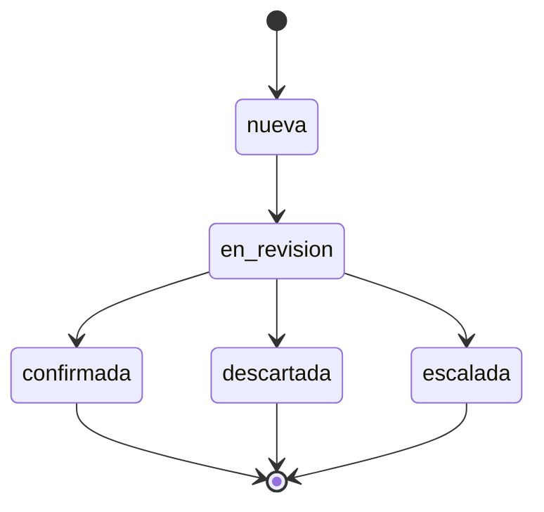

# 06 · Plataforma

Los contratos que las cuatro personas comparten, el árbol del repo, los comandos y las
modalidades de arranque.

> **Por qué este documento existe.** Los contratos de datos también están en
> `CLAUDE.md`, pero `CLAUDE.md` está en `.gitignore`: no viaja en el repo y nadie más
> lo recibe. **Este es el único lugar versionado donde el equipo puede leer los
> contratos.** Si algo de aquí cambia, cambia para los cuatro.

Cada contrato de este documento tiene una prueba que lo sostiene. La columna "prueba"
dice cuál. Un contrato sin prueba es una intención.

---

## 1. Contratos de datos

| Contrato | Decisión | Prueba |
|---|---|---|
| Dinero | `monto_crc`, entero de 64 bits, colones enteros. Nunca flotante. Campo `moneda: "CRC"` desde el día 1 | `prueba_modelos_dominio.py`, `prueba_validadores_mongo.py` |
| Fechas | Siempre ISODate en UTC. El portal formatea a hora de Costa Rica al presentar. Única excepción: `indicadores_diarios.fecha`, texto `YYYY-MM-DD` | `prueba_modelos_dominio.py` |
| Identificadores | Cadenas legibles del `scripts/practica1/CONTRATO-IDS.md` (`CLI-001`, `TXN-001`), nunca ObjectId | `prueba_modelos_dominio.py` |
| Versión de esquema | `esquema_version`, entero, en **todo** documento desde el primero | `prueba_modelos_dominio.py` |
| Nombres | snake_case en español, un solo estilo. Prohibidos `id`, `type` y `class` como nombre de campo | `prueba_modelos_dominio.py` |
| Estados de alerta | `nueva` → `en_revision` → `confirmada` / `descartada` / `escalada` | `prueba_maquina_estados.py` |
| Colecciones | 11 de dominio + 2 de operación = 13 | `prueba_modelos_dominio.py` |

Los 11 modelos Pydantic están en `app/modelos/`, agrupados igual que los scripts de la
Práctica 1 para que cada quien encuentre los suyos donde tiene su script:

| Archivo | Colecciones | Script hermano |
|---|---|---|
| `identidad.py` | `clientes`, `cuentas`, `perfiles_comportamiento` | `a-identidad.js` |
| `transaccional.py` | `transacciones`, `reglas_deteccion`, `listas_riesgo` | `b-transaccional.js` |
| `alertas.py` | `agentes`, `alertas`, `casos` | `c-alertas.js` |
| `cierre.py` | `notificaciones`, `indicadores_diarios` | `d-cierre.js` |

### 1.1 Dinero: "entero de 64 bits" no lo da el modelo

Esto es lo que más fácil se rompe, y romperlo no da error hasta mucho después.

El modelo Pydantic garantiza que `monto_crc` es un entero (`strict=True`, así que
`280000.0` es un error de validación y no una conversión silenciosa). **Lo que el
modelo no puede garantizar es el tipo BSON con el que se guarda:**

| Cómo se escribe | Qué queda en Mongo | Sirve |
|---|---|---|
| `280000` en mongosh | `double` | **No** |
| `280000` como `int` de Python | `int32` (cabe en 32 bits) | **No** |
| `NumberLong(280000)` en mongosh | `long` | Sí |
| `bson.Int64(280000)` en Python | `long` | Sí |

Los validadores declaran `bsonType: "long"`, así que un `int32` **se rechaza**. La
conversión la hace `app/repos/carga_demo.py` al escribir: todo campo que termine en
`_crc` se envuelve en `Int64`. La prueba
`prueba_el_dinero_como_entero_de_32_bits_se_rechaza` verifica las dos mitades: que el
entero pelado se rechaza y que envuelto pasa.

Campos de dinero actuales: `transacciones.monto_crc`, `alertas.monto_crc`,
`perfiles_comportamiento.promedio_crc` y `.maximo_crc`. Un promedio también es dinero:
va redondeado a colón entero, porque SINPE Móvil no opera céntimos.

### 1.2 Fechas

Una fecha sin zona es ambigua: 22:47 en San José y 22:47 en UTC son dos instantes
distintos con seis horas de diferencia, y la regla de horario habitual (R-05) depende
de la hora. Por eso el modelo **rechaza** un `datetime` sin `tzinfo` y normaliza
cualquier otro a UTC.

El cliente de Mongo se crea con `tz_aware=True`; sin eso, una fecha que se escribió en
UTC vuelve sin zona y queda lista para que alguien la interprete como hora local.

Dos excepciones, las dos declaradas:

- `indicadores_diarios.fecha`: texto `YYYY-MM-DD`. Un indicador es de un día
  calendario de Costa Rica, no de un instante.
- `perfiles_comportamiento.horario_habitual`: `{inicio: "07:00", fin: "19:00"}` en hora
  local. "Opera de 7 a 7" es una afirmación sobre el día del cliente.

### 1.3 Identificadores

| Prefijo | Colección | Ejemplo |
|---|---|---|
| `CLI` | `clientes` | `CLI-001` |
| `CTA` | `cuentas` | `CTA-001` |
| `TXN` | `transacciones` | `TXN-001` |
| `REG` | `reglas_deteccion` | `REG-001` |
| `RSK` | `listas_riesgo` | `RSK-001` |
| `AGT` | `agentes` | `AGT-001` |
| `ALR` | `alertas` | `ALR-001` |
| `CAS` | `casos` | `CAS-001` |
| `NOT` | `notificaciones` | `NOT-001` |

Los tipos del modelo llevan el patrón, así que un `CLI-001` donde va un `TXN-001` es un
error de validación y no una referencia rota que aparece tres semanas después.

**Dos colecciones no llevan prefijo, y es a propósito.** Son las materializadas, y usan
su clave natural para que el `$merge` que las produce sea idempotente sin trabajo extra:

- `perfiles_comportamiento._id` = el `cliente_id` (`CLI-001`). Un perfil por cliente.
- `indicadores_diarios._id` = la fecha (`2026-09-24`). Un documento por día. El
  documento lleva la fecha **dos veces**, como `_id` y como `fecha`: el `_id` para la
  idempotencia y el campo `fecha` porque es el que declara el validador.

Una cuenta mula **no** tiene documento en `cuentas`: viaja como número de cuenta dentro
de `transacciones.cuenta_destino` y, si se identifica, como entrada en `listas_riesgo`.

### 1.4 Máquina de estados de la alerta



| Desde | Puede ir a |
|---|---|
| `nueva` | `en_revision` |
| `en_revision` | `confirmada`, `descartada`, `escalada` |
| `confirmada`, `descartada`, `escalada` | nada: son terminales |

Está en `app/modelos/estados.py`, y **solo el arquitecto la cambia**: cambiarla es
cambiar `TRANSICIONES` y su prueba en el mismo commit. H-14 tiene que llamar
`exigir_transicion(origen, destino)` antes de escribir el estado nuevo.

Tres cosas que la tabla decide y conviene tener claras:

- **No existe `nueva → confirmada`.** El agente toma la alerta antes de resolverla, así
  el historial siempre registra quién la tomó. `prueba_todo_lo_demas_se_rechaza`
  recorre los 25 pares posibles y exige que los 21 que no están en la tabla fallen.
- **Los terminales no tienen salida.** Reabrir es crear un caso (colección `casos`), no
  retroceder la alerta, para que el historial no mienta.
- **No existe el estado `resuelta`** que menciona alguna versión vieja de
  `docs/01-vision-y-alcance.md`. Manda esta tabla.

### 1.5 Severidad, y dónde viven los números

`MEDIA`, `ALTA`, `CRITICA`, en mayúscula. **No hay `BAJA`**: si el puntaje no supera el
umbral no se crea alerta (UC-02), así que una alerta de severidad baja no puede existir.

**Los cortes de puntaje NO están en el código ni en el YAML.** Viven en
`politica_deteccion`, para que cambiar un umbral no requiera desplegar. Se lee con
`db.politica_deteccion.findOne({vigente: true})`, y **esta es la forma real del
documento**, no una parecida:

```js
{
  _id: "POL-001",
  descripcion: "Cortes de severidad y umbral de creacion de alerta",
  vigente: true,
  version: 1,                 // version de la politica, distinta de esquema_version
  umbral_alerta: 35,          // bajo esto no se crea alerta (40 antes de la calibracion, docs/08-calibracion.md)
  puntaje_maximo: 100,
  cortes_severidad: [         // ARREGLO de objetos, no un objeto
    { severidad: "MEDIA",   puntaje_minimo: 35, puntaje_maximo: 54 },
    { severidad: "ALTA",    puntaje_minimo: 55, puntaje_maximo: 69 },
    { severidad: "CRITICA", puntaje_minimo: 70, puntaje_maximo: 100 }
  ],
  notificacion: { severidad_minima: "CRITICA", ventana_agrupacion_minutos: 5 },
  esquema_version: 1,
  vigente_desde: ISODate("2026-09-01T00:00:00Z")
}
```

Los pesos de las 6 reglas suman más de 100, así que el puntaje se calcula como
`min(suma, puntaje_maximo)`. El modelo es `PoliticaDeteccion` (H-08, en
`app/deteccion/evaluador.py`) y **se lee en un solo lugar** (T-19):
`leer_politica_vigente` en `app/repos/reglas.py`, que usan la API de reglas y D1.
`pruebas/arquitectura/prueba_politica_unica.py` impide una segunda lectura.

### 1.6 La alerta lleva copia de los campos de despliegue

La fila del panel necesita cliente, cuentas y monto para que el agente decida sin abrir
el detalle. Esos campos van **copiados dentro de la alerta** al momento de crearse, no
resueltos con `$lookup` en cada página:

`cuenta_origen`, `cuenta_destino`, `monto_crc`, `moneda`, `cliente_nombre`.

Dos razones, y ninguna es nueva: "nada se recalcula dentro de una petición HTTP" es una
regla de oro de `docs/04-arquitectura.md`, y es el mismo principio por el que las reglas
disparadas van embebidas: la alerta debe poder explicarse dentro de un año, y para eso
el monto que se vio al crearla no puede depender de que la transacción siga igual. A D1
no le cuesta una consulta extra, porque cuando escribe la alerta ya tiene la transacción
en la mano.

> **Ojo con un mismo nombre que significa dos cosas.** En `transacciones`,
> `cuenta_origen` es el identificador `CTA-001`. En `alertas`, `cuenta_origen` es el
> **número SINPE** (`8712-4455`), porque es un campo para mostrar y el agente lee el
> número, no una llave interna. Está así en el validador y en el modelo.

### 1.7 `reglas_disparadas`: v1 referencias, v2 copia embebida (H-26)

`alertas` es la primera colección con dos versiones de esquema (decisiones D-01, D-12,
D-14). La versión es **por colección**: las demás siguen en `esquema_version: 1`.

| | `reglas_disparadas` | `politica` | Dónde queda la versión de cada regla |
|---|---|---|---|
| v1 | `["REG-001", "REG-002", "REG-003"]` | no existe | solo como texto en `historial[0].nota` |
| v2 | `[{regla_id, codigo, version, peso, explicacion}]` | `{politica_id, version}` | en el dato |

- **D1 escribe v2** con lo que ya produce el evaluador (`ReglaDisparada`): la alerta se
  explica sola dentro de un año aunque la regla cambie.
- **Lectura dual.** `Alerta` (en `app/modelos/alertas.py`) lee las dos; `esquema_version`
  decide qué forma es válida, y una mezcla se rechaza en el modelo y en el validador
  (`oneOf` del bloque de `alertas` en `01-colecciones.js`). `alerta.regla_ids` sirve
  igual en v1 y v2; `alerta.reglas_aplicadas` trae la copia embebida (vacía en v1).
- **Migración** `scripts/migraciones/001-alertas-v1-a-v2.js`, con `python tareas.py
  migrar`. Reejecutable e idempotente: imprime cuántas migró y cuántas ya estaban en v2.
  La versión sale de la nota de D1 y, si no la dice, de la que regía en
  `fecha_creacion` según `versiones_anteriores` de la regla (H-16). La explicación se
  reconstruye desde la regla **en esa versión**; si esa versión ya no existe queda
  `"no disponible: regla editada"` y se cuenta. La `ALR-001` sembrada queda en v1 a
  propósito: es lo que la migración demuestra.
- **D-15.** Re-sembrar (`python tareas.py datos-demo`) borra la historia de versiones
  de las reglas; el comando lo avisa.

### 1.8 El historial embebido empieza cuando nace la alerta

`alertas.historial` tiene **al menos una entrada siempre**: la primera es la creación, y
la escribe el motor con `agente_id: null`, porque no la hizo una persona. Los campos son
`accion`, `agente_id`, `fecha` y `nota` (no `agente` ni `ts`, como decía el andamio de la
Práctica 1). H-14 **agrega** a esta lista, nunca la sobrescribe.

### 1.9 Las 13 colecciones

11 de dominio (Práctica 1) más 2 de operación:

| Colección | Qué es |
|---|---|
| `politica_deteccion` | Cortes de severidad y umbral de creación. Por esto los umbrales no están en el YAML |
| `deteccion_estado` | Token de reanudación del change stream, para que H-09 retome donde quedó |

Los nombres se toman de `app/modelos/__init__.py` (`COLECCIONES`, `COLECCION_ALERTAS`,
...) y no se escriben a mano: así un nombre mal escrito es un error de importación y no
una colección vacía que aparece de la nada.

---

## 2. Reglas de arquitectura

Todas verificadas por `pruebas/arquitectura/prueba_capas.py`, que recorre el árbol con
el módulo `ast`. No necesita Mongo ni levantar la aplicación.

| Regla | Por qué |
|---|---|
| `app/deteccion/` no importa `app/api/` | El motor es headless. Si importa la capa HTTP, deja de poder probarse sin levantar un servidor |
| Ninguna consulta a Mongo fuera de `app/repos/` | Para que "qué consultas hace este sistema" se pueda responder mirando una carpeta, y afinar un índice no sea una cacería |
| Un solo cliente de Mongo por proceso, creado en el lifespan | Uno por petición agota los sockets del servidor |
| La URI solo en `config/centinela.yml` | Una URI en el código es un ambiente hundido en el código |
| Solo `app/nucleo/config.py` lee entorno o YAML | Si cada módulo lee `os.environ`, la precedencia deja de ser un contrato |
| El driver es `pymongo.AsyncMongoClient` | Motor está deprecado, fin de vida mayo 2026. Por eso el paquete es `app/deteccion/` y no `app/motor/` |
| Sin emojis en ningún lado | Regla del repo, y la prueba la verifica por rango Unicode |

`app/deteccion/` todavía no existe: la prueba **pasa en vacío** a propósito, para que la
regla ya esté puesta cuando empiece H-09 en vez de llegar después a discutir un import
ya escrito. Hay una contraprueba que verifica que la regla no pasa por no mirar nada.

El ping de `/salud` vive en `app/repos/salud.py` y no en `app/nucleo/db.py`: un ping es
una consulta, y una regla que se incumple el primer día no es una regla.

### Árbol

```
app/
  main.py              FastAPI, lifespan que crea y cierra el cliente de Mongo
  nucleo/
    config.py          clase Ajustes; UNICO lugar que lee entorno o YAML
    db.py              AsyncMongoClient unico; UNICO lugar con la URI
  modelos/             los 11 de dominio, tipos base y maquina de estados
  repos/               UNICO lugar con consultas
  api/
    errores.py         forma estable del error
    esquemas.py        respuestas HTTP
    paginacion.py      acotado de limite
    dependencias.py    inyeccion de ajustes, base y repositorios
    rutas/             salud, alertas
config/centinela.yml   tecnico, sin secretos, sin numeros de negocio
infra/                 docker-compose.yml y .env.ejemplo
pruebas/
  contrato/            configuracion, maquina de estados, modelos, error, OpenAPI, validadores
  unitarias/           paginacion, construccion del filtro
  arquitectura/        las reglas de capas
  dobles/              conjunto de demo y repositorios falsos
tareas.py              lanzador, solo biblioteca estandar
```

---

## 3. Configuración

Precedencia, de mayor a menor. **Verificada por `prueba_configuracion.py`, no a ojo:**

```
entorno  >  config/centinela.local.yml  >  config/centinela.yml
```

El archivo local no se versiona (está en `.gitignore`) y solo necesita las claves que
quiere cambiar: el merge es profundo, así que `app: {pagina_maxima: 25}` no borra el
resto del bloque `app`.

En entorno el prefijo es `CENTINELA_` y el separador de nivel es doble guion bajo:

```
CENTINELA_APP__PAGINA_MAXIMA=25
CENTINELA_MONGO__BASE=antifraude_pruebas
```

**Qué NO va en el YAML:**

- **Secretos.** Van por entorno; el molde está en `infra/.env.ejemplo`.
- **Números de negocio.** Ni umbrales, ni pesos de reglas, ni cortes de severidad: eso
  vive en `politica_deteccion` y en `reglas_deteccion`, en Mongo, para poder cambiarlo
  sin desplegar. Hay dos pruebas que lo vigilan: una recorre las claves del YAML
  buscando palabras de negocio, y la otra es que los bloques de configuración declaran
  `extra="forbid"`, así que **una clave no declarada impide arrancar**. Si alguien pone
  `app.umbral_alerta`, la aplicación no levanta.

`app.pagina_maxima` y `app.pagina_por_omision` sí van en el YAML: son guardas técnicas
de la capa HTTP, no reglas de negocio.

### La URI, una sola para las dos modalidades

```
mongodb://localhost:27018,localhost:27019,localhost:27020/?replicaSet=rsfraude
```

Funciona igual desde el host y desde un contenedor con
`network_mode: service:mongo1`, y no es casualidad: `scripts/init-replicaset.js` declara
los miembros como `localhost:27018/19/20`, y `mongo1` publica esos tres puertos. Desde
el host se alcanza por los puertos publicados; desde un contenedor que comparte el
espacio de red de `mongo1`, los tres nodos están en su propio `localhost`. Cambiarla por
nombres de servicio de Compose rompe la modalidad de host.

**Usar siempre la cadena completa, nunca un nodo suelto.** `mongo1` no siempre es el
primario: después de una elección puede ser `mongo2`, y entonces
`mongosh --port 27018` contesta `not primary`. Con la URI completa, el driver descubre
el primario solo.

---

## 4. Arranque

### El clúster es uno solo, y hay que saber quién manda

Un solo replica set compartido es lo correcto y es lo que el equipo quiere. Lo que no
puede quedar implícito es esto:

- **El proyecto de Compose tiene nombre explícito** (`name: centinela` en
  `infra/docker-compose.yml`). Sin esa clave, el proyecto depende de la ruta donde esté
  clonado el repo; con ella, dos personas con el repo en carpetas distintas obtienen el
  mismo proyecto.

  Lo que esa clave **no** hace es evitar que dos checkouts del repo se peleen los
  contenedores: comparten el archivo, así que antes derivaban todos el mismo nombre y
  ahora usan todos `centinela` — la misma colisión con otro nombre. Lo que la evita es
  la regla de abajo.

- **Los volúmenes son normales: Compose los crea y los administra.** No llevan
  `external: true` ni `name:`, y eso es una decisión con historia. Un volumen declarado
  `external` Compose **no lo crea**: asume que existe, y si no existe `up` falla con
  `external volume "..." not found` antes de arrancar un solo contenedor. En la máquina
  de quien clona el repo por primera vez, en un corredor de CI o en la del profesor el
  día de la defensa, eso es un arranque roto en el primer paso.

  Se habían fijado para conservar una siembra existente, y la cuenta no cerraba: **la
  base entera se regenera en segundos** (`01 → 02 → 03` más los documentos de dominio,
  todo idempotente). Perder un volumen viejo no cuesta nada; que un compañero no pueda
  arrancar cuesta el proyecto. `prueba_infraestructura.py` vigila que no vuelvan.

  Corolario práctico: **verificar el arranque en una máquina que ya tiene los volúmenes
  de corridas anteriores no prueba que funcione en una limpia.** Para probarlo de verdad
  hay que borrar los volúmenes (`python tareas.py abajo --borrar-datos`) o levantar una
  copia aislada del compose con otro nombre de proyecto.
- **Solo el checkout principal corre `docker compose`.** Esta es la regla operativa, y
  no es burocracia: mientras alguna rama todavía tenga el `docker-compose.yml` viejo sin
  la clave `name:`, desde ahí Compose usa el proyecto `infra` con los mismos nombres de
  contenedor, y los dos proyectos se pelean los mismos `fraude-mongo1/2/3`. El síntoma
  es que los contenedores se caen y vuelven a subir solos mientras alguien más verifica.

  Quien solo necesite **ejecutar** algo contra la base no necesita Compose para nada:

  ```
  mongosh "mongodb://localhost:27018,localhost:27019,localhost:27020/?replicaSet=rsfraude" --file /ruta/absoluta/script.js
  docker exec fraude-mongo1 mongosh --port 27018 --quiet --eval "..."
  ```

  **Nunca `docker compose up` desde un worktree.**
- **Los scripts se corren desde el host, con ruta absoluta del host y la URI completa**,
  no con `docker compose exec --file`. El montaje de `/scripts` apunta a la carpeta de
  quien recreó los contenedores de último; desde otro checkout, `--file /scripts/x.js`
  lee el archivo de otra persona o no lo encuentra. `tareas.py` ya lo hace así:

```
mongosh "mongodb://localhost:27018,localhost:27019,localhost:27020/?replicaSet=rsfraude" --file /ruta/absoluta/del/host/scripts/semilla/01-colecciones.js
```

La única excepción es `rs.initiate()`: antes de iniciar el conjunto no hay replica set
que descubrir, así que ese script se corre con conexión directa
(`mongodb://localhost:27018/?directConnection=true`). `tareas.py` también lo hace solo.

### Modalidad A: Mongo en Compose, Python en el host — **probada**

```
python tareas.py instalar     # uv sync: interprete 3.13 y versiones del lock
python tareas.py arriba       # levanta los 3 nodos, inicia el replica set y espera al primario
python tareas.py datos-demo   # siembra estructura, catalogos y el conjunto de demo
python tareas.py dev          # uvicorn con recarga
```

`arriba` espera a que la elección termine antes de reportar. La elección tarda entre 5 y
15 segundos, y sin la espera el comando terminaba mostrando tres `SECONDARY`, que parece
un error y no lo es.

### Modalidad B: todo en Compose — **probada**

```
python tareas.py arriba --con-app   # los 3 nodos mas la API, todo en Compose
python tareas.py datos-demo
```

Para la demo y la defensa. El navegador entra por el puerto publicado, igual que en la
modalidad A, y **la URI del YAML no cambia ni una letra** entre las dos.

Eso último no sale gratis, y conviene entender por qué funciona. El servicio `app` entra
al espacio de red de `mongo1` con `network_mode: service:mongo1`, exactamente como ya
hacen `mongo2` y `mongo3`. Por eso **el puerto 8000 se publica en la lista `ports` de
`mongo1`, no en la de `app`**: un servicio que toma prestada la pila de red de otro no
puede declarar puertos propios, porque no tiene pila propia. El resultado es que
`localhost:27018` y `localhost:8000` significan lo mismo desde el host, desde `mongo1` y
desde el contenedor de la API.

La alternativa —reiniciar el replica set anunciando nombres de Docker— rompería el acceso
desde el host y obligaría a editar el archivo `hosts` en Windows, que es justo lo que esta
topología existe para evitar.

`app` lleva `profiles: ["app"]`, así que un `docker compose up` sin argumentos sigue
levantando solo el replica set. Nadie se encuentra un contenedor nuevo sin pedirlo.

---

## 5. Comandos

| Comando | Qué hace |
|---|---|
| `python tareas.py instalar` | `uv sync` con las versiones exactas del lock |
| `python tareas.py arriba` | Levanta el replica set, lo inicializa y espera al primario |
| `python tareas.py arriba --con-app` | Lo mismo, más la API dentro de Compose (modalidad B) |
| `python tareas.py abajo [--borrar-datos]` | Lo apaga. Con la bandera, borra también los volúmenes |
| `python tareas.py estado` | Estado de los tres nodos |
| `python tareas.py dev` | La API en el host, con recarga |
| `python tareas.py datos-demo` | Siembra y carga el conjunto de demo |
| `python tareas.py pruebas [--tipo ...] [--sin-mongo]` | Las pruebas, por tipo |
| `python tareas.py verificar` | Instala y prueba: lo que se corre antes de pedir revisión |

`tareas.py` usa **solo biblioteca estándar** (`argparse` y `subprocess`), a propósito:
el equipo trabaja en macOS y en Windows, make no viene en Windows, y un `.sh` habría
excluido a media clase. Cualquier comando acepta `--dry-run`.

### Orden de la siembra: 01 → 02 → 03, y no otro

`datos-demo` corre, en este orden:

1. `scripts/semilla/01-colecciones.js` — colecciones con sus validadores
2. `scripts/semilla/02-indices.js` — índices con nombre
3. `scripts/semilla/03-catalogos.js` — catálogo de reglas y política de severidad
4. Los documentos de dominio del caso documentado

**El orden es obligatorio:** `01` hace drop de las colecciones para recrearlas con su
validador, así que corrido después del `03` se lleva el catálogo que el `03` acaba de
escribir. Ya pasó en vivo.

El catálogo de reglas **no** está en el cargador de Python: definirlo en dos lugares es
garantizar que se separen. Los pesos de las reglas son de quien las diseña (H-07).

### CI: una prueba de Mongo saltada no cuenta como verde

`.github/workflows/ci.yml` corre en cada PR hacia `dev` o `main` y en cada push a `dev`:
ruff, `pytest -m "not mongo"` y `pytest -m mongo` contra un replica set de un nodo. Antes
del paso de Mongo siembra la base `antifraude` con `01 → 02 → 03`, en el mismo orden que
`datos-demo`, y corre ese paso con `CENTINELA_EXIGIR_MONGO=1`. Con esa variable, las dos
razones por las que una prueba de Mongo se saltaba (el replica set no responde, o la base
no tiene validadores) son **fallas**. La primera corrida del CI salió verde con 26 pruebas
saltadas; eso ya no puede pasar. En local, sin la variable, siguen siendo saltos, y quien
quiera la misma exigencia corre `CENTINELA_EXIGIR_MONGO=1 uv run pytest -m mongo -rs`.
`pruebas/unitarias/prueba_modo_estricto_mongo.py` verifica las dos mitades. El job tiene
permiso de solo lectura, cancela la corrida anterior de la misma rama y fija las acciones
por SHA. La auditoría de dependencias (`pip-audit`) no es compuerta todavía: hoy reporta
vulnerabilidades en `certifi`, `dnspython` y `pymongo`, que se cierran subiendo versiones
en el lock.

Ninguna prueba `mongo` lee ni escribe la base de trabajo `antifraude`: usan `antifraude_pruebas*`, y lo que necesitan de la semilla (validadores, catalogo, ALR-001 en v1) lo carga `conftest.py` en `antifraude_pruebas_semilla` desde `scripts/semilla/`. Resultado igual sobre una base recien sembrada, migrada o con datos del generador (T-34).

---

## 6. Contrato HTTP

Publicado como OpenAPI en `/openapi.json`, navegable en `/docs`.

### La forma del error es una sola

```json
{
  "error": {
    "codigo": "parametros_invalidos",
    "mensaje": "La peticion tiene parametros invalidos",
    "detalles": [{ "campo": "limite", "mensaje": "Input should be greater than or equal to 1" }]
  }
}
```

Un 404, un 422 de validación y un 500 inesperado tienen **la misma forma**. No se usa el
`{"detail": ...}` que trae FastAPI porque `detail` cambia de tipo según el caso (texto en
un `HTTPException`, lista de objetos en un error de validación), y entonces el portal
tiene que ramificar por tipo para mostrar un mensaje. Con esto, el portal lee
`error.mensaje` y, si quiere detalle, recorre `error.detalles`.

`codigo` es para el programa y es estable; `mensaje` es para la persona y puede cambiar
de redacción sin romper a nadie. El vocabulario de códigos es cerrado:
`parametros_invalidos`, `no_encontrado`, `conflicto`, `transicion_invalida`,
`base_no_disponible`, `error_interno`.

Una transición fuera de la máquina de estados sale como **409**, no 422: la petición es
válida, lo que no se puede es aplicarla al estado actual del recurso.

### `POST /api/v1/alertas/{alerta_id}/transiciones` (H-14)

Cuerpo `{destino, agente_id, nota?, estado_esperado?}`; responde `{alerta, caso_id}`.
POST y no PATCH del estado: una transición es una entrada que se **agrega** al
historial, no un campo que se pisa.

| Caso | Respuesta |
|---|---|
| Par fuera de `TRANSICIONES` | 409 `transicion_invalida`, con el estado actual en `detalles` |
| Otro agente la tomó, o cambió entre la lectura y la escritura | 409 `conflicto`, sin escribir |
| `estado_esperado` no coincide | 409 `conflicto`, sin escribir |
| `en_revision -> X` pedido por quien no la tomó | 409 `conflicto` |
| No existe | 404 `no_encontrado` |

La escritura es `$set` del estado más `$push` al historial, filtrada por el estado y el
agente leídos (`planear_transicion` en `app/repos/alertas.py`, pura). Escalar crea el
caso `CAS-xxx` (derivado de `ALR-xxx`) y mueve la alerta en **una transacción
multi-documento**: el caso se inserta primero y, si la alerta ya no coincide o el caso
existe, se deshacen las dos escrituras.

El esquema publicado dice la verdad: `prueba_openapi.py` verifica que el 422 documentado
sea `RespuestaError` y no el `HTTPValidationError` que FastAPI documenta por omisión.

### `/salud` y `/estado` son rutas distintas

| Ruta | Responde | Estado |
|---|---|---|
| `GET /salud` | El proceso está vivo y la base contesta. Trae el nombre del replica set y si el nodo es primario | Existe |
| `GET /estado` | El sistema está **haciendo su trabajo**: qué tareas corren o están caídas, último evento procesado, retraso, último error | Existe |

Están separadas porque un proceso vivo con el motor caído es justo el escenario que un
solo endpoint de salud esconde: responde 200 mientras no se detecta un solo fraude.

`/estado` se apoya en `app/supervision/`, que registra cada tarea de fondo y la vigila.
Una tarea que muere no se pierde en silencio: deja el sistema en `degradado` y su último
error queda a la vista. Los disparadores D1, D2 y D3 todavía no existen —son H-09, H-11
y H-22— pero el andamio que los va a vigilar sí, y se prueba matando una tarea a mano.
`/estado` nombra la historia de cada uno, así que la ruta dice quién lo va a construir.

**T-18.** Una tarea viva puede estar `degradada`: D1 sin reglas activas late, pero no
puede generar una sola alerta. D1 mira el catálogo al abrir el change stream y en cada
transacción; mientras esté vacío, su fila trae `advertencia` con el motivo y el sistema
queda `degradado`. Se limpia sola cuando vuelve a haber reglas.

`/salud` responde 200 aunque Mongo no conteste, con `mongo_conectado: false` y el
motivo en `detalle`: la ruta cumplió su trabajo respondiendo, y quien la consulta
necesita el diagnóstico.

### `GET /api/v1/alertas`

| Parámetro | Tipo | Nota |
|---|---|---|
| `estado` | enum de la máquina | Filtro exacto |
| `severidad` | `MEDIA`, `ALTA`, `CRITICA` | Filtro exacto |
| `desde`, `hasta` | fecha con zona | Rango sobre `fecha_creacion`, inclusive en los dos extremos. Sin zona se interpreta como UTC |
| `limite` | entero ≥ 1 | **Acotado por `app.pagina_maxima`** |
| `desplazamiento` | entero ≥ 0 | |

Los filtros son combinables. La respuesta:

```json
{ "total": 3, "limite": 50, "desplazamiento": 0, "elementos": [ ... ] }
```

`total` es el total que cumple el filtro, no el tamaño de la página: el agente necesita
saber cuántas alertas tiene en su cola. `limite` es el que **de verdad se aplicó** tras
acotarlo, que puede ser menor que el pedido; va en la respuesta para que el cliente lo
note.

El orden es `fecha_creacion` descendente con `_id` como desempate. Sin el desempate,
paginar puede repetir un documento o saltárselo.

### El canal SSE: `GET /api/v1/alertas/flujo`

Es cómo la alerta nueva llega al panel sin que el agente recargue. Y la decisión de
fondo, la que hay que no deshacer por error: **no hay bus en memoria.**

El canal observa la colección `alertas` con un Change Stream. La fuente es **lo
persistido**, no un objeto en memoria, así que da igual quién escribió la alerta:
`datos-demo`, D1 dentro del proceso, o el detector corrido por línea de comandos. Todos
aparecen en el panel por el mismo camino.

El diseño anterior tenía un bus en memoria, y tenía tres agujeros: se perdía al
reiniciar, no definía de dónde recuperar lo perdido, y **las alertas de demo insertadas
directo en Mongo nunca habrían aparecido en el panel.** Quitar el bus es menos
maquinaria, no más.

| Pieza | Decisión |
|---|---|
| Identificador del evento | El token de reanudación del Change Stream. Es lo que el navegador devuelve en `Last-Event-ID` |
| Reconexión | Se reabre con `resumeAfter` y ese token, **con el mismo pipeline y las mismas opciones**: cambiarlos al reanudar da comportamiento impredecible |
| Token inservible | Si el oplog ya rodó, Mongo responde `ChangeStreamHistoryLost`. El canal emite un evento `resincronizar` y el panel vuelve a pedir su cola a `/api/v1/alertas` |
| Formato | `ServerSentEvent(raw_data=...)`, **no `data`**: el panel inserta HTML con HTMX, y `data` se serializa como JSON, así que llegaría entrecomillado. Son mutuamente excluyentes |
| Cliente | htmx más la extensión `htmx-ext-sse`, vendorizada como archivo aparte en `app/estaticos/`. **No viene en el núcleo de htmx**, y agrega su propia reconexión con espera progresiva sobre la del navegador |

**Lo que se promete, dicho con precisión.** `Last-Event-ID` lo manda el navegador solo,
pero recuperar lo perdido lo tiene que implementar el servidor: no es automático. Y lo
que este canal promete es **reconstruir el estado de la cola**, no reproducir cada evento
histórico. Para un panel de trabajo eso es lo correcto: el agente quiere su cola como
está ahora, no una repetición de cada transición. Reproducir todo evento exigiría un
registro durable aparte, que ninguna historia ni ningún rubro pide.

**Límite conocido:** un Change Stream por conexión. Con un puñado de agentes está bien;
escalar a decenas pediría un flujo compartido con reparto entre conexiones. Está
documentado, no construido.

### Reglas: `/api/v1/reglas` (H-16)

Umbrales, pesos y parámetros se cambian por la API, sin tocar código ni la base a mano.
Sin autenticación todavía: el rol de supervisor es H-25.

| Ruta | Hace | Errores |
|---|---|---|
| `GET /api/v1/reglas[?activa=]` | Catálogo ordenado por `codigo`, cada regla con `versiones_anteriores` | 422 |
| `GET /api/v1/reglas/{regla_id}` | Una regla con su historia | 404, 422 |
| `GET /api/v1/reglas/tipos` | Tipos que el motor sabe evaluar, qué significa su `umbral` y qué `parametros` lee | |
| `POST /api/v1/reglas` | Alta en `version: 1`; el servidor asigna el siguiente `REG-NNN` | 409 código repetido, 422 |
| `PATCH /api/v1/reglas/{regla_id}` | Edita `descripcion`, `umbral`, `parametros`, `peso`, `activa` | 404, 409, 422 |
| `POST /api/v1/reglas/simular` | Evalúa una transacción sin escribir nada | 409 sin política, 422 |

**Versionado.** Cada edición sube `version` en uno y empuja la versión anterior completa,
con `reemplazada_en`, a `versiones_anteriores` del mismo documento. No hay colección
nueva (el contrato es de 13): las reglas se editan poco y se leen con su historia. Una
alerta guarda `regla_id` y `version`, así que se sigue explicando aunque la regla cambie.

**Concurrencia optimista.** La edición es un solo `find_one_and_update` filtrado por la
versión leída. Si otro la editó en el medio no se escribe nada y sale 409. El cliente
puede mandar `version_esperada` para que el 409 salga aunque la carrera haya sido antes
de su lectura (dos supervisores con la misma pantalla abierta).

**Desactivar es `PATCH {"activa": false}`**, no una ruta aparte: es una edición más, con
el mismo versionado y la misma concurrencia, y reactivar es simétrico.

**Lo que no entra.** Un `tipo` fuera de `app.deteccion.evaluador.EVALUADORES` (422, el
mensaje lista los soportados); `parametros` que el tipo no lee o le faltan (un
`ventana_minuto` mal escrito haría que la regla deje de evaluarse en silencio); dinero
en `parametros` que no sea entero; `tipo` o `codigo` en un `PATCH` (campo desconocido,
422). Campos iguales a lo guardado no crean versión.

**Simular.** El cuerpo trae `transaccion` y `contexto` (`ContextoEvaluacion`, lo que H-09
precalcula), y opcionalmente `reglas` y `politica`. Las reglas propuestas se superponen
al catálogo de la base por `_id`, así que para probar un umbral se manda solo esa regla.
La respuesta es la `Evaluacion` completa: puntaje, severidad, disparadas con su
explicación y no evaluadas con su motivo. Con el catálogo sembrado, TXN-001 da 75
CRITICA; con R-01 en umbral 20 da 40 MEDIA.

```bash
curl -X PATCH localhost:8000/api/v1/reglas/REG-001 \
  -H 'content-type: application/json' -d '{"umbral": 20, "version_esperada": 1}'
```

---

## 7. Datos de demo

`pruebas/dobles/datos_demo.py`. Pequeño, reproducible y **sin un solo dato inventado**:
todo sale de `CONTRATO-IDS.md` y del caso de `docs/02-casos-de-uso.md` — María Rodríguez,
cuenta `8712-4455`, `TXN-001` de ₡280.000 a las 22:47 hacia la mula `6033-9001`,
`ALR-001` con puntaje 75 resuelta por José Solís, la cadena `RSK-001..004`.

Reproducible sin semilla aleatoria porque son literales: dos corridas dejan la base
idéntica. No usa Faker; el generador con Faker es H-03/H-04/H-05 y es otra cosa.

Escribe con `replace_one(upsert=True)` por documento y **no borra nada más**. Una
versión anterior hacía `delete_many({})` por colección, lo que habría borrado la siembra
de la Práctica 1: un comando de demo no puede destruir el entregable de otra persona.
Tampoco hace `dropDatabase()`, que se llevaría índices y validadores.

Vive en `pruebas/dobles/` porque es un doble de prueba que además sirve de demo, y la
dirección de las dependencias es **pruebas → app**, nunca al revés.

---

## 7b. Generador de datos sintéticos (H-03, H-04, H-05)

CLI aparte, nunca dentro del proceso web: `uv run python -m app.generador --clientes 200
--transacciones 5000`. Los valores por omisión salen del bloque `generador` de
`config/centinela.yml` (`AjustesGenerador`, `extra="forbid"`); cada bandera
(`--clientes --transacciones --ritmo --semilla --proporcion`) los cambia para esa corrida.
Son parámetros de simulación, no reglas de detección: las reglas siguen en Mongo.

- **Tope por entidad.** En Costa Rica el tope de SINPE Móvil depende del banco (100.000 a
  300.000 colones). La lista `generador.entidades` (`nombre`, `tope_crc`, mínimo 4) es la
  fuente: cada cuenta lleva su `entidad` y ninguna transacción, legítima o de fraude,
  supera el tope de la entidad de su cuenta de origen. Agregar una entidad no toca código (los nombres del YAML son genéricos, "Entidad A" a "Entidad E").
- **Determinista.** Misma semilla, mismos datos; la historia termina en `fecha_fin` (no usa
  el reloj). Escribe con `insert_many` por lotes (`tamano_lote`) y, con `ritmo_por_segundo`
  mayor que 0, reparte la inserción en el tiempo para ver las alertas aparecer en vivo.
- **Perfiles coherentes.** Se calculan de lo que se generó (promedio, máximo, cantidad) y solo
  de lo legítimo; el máximo nunca pasa del tope y lo legítimo no supera 5 veces el promedio.
- **Fraude.** Menos del 2 % (`proporcion_anomalos`, el YAML rechaza 0.02 o más). Tres patrones:
  `monto_atipico_destino_nuevo` (11 a 13 veces el promedio del cliente, no un monto enorme),
  `rafaga_fragmentada` (4 a 6 transferencias cerca del tope en minutos) y `cadena_mulas`
  (victima, 3 o 4 cuentas mula del banco y una salida externa). Cada transacción lleva
  `simulacion: {fraude, patron, episodio}`: etiqueta SOLO para medir (H-10), que el motor
  nunca lee.
- **Mulas reportadas.** `proporcion_mulas_reportadas` (0 a 1, por omisión 0,5) mete esa fracción de las mulas que reciben en una cadena en `listas_riesgo` (`RSK-0001`..., vigente, con `fecha_reporte` un día antes de su primera transacción recibida), para que R-07 tenga contra qué disparar.
- **Idempotente.** Identificadores de 4 o más dígitos (`CLI-0001`, `TXN-000001`) y la etiqueta
  `simulacion` permiten borrar la corrida anterior sin tocar los datos de la Práctica 1.
- **Identificadores.** Los validadores aceptan 3 o más dígitos (`[0-9]{3,}`) igual que los modelos.

---

## 8. Divergencias abiertas

Anotadas para que nadie las resuelva dos veces, cada una en distinto sentido.

| Divergencia | Estado |
|---|---|
| Los comentarios de ejemplo de `scripts/practica1/*.js` usan `monto` y `fecha`, sin `moneda` ni `esquema_version`, y montos como literal numérico (que mongosh guarda como `double`) | **Los contratos de este documento son los que valen.** Esos archivos quedaron como referencia interna: la Práctica 1 se entregó fuera del repo, así que no son el entregable calificado. Corregir los comentarios está pendiente de decisión, y no urge |
| `scripts/practica1/CONTRATO-IDS.md` lista tres reglas (`REG-001..003`) | El catálogo real tiene seis: se agregaron `R-07`, `R-09` y `R-11`. La fuente viva es `scripts/semilla/03-catalogos.js` |
| `perfiles_comportamiento.desviacion_crc` está en `CONTRATO-IDS.md` pero no en el validador | El modelo lo declara opcional y no lo escribe hasta que el validador lo acepte |
| `casos.fecha_apertura`, `notificaciones.detalle_error`, `indicadores_diarios.calculado_en`, `reglas_deteccion.version` y `.parametros`: el modelo los declara, el validador todavía no | Opcionales en el modelo. Los campos opcionales no se escriben cuando son nulos, porque los validadores declaran `additionalProperties: false` y una clave nula sería una clave desconocida |
| Hay **12 colecciones**, no las 13 de la sección 1.9 | **Resuelta en H-09**: `01-colecciones.js` (bloque 13) crea `deteccion_estado` con validador; guarda el token de D1 (clase `reanudacion`, escrito después de la alerta) y los eventos que agotaron reintentos (clase `descarte`). Quedan 13 |
| La **reanudación del canal SSE contra Mongo real** no tiene prueba automática | El camino feliz se comprobó a mano contra el clúster de tres nodos: alerta insertada, evento con su token, HTML sin serializar. Lo que falta es provocar `ChangeStreamHistoryLost` de verdad, y eso pide un replica set con `oplogSize` diminuto, un ambiente aparte del suite. Hoy ese camino se cubre con un doble |

Ya resuelta: `docs/04-arquitectura.md` hablaba de React, WebSocket, "motor proceso
aparte" y 11 colecciones. Corregido en H-00B, junto con el glosario y el criterio de
H-17.

---

## 9. Qué falta, y de quién es

H-00A y H-00B están cerradas. Lo que sigue no es de la plataforma:

| Falta | De quién |
|---|---|
| Los disparadores D1 y D2, y la colección `deteccion_estado` | H-09 y H-11 — **B** |
| El disparador D3, que recalcula indicadores | Va con H-22 — **C**. El pipeline y el disparador que lo invoca son una sola unidad de trabajo: repartirlos entre dos personas deja la integración colgando |
| `scripts/procedimientos/` con los recálculos corribles por `mongosh --file` | **A**, y es lo que cubre el rubro 9 de la rúbrica |
| El generador con Faker, a escala de proyecto | H-03 a H-05 — **A** |
| Las plantillas del portal conectadas a Jinja y al canal SSE | H-17 en su segunda mitad — **C** |
| Los endpoints de escritura: resolver una alerta, gestionar reglas | H-14 y H-16 — **D** |

**Dos rubros de la rúbrica siguen sin evidencia**, y valen 6 de 30 puntos: los
disparadores de procesos y los procedimientos almacenados. Los scripts de siembra no
sirven para eso — crean estructura, no reaccionan a cambios ni son rutinas invocables.
La evidencia sale de H-09 y H-11 para el primero, y de `scripts/procedimientos/` para el
segundo.

## Portal conectado (H-17 y T-16)

Paginas HTML en `app/api/rutas/paginas.py`, fuera de `/api/v1`, con Jinja y HTMX
vendorizados (`app/estaticos/PROCEDENCIA.md`). Arrancar con `uvicorn app.main:app` y abrir
`http://localhost:8000/panel`.

| Ruta | Que hace |
|---|---|
| `/panel` | Cola ordenada por severidad y fecha; se mantiene por SSE (`/api/v1/alertas/flujo`). `resincronizar` y una reconexion piden de nuevo `/panel/cola` |
| `/reglas` | Catalogo, edicion con `version_esperada` (409 visible), versiones anteriores, tipos soportados y politica vigente en solo lectura |
| `/detalle/{alerta_id}` | H-18. Transaccion, perfil, cada regla con version, aporte y explicacion (tabla que suma hasta el puntaje, con los cortes de la politica y el alcanzado), politica usada, historial en orden y resolucion: botones solo para lo que permite la maquina de estados, selector de agente (sin autenticacion hasta H-25) y el 409 como mensaje. Una alerta v1 muestra los ids y "alerta v1: migrar con python tareas.py migrar". Resolver usa el mismo handler que `POST /api/v1/alertas/{id}/transiciones`; escalar muestra el caso creado |
| `/detalle`, `/busqueda` | Maqueta estatica dentro de la plantilla base, marcada "en construccion" (H-19 pendiente) |
| `/tablero` (H-20) | Lee `indicadores_diarios` (`app/repos/tablero.py`), suma el periodo (`?dias=`, 1 a 30) contra el anterior y dibuja SVG generado en el servidor. Muestra `calculado_en` en hora CR. Con la coleccion vacia sugiere `python tareas.py indicadores`. `por_agente` y `por_hora` son opcionales en el rollup: si faltan, la pagina lo dice |
| `/red-mulas/{cuenta}` (T-35) | Grafo SVG de `RepoRedMulas`: nodos por nivel, aristas con monto y minutos entre eslabones, y propuestas para `listas_riesgo` (solo lectura). El detalle de alerta enlaza desde la cuenta destino. Rutas en `app/api/rutas/paginas_tablero.py`, registrado antes de `paginas.py` |

La fila del panel es la misma plantilla (`sse/fila_alerta.html`) para la carga inicial y
para cada evento SSE. El formulario de reglas reutiliza el handler de `PATCH
/api/v1/reglas/{id}`. Sin autenticacion hasta H-25: la cabecera lo avisa ("modo local").


## Politica por API y validadores sin re-sembrar (T-20, T-24, T-28)

**Politica (D-16).** `GET /api/v1/politica` devuelve la politica vigente con su historia;
`PATCH /api/v1/politica` edita `umbral_alerta`, `puntaje_maximo` y `cortes_severidad` con el
mismo patron que una regla (H-16): `version` + 1, la anterior completa en
`versiones_anteriores` (con `reemplazada_en`), `version_esperada` y 409, y una sola escritura
filtrada por la version leida. Los cortes se validan contra el resultado final: contiguos, sin
huecos ni solapes, de `umbral_alerta` a `puntaje_maximo`, con severidades validas; si no, 422
con el tramo que falla. D1 relee la politica en cada evento (`leer_politica_vigente`), asi
que el cambio rige en la siguiente evaluacion. Requiere que el validador de
`politica_deteccion` declare `versiones_anteriores` (la prueba
`prueba_el_validador_real_declara_la_historia_de_la_politica` lo vigila).

**Validadores.** `python tareas.py validadores` corre
`scripts/semilla/actualizar-validadores.js`: carga `01-colecciones.js` contra
`antifraude_validadores_tmp`, copia validator, validationLevel y validationAction a
`antifraude` con `collMod` donde difieren (crea la coleccion si falta), y borra la temporal.
No toca documentos. Es la salida cuando un validador viejo produce el codigo 121: la API
responde 409 `conflicto` con esa sugerencia en lugar de un 500. Re-sembrar sigue existiendo,
pero borra todo.

**Generador.** `python tareas.py generar [banderas]` corre `uv run python -m app.generador`
pasando las banderas tal cual. `Cuenta.entidad` y `Transaccion.simulacion` son opcionales
en los modelos (los escribe el generador; el motor nunca lee `simulacion`).

## Inteligencia: efectividad (H-10) y red de mulas (H-23)

Rutas en `app/api/rutas/inteligencia.py`, bajo `/api/v1`.

**Efectividad.** `GET /api/v1/efectividad` y `uv run python -m app.deteccion.efectividad`
(tabla en la terminal) devuelven el mismo reporte. Se corre despues de cada ajuste de
reglas. Cruza `alertas` con la etiqueta oculta `transacciones.simulacion`: es la unica
lectura de esa etiqueta en todo el sistema (`app/repos/efectividad.py`); el motor no la
lee. La unidad es la transaccion etiquetada: detectado = fraude con alerta, perdido =
fraude sin alerta, falso positivo = legitima con alerta. Una alerta cuenta en cualquier
estado (se mide al motor, no al agente). Las alertas sobre transacciones sin etiqueta (demo,
Practica 1) se informan aparte como `alertas_sin_etiqueta`. Precision y exhaustividad son
`null` cuando no hay denominador. Por patron: exhaustividad y episodios con al menos una
alerta. Calculo puro en `app/deteccion/efectividad.py`.

Referencia (generador 200 clientes / 5.000 transacciones, semilla por omision, catalogo
de `03-catalogos.js`, D1 procesando): 60 fraudes, 56 detectados, 4 perdidos, 22 falsos
positivos; precision 71,8 %, exhaustividad 93,3 %. Por patron: `monto_atipico` 19/19,
`rafaga_fragmentada` 27/28, `cadena_mulas` 10/13 (3 de 3 episodios con alerta).

**Red de mulas.** `GET /api/v1/red-mulas/{cuenta}?desde=&ventana_minutos=60&saltos=6`.
`cuenta` es un numero SINPE o un `CTA-...` (404 si el `CTA` no existe). Devuelve `nodos`
(cuenta SINPE, `cuenta_id`, `externa`, `nivel`, `en_lista_riesgo`), `aristas`
(`transaccion_id`, origen, destino, `monto_crc`, fecha, salto, `minutos_desde_anterior`) y
`propuestas_lista_riesgo`: las cuentas que recibieron dinero y no estan vigentes en
`listas_riesgo`. Solo propone; no escribe.

Es un `$graphLookup` sobre `transacciones` (Unidad 10 del curso). Para eso cada
transaccion lleva `sinpe_origen`, el SINPE de su cuenta de origen: el mismo espacio de
valores que `cuenta_destino`. Lo escribe el generador siempre; el validador lo declara
opcional y lo viejo lo recibe con `scripts/migraciones/002-transacciones-sinpe-origen.js`
(`python tareas.py migrar` corre 001 y 002 en orden; reejecutable, la segunda corrida
rellena cero). La agregacion parte de `cuentas` (`$match` por `idx_cuentas_sinpe`) y
hace `$graphLookup` con `connectFromField: cuenta_destino`, `connectToField:
sinpe_origen`, `maxDepth: 5` (6 saltos), `depthField` y `restrictSearchWithMatch` con la
fecha acotada a `[desde, desde + 6 * ventana]`. Cada nivel va por el indice nuevo
`idx_transacciones_sinpe_origen_fecha` (`{sinpe_origen: 1, fecha: 1}`, en
`02-indices.js`). El `explain` de `$graphLookup` no nombra el indice de sus busquedas
internas; la prueba lo comprueba con el contador de `$indexStats` (sube el del indice
nuevo, no el de `cuenta_origen`).

`restrictSearchWithMatch` es una condicion fija para todos los niveles, y la de una
cadena es por eslabon: la salida tiene que ser posterior a la llegada y caer dentro de
`ventana_minutos`. Las mismas mulas se reusan en varios episodios, asi que ese filtro se
aplica despues, en Python (`filtrar_por_eslabon`, puro), sobre lo que devolvio el
`$graphLookup`. Una prueba unitaria falla si el repositorio deja de mandar el
`$graphLookup`.

## Indicadores diarios: vista materializada y D3 (H-22)

`indicadores_diarios` es una **vista materializada**: una coleccion derivada de `alertas`,
calculada por un pipeline y guardada con `$merge`, para que el tablero (H-20) lea un
documento por dia y no recorra las alertas. Nadie la escribe a mano ni desde la API; la
unica escritora es `app/repos/indicadores.py`. Si se borra, se reconstruye.

Pipeline (`construir_pipeline`, funcion pura): `$match` de `fecha_creacion` en el rango,
`$group` por dia en hora de Costa Rica (`$dateToString` con `timezone: "-06:00"`; el
`$match` usa esos mismos limites en UTC), `$sort` por `_id`, `$project` con la forma del
documento y `$merge` en `indicadores_diarios` con `on: _id`, `whenMatched: replace`. El
`_id` y `fecha` son el texto `YYYY-MM-DD`, la unica excepcion al contrato de fechas.

**Idempotente:** el `_id` es la fecha y el `$merge` reemplaza el documento completo; dos
corridas dejan los mismos documentos (solo cambia `calculado_en`). Un dia del rango sin
alertas se escribe en ceros aparte, solo si no existe, para que el tablero lea un cero y
no un hueco.

**Que guarda:** `total_alertas`, `por_severidad`, `por_estado`, `por_agente` (clave
`agente_id`; las alertas sin agente van bajo `sin_asignar`), `por_hora` (claves "00" a
"23" en hora de Costa Rica, las 24 siempre) , `calculado_en` y `esquema_version`. El
validador de `scripts/semilla/01-colecciones.js` declara `por_agente` y `por_hora` como
opcionales, con `patternProperties` para las claves. `actualizar-validadores.js` carga
ese mismo archivo, asi que no tiene copia aparte. Las transacciones evaluadas no se guardan.

**D3** (`app/deteccion/d3.py`): tarea del supervisor que recalcula el dia actual cada
`indicadores.intervalo_segundos` (YAML; tiene que ser menor que la tolerancia de retraso,
porque cada recalculo es un latido). `/estado` la reporta `corriendo`. Si falla, anota el
error y reintenta en la vuelta siguiente.

**A mano:** `python tareas.py indicadores [--desde YYYY-MM-DD --hasta YYYY-MM-DD]` (o
`python -m app.deteccion.indicadores`); sin banderas, el dia de hoy.

## Busqueda forense (H-15) y su pantalla (H-19)

`GET /api/v1/transacciones`, con filtros combinables (AND): `desde` / `hasta` (sobre
`fecha`, con `$gte` y `$lte`), `monto_min` / `monto_max` (colones enteros; un monto con
decimales o un rango invertido es 422 en la forma unica del error), `cuenta`, `canal`
(repetible, va con `$in`) y `estado_alerta`. Paginacion acotada por `app.pagina_maxima`
como las alertas; orden por `fecha` descendente con `_id` de desempate. Con
`depurar=true` la respuesta trae `plan`: etapas, indices, documentos y claves examinados
y milisegundos del `explain` en `executionStats`.

- `cuenta` busca en `cuenta_origen` (CTA), `sinpe_origen` o `cuenta_destino` con un
  `$or`; cada rama usa su indice de `02-indices.js`.
- `estado_alerta` se resuelve sin `$lookup`: una consulta previa a `alertas` por estado
  (tope de 50.000 ids) y `_id: {$in: [...]}` sobre `transacciones`. La alerta asociada de
  cada fila (`alerta_id`, `alerta_estado`) se resuelve para toda la pagina en una consulta
  con `transaccion_id: {$in: [...]}` (indice unico).
- Pantalla `/busqueda`: los mismos filtros con formulario (los campos en blanco son "sin
  filtro"; las fechas son dias de Costa Rica). `/busqueda/exportar.csv` aplica los mismos
  filtros en el servidor: montos enteros, fechas en hora de Costa Rica, hasta 10.000 filas
  (`X-Total-Coincidencias` y `X-Filas-Exportadas` dicen si se recorto).
- Rendimiento (100.000 transacciones, 2.000 clientes): p95 de 20 consultas
  representativas por la API completa, bajo 200 ms. Los filtros que no tienen indice
  (`fecha` sola, `canal` solo, sin filtros) hacen COLLSCAN y cuestan decenas de ms; ver
  la duda de indices en el informe de la historia. La prueba `volumen` imprime el p95 de
  cada consulta.
